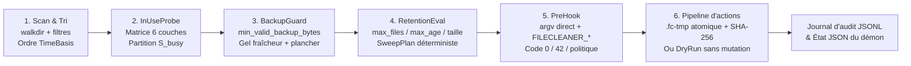

<div align="center">
  
  <br />
  
</div>

<h1 align="center">FileCleaner — Moteur Déterministe de Rétention, Garde de Sauvegardes & Cycle de Vie en Rust</h1>

<div align="center">

[](https://github.com/jmrenouard/FileCleaner/releases)
[](https://github.com/jmrenouard/FileCleaner/actions/workflows/ci.yml)
[](Cargo.toml)
[](docs/ACTION_LOGBOOK.md)
[](docs/ACTION_LOGBOOK.md)
[](docs/ACTION_LOGBOOK.md)
[](#matrice-de-compilation-croisée-9-cibles)
[](LICENSE)

[English (`README.md`)](README.md) · **Français**

</div>

> **Ne confiez plus vos sauvegardes critiques ni vos files d'attente actives à des commandes `find ... -delete` fragiles ou à des configurations `logrotate` liées à l'OS :** FileCleaner applique un pipeline à sûreté intrinsèque (*fail-closed*) en 6 phases doté de garde-fous « homme-mort », d'une matrice de détection active en 6 couches, de hooks pré-suppression sans injection shell, de transformations atomiques pure-Rust et d'un démon multiplateforme.

---

## Table des matières

1. [Portail documentaire et gouvernance](#portail-documentaire-et-gouvernance)
2. [Pourquoi choisir FileCleaner ?](#pourquoi-choisir-filecleaner)
3. [Architecture : le pipeline fail-closed en 6 phases](#architecture--le-pipeline-fail-closed-en-6-phases)
4. [Matrice des fonctionnalités et des sondes](#matrice-des-fonctionnalités-et-des-sondes)
5. [Démarrage rapide CLI (`init`, `validate`, `plan`, `run`, `check-in-use`, `daemon`)](#démarrage-rapide-cli)
6. [Exemples de configuration (TOML & YAML)](#exemples-de-configuration-toml--yaml)
7. [Matrice de compilation croisée (9 cibles)](#matrice-de-compilation-croisée-9-cibles)
8. [Contribution et gouvernance technique](#contribution-et-gouvernance-technique)

---

## Portail documentaire et gouvernance

| Pilier | Édition Française | English Edition |
| :--- | :--- | :--- |
| **Présentation & Démarrage** | [**`README.fr.md`**](README.fr.md) | [**`README.md`**](README.md) |
| **Guide Pratique 5 Minutes** | [**HOWTO 5 minutes (`docs/fr/HOWTO.md`)**](docs/fr/HOWTO.md) | [**5-Minute HOWTO (`docs/en/HOWTO.md`)**](docs/en/HOWTO.md) |
| **Manuel d'exploitation & CLI** | [**Guide utilisateur (`docs/fr/GUIDE_UTILISATEUR.md`)**](docs/fr/GUIDE_UTILISATEUR.md) | [**User Guide (`docs/en/USER_GUIDE.md`)**](docs/en/USER_GUIDE.md) |
| **Recettes de production** | [**Exemples & Recettes (`docs/fr/EXEMPLES_RECETTES.md`)**](docs/fr/EXEMPLES_RECETTES.md) | [**Cookbook Examples (`docs/en/COOKBOOK_EXAMPLES.md`)**](docs/en/COOKBOOK_EXAMPLES.md) |
| **Architecture & Mathématiques** | [**Spécifications formelles (`docs/fr/SPECIFICATIONS.md`)**](docs/fr/SPECIFICATIONS.md) | [**Formal Specifications (`docs/en/SPECIFICATIONS.md`)**](docs/en/SPECIFICATIONS.md) |
| **Journal des versions** | [**`CHANGELOG.md`**](CHANGELOG.md) | [**`CHANGELOG.md`**](CHANGELOG.md) |
| **Traçabilité d'ingénierie** | [**Journal d'actions (`docs/ACTION_LOGBOOK.md`)**](docs/ACTION_LOGBOOK.md) · [**Registre RCA (`docs/RCA_REGISTER.md`)**](docs/RCA_REGISTER.md) · [**Session d'alignement (`docs/team-sessions/team-session-2026-11-20.md`)**](docs/team-sessions/team-session-2026-11-20.md) | — |

---

## Pourquoi choisir FileCleaner

Les scripts cron ad hoc et outils historiques de rotation provoquent régulièrement des incidents silencieux en production à travers quatre failles structurelles :

| Risque de production | Comportement fragile (`find` / Shell / `logrotate`) | Garantie FileCleaner v1.0.0 |
| :--- | :--- | :--- |
| **Effacement silencieux de la dernière sauvegarde** | Lorsqu'un `pg_dump` ou `mysqldump` échoue en silence pendant deux semaines, `find -mtime +14 -delete` supprime la **dernière sauvegarde saine survivante**, ne laissant qu'un répertoire vide ou des fichiers de 0 octet. | **Garde-fous de sauvegarde** : Exclut les ébauches sous `min_valid_backup_bytes`, verrouille le plancher minimal `min_keep_files`, et déclenche un **gel « homme-mort »** (`require_newer_within` / `freeze_if_newest_older_than`) dès qu'aucune sauvegarde valide récente n'existe. |
| **Corruption en cours d'écriture** | Les passes cron suppriment ou déplacent des transferts incomplets, des journaux actifs ou des dumps encore ouverts par `rsync`, `tar`, `mysqldump` ou une application. | **Matrice de détection en 6 couches** : Combine marqueurs annexes (`.part`/`.lock`), verrou `flock(LOCK_EX \| LOCK_NB)`, analyse `/proc/*/fd` sous Linux, `share_mode(0)` sous Windows, délai `min_idle_age` et fenêtre de stabilité `(size, mtime)` en deux points. |
| **Écart entre simulation et exécution réelle** | Les scripts de prévisualisation divergent du réel, un `mv` inter-volumes laisse des copies tronquées en cas de coupure, et les hooks shell (`sh -c`) exposent aux injections sur noms spéciaux. | **Parité Dry-Run & écriture atomique** : `plan` et `run --dry-run` calculent exactement le même `SweepPlan` ; les actions passent par `.fc-tmp` + `sync_all()`, restaurent le `mtime`, vérifient l'empreinte SHA-256 en déplacement inter-FS et lancent les hooks via `Command::new` (`argv`, sans shell). |
| **Ruptures de portabilité Windows / macOS / `musl`** | `find` GNU, `lsof` et `logrotate` échouent entre conteneurs Alpine, postes macOS et serveurs Windows, ou nécessitent des chaînes de compilation C `-sys`. | **Binaire unique 100 % pure-Rust** : Aucune dépendance C `-sys` (`miniz_oxide`, `lz4_flex`, `brotli`, `zip` pure-Rust, `sha2`, `notify`), compilé de manière déterministe pour **9 cibles Linux, macOS et Windows**. |

---

## Architecture : le pipeline fail-closed en 6 phases

Chaque exécution de `filecleaner run`, `filecleaner plan` ou passe du démon traite chaque règle active à travers six phases strictement ordonnées à sûreté intrinsèque :



1. **Priorité absolue des garde-fous** : `InUseProbe` ($S_{\text{busy}}$) et `BackupGuard` ($P_{\text{floor}}$ et gels de vétusté) s'appliquent *avant* les seuils de rétention et ne peuvent jamais être contournés par `max_files`, `max_age` ou `max_total_size`. Si la sûreté empêche de respecter un plafond, la règle termine proprement avec le statut `Constrained` (journalisé en détail et convertible en code de sortie `3` via `--strict-constraints`).
2. **Défauts à échec sécurisé** : Les liens symboliques sont ignorés (`follow_symlinks = false`), les fichiers temporaires internes `*.fc-tmp*` sont exclus, les noms illisibles en `filename_date` sont ignorés sans suppression, et l'absence de prise en charge de `Created` (`birthtime`) échoue explicitement sans repli silencieux vers `mtime`.

---

## Matrice des fonctionnalités et des sondes

### Matrice de détection de fichiers actifs en 6 couches (`in_use`)

| Couche | Mécanisme | Périmètre OS | Ce qu'elle intercepte |
| :--- | :--- | :--- | :--- |
| **1** | **Marqueurs annexes et suffixes** | Linux, macOS, Windows | Fichiers se terminant par `.lock`, `.lck`, `.part`, `.tmp`, `.processing` ou accompagnés d'un fichier frère `<fichier><suffixe>`. |
| **2** | **Verrou consultatif (`flock`)** | Unix (Linux, macOS) | Détenteurs coopératifs `flock(LOCK_EX \| LOCK_NB)` sondés via `O_RDONLY` sans altérer `mtime`. |
| **3** | **Descripteurs ouverts (`/proc/*/fd`)** | Linux | Écrivains actifs sans `flock` (`pg_dump`, `mysqldump`, `rsync`, journaux applicatifs) identifiés par `(st_dev, st_ino)`. |
| **4** | **Sonde de partage exclusif** | Windows | Tout handle externe incompatible avec `share_mode(0)` (`ERROR_SHARING_VIOLATION` / `ERROR_LOCK_VIOLATION`). |
| **5** | **Délai d'inactivité (`min_idle_age`)** | Linux, macOS, Windows | Fichiers modifiés trop récemment (`now - mtime < min_idle_age`) ou présentant un horodatage futur suspect. |
| **6** | **Fenêtre de stabilité en 2 points** | Linux, macOS, Windows | Fichiers dont le couple `(size, mtime)` évolue pendant l'attente groupée `stability_window`. |

### Rétention, garde-fous, hooks et transformations

| Sous-système | Capacités |
| :--- | :--- |
| **Sélection & Horodatage** | Filtres glob et regex Rust d'inclusion/exclusion, `min_file_size` / `max_file_size`, `recursive` + `max_depth`, `follow_symlinks = false` par défaut, `modified` / `created` / `filename_date` (`regex` + `chrono` `strftime`). |
| **Politiques de rétention** | `max_files`, `max_age`, `max_total_size`, `combine_mode` (`any` \| `all`), `eviction_order` (`oldest_first` \| `largest_first`), unités d'octets (`B`, `KB`/`KiB`..`PB`/`PiB`), durées (`ms`, `s`, `m`, `h`, `d`, `w`). |
| **Garde-fous de sauvegarde** | `min_keep_files`, `min_valid_backup_bytes` (écarte les ébauches corrompues de 0 octet), `require_newer_within` (homme-mort), `freeze_if_newest_older_than`, `freeze_on_empty_valid`. |
| **Hooks pré-suppression** | Exécution directe `Command::new` (`{path}`, `{name}`, `{size}`, `{mtime_iso}`, `{rule}`), variables `FILECLEANER_*`, `timeout` avec terminaison forcée, code veto bénin `42` (`skip_exit_code`), `abort_file` / `abort_rule` / `warn_and_continue`. |
| **Pipeline d'actions** | Étapes composables dans l'ordre : `rename_by_date`, `compress` (`gzip`, `lz4`, `brotli`, `zip` pure-Rust), `move` (atomique ou inter-FS vérifié SHA-256 + `move_date_subdir`), `copy_truncate` (opt-in explicite), `trash`, `delete`. |
| **Démon & Observabilité** | Modes `interval`, `notify` (avec `debounce`) et `hybrid` ; fichiers atomiques PID, état JSON `state_file`, `stop_file` coopératif, arrêt gracieux `SIGINT`/`SIGTERM`, `--max-sweeps`, modèles `systemd`/`launchd`/`windows-task` et journal JSONL synchrone. |

---

## Démarrage rapide CLI

### Installation depuis les binaires officiels ou les sources

```bash
# Option 1 : Compiler et installer via Cargo (Rust >= 1.75 / Édition 2021)
cargo install --git https://github.com/jmrenouard/FileCleaner --locked

# Option 2 : Télécharger un binaire précompilé sur GitHub Releases (ex. Linux x86_64 musl)
curl -LO https://github.com/jmrenouard/FileCleaner/releases/download/v1.0.0/filecleaner-v1.0.0-x86_64-unknown-linux-musl.tar.gz
tar -xzf filecleaner-v1.0.0-x86_64-unknown-linux-musl.tar.gz
sudo install -m 0755 filecleaner /usr/local/bin/filecleaner
```

### Enchaînement sûr au premier jour (`init` $\rightarrow$ `validate` $\rightarrow$ `plan` $\rightarrow$ `run`)

```bash
# 1. Générer un modèle commenté sûr (profils : backups | logs | spool ; dry_run = true)
filecleaner init --output filecleaner.toml --profile backups --format toml

# 2. Valider la syntaxe TOML/YAML, les regex/globs, les unités et les invariants INV-CFG-*
filecleaner validate filecleaner.toml

# 3. Prévisualiser exactement le plan d'exécution (lecture seule stricte, zéro mutation)
filecleaner plan -c filecleaner.toml --json

# Ou exécuter en mode ad-hoc directement sur un répertoire sans fichier de configuration :
filecleaner plan --dir /var/backups/postgres --include "*.sql" --max-age 14d --min-keep 3 --compress gzip

# 4. Sonder un ou plusieurs fichiers sur les 6 couches (code 0 = sûr, code 10 = occupé)
filecleaner check-in-use /var/backups/postgres/pg_20261120_020000.sql --idle-age 10s --stability 2s

# 5. Lancer une passe réelle (alias : `clean` ; code 3 sur gel ou contrainte stricte)
filecleaner run -c filecleaner.toml --fail-on-freeze --strict-constraints

# 6. Exécuter en démon ou générer un modèle de service OS
filecleaner daemon run -c filecleaner.toml --mode hybrid
filecleaner daemon status -c filecleaner.toml --json
filecleaner daemon stop -c filecleaner.toml --timeout 30s
filecleaner daemon service-template --init-system systemd -c /etc/filecleaner/filecleaner.toml
```

Commande directe sans fichier de configuration (toujours prévisualiser avant d'exécuter) :

```bash
filecleaner plan --dir /var/log/app --include "*.log" --max-age 14d
filecleaner run --dir /var/log/app --include "*.log" --max-age 14d
```

Commencez par le [HOWTO en 5 minutes](docs/fr/HOWTO.md) pour des exemples rapides, `backup_guard` et des hooks Bash/PowerShell, consultez le [Guide utilisateur](docs/fr/GUIDE_UTILISATEUR.md) pour la référence complète des options et codes de sortie (`0`, `1`, `2`, `3`, `4`, `10`), ainsi que [Exemples & Recettes](docs/fr/EXEMPLES_RECETTES.md) pour des déploiements prêts pour la production. Remarque : `plan` / `--dry-run` réalise des sondes non exclusives et les fichiers générés utilisent des permissions Unix strictes `0600`.

---

## Exemples de configuration (TOML & YAML)

Les deux formats `.toml` et `.yaml`/`.yml` sont pris en charge nativement et détectés automatiquement par l'extension du fichier.

### TOML (`filecleaner.toml`)

```toml
dry_run = false
global_trash_dir = "/var/tmp/filecleaner-trash"

[daemon]
mode = "hybrid"
interval = "5m"
watch = true
debounce = "2s"
sweep_on_start = true
pid_file = "/run/filecleaner/filecleaner.pid"
state_file = "/run/filecleaner/state.json"
stop_file = "/run/filecleaner/filecleaner.stop"

[audit]
log_path = "/var/log/filecleaner/audit.jsonl"
jsonl = true

[[rules]]
name = "pg-backups"
path = "/var/backups/postgres"
recursive = true
max_depth = 2
follow_symlinks = false
include_globs = ["*.sql", "*.sql.gz", "*.dump"]
exclude_globs = ["pinned/**"]
min_file_size = "1KiB"
time_basis = "filename_date"
filename_date_regex = 'pg_(\d{8}_\d{6})'
filename_date_format = "%Y%m%d_%H%M%S"
max_files = 14
max_age = "30d"
max_total_size = "50GiB"
combine_mode = "any"
eviction_order = "oldest_first"
actions = ["compress", "move"]
compression = "gzip"
compress_remove_source = true
compress_overwrite = false
move_to = "/mnt/cold-archive/postgres"
move_date_subdir = "%Y/%m"
move_overwrite = false

[rules.backup_guard]
enabled = true
min_keep_files = 3
min_valid_backup_bytes = "1MiB"
require_newer_within = "36h"
freeze_on_empty_valid = true

[rules.in_use]
enabled = true
min_idle_age = "10s"
stability_window = "2s"

[rules.pre_delete_hook]
command = "/usr/local/bin/verify-offsite-copy"
args = ["--file", "{path}", "--rule", "{rule}"]
timeout = "15s"
on_failure = "abort_file"
skip_exit_code = 42
run_in_dry_run = false
```

### YAML (`filecleaner.yaml`)

```yaml
dry_run: true

daemon:
  mode: interval
  interval: 10m
  watch: false
  debounce: 2s
  sweep_on_start: true

audit:
  log_path: /var/log/filecleaner/audit.jsonl
  jsonl: true

rules:
  - name: app-logs
    path: /var/log/myapp
    recursive: false
    dry_run: true
    include_globs:
      - "*.log"
    time_basis: modified
    max_age: 7d
    max_total_size: 2GiB
    combine_mode: any
    eviction_order: oldest_first
    in_use:
      enabled: true
      check_os_locks: false
      check_proc_fd: false
      min_idle_age: 5s
      stability_window: 0s
    actions:
      - copy_truncate
    copy_truncate_to: /var/log/myapp/rotated
    compression: lz4
```

---

## Matrice de compilation croisée (9 cibles)

FileCleaner repose exclusivement sur des crates 100 % Rust (`miniz_oxide`, `lz4_flex`, `brotli`, `zip` `deflate` pure-Rust, `sha2`), sans aucune bibliothèque C/C++ `-sys` ni compilateur croisé externe sur l'ensemble des 9 cibles publiées :

| Système d'exploitation | Architecture | Cible Rust (Triple) | Format d'archive | Cas d'usage |
| :--- | :--- | :--- | :--- | :--- |
| **Linux** | `x86_64` | `x86_64-unknown-linux-gnu` | `.tar.gz` | Serveurs Linux glibc standards (`cargo-zigbuild`) |
| **Linux (Statique)** | `x86_64` | `x86_64-unknown-linux-musl` | `.tar.gz` | Binaire statique autonome pour conteneurs Alpine/scratch |
| **Linux** | `ARM64` | `aarch64-unknown-linux-gnu` | `.tar.gz` | AWS Graviton, Ampere, Raspberry Pi OS 64 bits |
| **Linux (Statique)** | `ARM64` | `aarch64-unknown-linux-musl` | `.tar.gz` | Conteneurs ARM64 statiques et systèmes embarqués |
| **Linux (Hard-Float)** | `ARMv7` | `armv7-unknown-linux-gnueabihf` | `.tar.gz` | Cartes ARM 32 bits et passerelles industrielles |
| **Windows** | `x86_64` | `x86_64-pc-windows-msvc` | `.zip` | Windows Server et Windows 10/11 natifs (MSVC) |
| **Windows** | `ARM64` | `aarch64-pc-windows-msvc` | `.zip` | Windows sur ARM64 (MSVC) |
| **macOS** | `Apple Silicon` | `aarch64-apple-darwin` | `.tar.gz` | Mac M1/M2/M3/M4 |
| **macOS** | `Intel x86_64` | `x86_64-apple-darwin` | `.tar.gz` | Mac Intel (macOS 12+) |

---

## Contribution et gouvernance technique

Toute modification sur FileCleaner respecte une traçabilité rigoureuse et des seuils de qualité vérifiés (référence Issue `#20` / branche `feat/issue-20-audit-tests-simple-howto` : `cargo fmt --all -- --check` conforme, `cargo clippy --all-targets -- -D warnings` **`0` alerte** sur Linux/Windows/macOS, **`124` tests réussis** [`64` unitaires + `60` d'intégration sur `9` suites], et **`94.31%` de couverture de lignes** / **`92.45%` de régions** sur `9 100` lignes via `cargo llvm-cov --fail-under-lines 90` avec chaque module `src/*.rs >= 90.21%`) :

- [**`docs/ACTION_LOGBOOK.md`**](docs/ACTION_LOGBOOK.md) — Journal chronologique des actions et métriques de validation.
- [**`docs/RCA_REGISTER.md`**](docs/RCA_REGISTER.md) — Analyses de causes racines (`RCA`), impasses écartées (`IMP`), approximations plateforme (`APP`) et feuille de route `v1.1` (`IDEA`).
- [**`docs/team-sessions/team-session-2026-11-20.md`**](docs/team-sessions/team-session-2026-11-20.md) — Synthèse pluridisciplinaire d'alignement architectural et de sûreté.

Distribué sous licence [**Apache License 2.0**](LICENSE).
