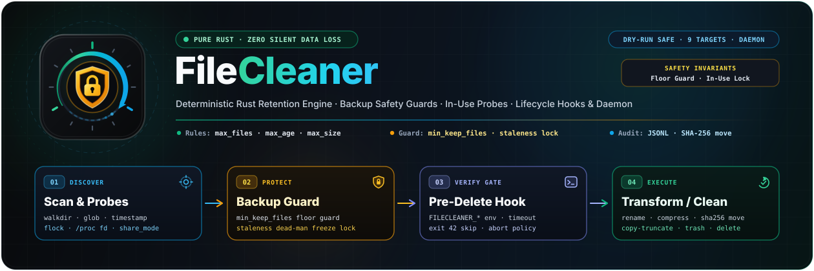
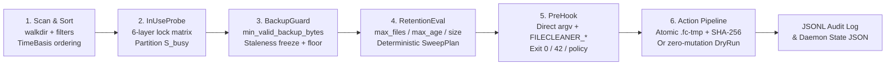

<div align="center">
  
  <br />
  
</div>

<h1 align="center">FileCleaner — Deterministic Rust Retention, Backup-Guard & Lifecycle Engine</h1>

<div align="center">

[](https://github.com/jmrenouard/FileCleaner/releases)
[](https://hub.docker.com/r/jmrenouard/filecleaner)
[](https://github.com/jmrenouard/FileCleaner/actions/workflows/ci.yml)
[](Cargo.toml)
[](docs/ACTION_LOGBOOK.md)
[](docs/ACTION_LOGBOOK.md)
[](docs/ACTION_LOGBOOK.md)
[](#9-target-cross-compilation-matrix)
[](LICENSE)

**English** · [Français (`README.fr.md`)](README.fr.md)

</div>

> **Stop trusting fragile `find ... -delete` one-liners and platform-locked `logrotate` jobs with critical backups and live spools:** FileCleaner enforces a fail-closed 6-phase retention pipeline with dead-man's-switch backup guardrails, a 6-layer active-writer detection matrix, shell-injection-free pre-delete hooks, pure-Rust atomic transforms, and a cross-platform daemon.

---

## Table of Contents

1. [Documentation & Governance Hub](#documentation--governance-hub)
2. [Why FileCleaner?](#why-filecleaner)
3. [Architecture: The Fail-Closed 6-Phase Pipeline](#architecture-the-fail-closed-6-phase-pipeline)
4. [Feature & Multi-Probe Matrix](#feature--multi-probe-matrix)
5. [CLI Quickstart (`init`, `validate`, `plan`, `run`, `check-in-use`, `daemon`)](#cli-quickstart)
6. [Configuration Examples (TOML & YAML)](#configuration-examples-toml--yaml)
7. [9-Target Cross-Compilation Matrix](#9-target-cross-compilation-matrix)
8. [Contributing & Engineering Governance](#contributing--engineering-governance)

---

## Documentation & Governance Hub

| Pillar | English Edition | Édition Française |
| :--- | :--- | :--- |
| **Overview & Quickstart** | [**`README.md`**](README.md) | [**`README.fr.md`**](README.fr.md) |
| **Simple 5-Minute HOWTO** | [**5-Minute HOWTO (`docs/en/HOWTO.md`)**](docs/en/HOWTO.md) | [**HOWTO 5 minutes (`docs/fr/HOWTO.md`)**](docs/fr/HOWTO.md) |
| **Operations & CLI Manual** | [**User Guide (`docs/en/USER_GUIDE.md`)**](docs/en/USER_GUIDE.md) | [**Guide utilisateur (`docs/fr/GUIDE_UTILISATEUR.md`)**](docs/fr/GUIDE_UTILISATEUR.md) |
| **Production Recipes** | [**Cookbook Examples (`docs/en/COOKBOOK_EXAMPLES.md`)**](docs/en/COOKBOOK_EXAMPLES.md) | [**Exemples & Recettes (`docs/fr/EXEMPLES_RECETTES.md`)**](docs/fr/EXEMPLES_RECETTES.md) |
| **Formal Architecture & Math** | [**Formal Specifications (`docs/en/SPECIFICATIONS.md`)**](docs/en/SPECIFICATIONS.md) | [**Spécifications formelles (`docs/fr/SPECIFICATIONS.md`)**](docs/fr/SPECIFICATIONS.md) |
| **Release History** | [**`CHANGELOG.md`**](CHANGELOG.md) | [**`CHANGELOG.md`**](CHANGELOG.md) |
| **Engineering Traceability** | [**Action Logbook (`docs/ACTION_LOGBOOK.md`)**](docs/ACTION_LOGBOOK.md) · [**RCA Register (`docs/RCA_REGISTER.md`)**](docs/RCA_REGISTER.md) · [**Team Session (`docs/team-sessions/team-session-2026-11-20.md`)**](docs/team-sessions/team-session-2026-11-20.md) | — |

---

## Why FileCleaner?

Traditional cleanup cron scripts and ad-hoc rotation utilities routinely cause silent production outages through four structural failure modes:

| Production Failure Mode | Fragile `find` / Shell / `logrotate` Behavior | FileCleaner v1.1.0 Guarantee |
| :--- | :--- | :--- |
| **The Silent Stale-Backup Wipe** | When a `pg_dump` or `mysqldump` job fails silently for two weeks, `find -mtime +14 -delete` deletes the **last surviving valid backup**, leaving an empty vault or 0-byte error stubs. | **Backup Safety Guards**: Filters out corrupt stubs below `min_valid_backup_bytes`, locks the newest `min_keep_files` floor, and triggers a **staleness dead-man's-switch freeze** (`require_newer_within` / `freeze_if_newest_older_than`) when no fresh valid backup exists. |
| **Mid-Write File Truncation & Corruption** | Cron sweeps unlink or move incoming transfers, rotating logs, or dumps still held open by `rsync`, `tar`, `mysqldump`, or an application process. | **6-Layer In-Use Detection Matrix**: Combines sidecar lock/temp suffixes, Unix `flock(LOCK_EX \| LOCK_NB)`, Linux `/proc/*/fd` inode matching, Windows `share_mode(0)`, `min_idle_age` cooldown, and a batched two-point `(size, mtime)` stability window. |
| **Dry-Run Drift & Non-Atomic Moves** | Preview scripts diverge from live execution, cross-filesystem `mv` leaves half-written files on power loss, and shell hooks (`sh -c`) break or inject commands on special characters in filenames. | **Strict Dry-Run Parity & Atomic Staging**: `plan` and `run --dry-run` compute the identical `SweepPlan`; transforms write to `.fc-tmp` with `sync_all()`, restore `mtime`, verify SHA-256 on cross-FS `move`, and run hooks via direct `Command::new` (`argv`, never a shell). |
| **Windows / macOS / `musl` Portability Gaps** | GNU `find`, `lsof`, and `logrotate` scripts break across Linux containers, macOS workstations, and Windows servers or require fragile C `-sys` toolchain dependencies. | **100% Pure-Rust Single Binary**: Zero C `-sys` bindings (`miniz_oxide`, `lz4_flex`, `brotli`, pure-Rust `zip`, `sha2`, `notify`), compiling deterministically across **9 Linux, macOS, and Windows targets**. |

---

## Architecture: The Fail-Closed 6-Phase Pipeline

Every `filecleaner run`, `filecleaner plan`, and daemon sweep processes each enabled rule through six strictly ordered, fail-closed phases:



1. **Safety Invariants Always Win**: `InUseProbe` ($S_{\text{busy}}$) and `BackupGuard` ($P_{\text{floor}}$ and staleness freezes) execute *before* retention pruning and cannot be overridden by `max_files`, `max_age`, or `max_total_size`. If safety guards prevent meeting a cap, the rule finishes cleanly as `Constrained` (with structured diagnostics, optional strict exit code `3` via `--strict-constraints`).
2. **Fail-Closed Defaults**: Symbolic links are skipped (`follow_symlinks = false`), internal `*.fc-tmp*` staging files are excluded, unparseable `filename_date` names are skipped rather than deleted, and missing `Created` (`birthtime`) support errors explicitly rather than silently falling back to `mtime`.

---

## Feature & Multi-Probe Matrix

### 6-Layer In-Use File Detection Matrix (`in_use`)

| Layer | Mechanism | OS Scope | What It Catches |
| :--- | :--- | :--- | :--- |
| **1** | **Sidecar & Temp-Suffix Markers** | Linux, macOS, Windows | Files ending in `.lock`, `.lck`, `.part`, `.tmp`, `.processing` or accompanied by `<file><suffix>` sidecars. |
| **2** | **Advisory File Lock (`flock`)** | Unix (Linux, macOS) | Cooperative exclusive/shared `flock(LOCK_EX \| LOCK_NB)` holders via `O_RDONLY` without altering `mtime`. |
| **3** | **Open Descriptor Scan (`/proc/*/fd`)** | Linux | Un-flocked active writers (`pg_dump`, `mysqldump`, `rsync`, app loggers) matched by `(st_dev, st_ino)`. |
| **4** | **Exclusive Share-Mode Probe** | Windows | Any external open handle incompatible with `share_mode(0)` (`ERROR_SHARING_VIOLATION` / `ERROR_LOCK_VIOLATION`). |
| **5** | **Minimum Idle Age (`min_idle_age`)** | Linux, macOS, Windows | Files modified too recently (`now - mtime < min_idle_age`) or with future-skewed timestamps. |
| **6** | **Two-Point Stability Window** | Linux, macOS, Windows | Files actively growing or changing `(size, mtime)` across a single batched `stability_window` wait. |

### Retention, Guardrails, Hooks & Transforms

| Subsystem | Capabilities |
| :--- | :--- |
| **Selection & Time Basis** | Glob & Rust regex include/exclude filters, `min_file_size` / `max_file_size`, `recursive` + `max_depth`, `follow_symlinks = false` default, `modified` / `created` / `filename_date` (`regex` + `chrono` `strftime`). |
| **Retention Policies** | `max_files`, `max_age`, `max_total_size`, `combine_mode` (`any` \| `all`), `eviction_order` (`oldest_first` \| `largest_first`), human byte units (`B`, `KB`/`KiB`..`PB`/`PiB`), human durations (`ms`, `s`, `m`, `h`, `d`, `w`). |
| **Backup Guardrails** | `min_keep_files`, `min_valid_backup_bytes` (excludes corrupt/0-byte stubs), `require_newer_within` (dead-man's-switch), `freeze_if_newest_older_than`, `freeze_on_empty_valid`. |
| **Pre-Delete Hooks** | Direct `Command::new` (`argv` token expansion `{path}`, `{name}`, `{size}`, `{mtime_iso}`, `{rule}`), `FILECLEANER_*` env vars, `timeout` kill/reap, exit `42` benign veto (`skip_exit_code`), `abort_file` / `abort_rule` / `warn_and_continue`. |
| **Lifecycle Actions** | Composable ordered pipelines: `rename_by_date`, `compress` (pure-Rust `gzip`, `lz4`, `brotli`, `zip`), `move` (atomic rename + cross-FS SHA-256 verification + `move_date_subdir`), `upload_s3` (pure-Rust SigV4 + streaming multipart + fail-closed SHA-256 verification before local deletion), `copy_truncate` (explicit opt-in), `trash`, `delete`. |
| **S3 & DBA PostgreSQL** | Env-var-only S3/MinIO/Ceph RGW/R2 credentials (`AWS_ACCESS_KEY_ID`/`AWS_SECRET_ACCESS_KEY`, zero plaintext secrets), `filecleaner init --profile dba-postgres`, PITR `.history`/`.partial` guards + `examples/hooks/verify_pg_wal_safe.sh`, and live 6-scenario PG17 + MinIO Docker E2E lab (`scripts/e2e-dba-s3-lab.sh`). |
| **Daemon & Observability** | `interval`, `notify` (debounced FS watcher), and `hybrid` modes; atomic PID, live JSON `state_file`, cooperative `stop_file`, `SIGINT`/`SIGTERM` graceful shutdown, `--max-sweeps`, `systemd`/`launchd`/`windows-task` templates, and synchronous JSONL audit logs. |

---

## CLI Quickstart

### Install from Prebuilt Release, Cargo, or Docker Hub

```bash
# Option 1: Run multi-arch container directly from Docker Hub (linux/amd64 & linux/arm64)
docker run --rm jmrenouard/filecleaner:latest --version
docker run --rm -v "$(pwd)/data:/data" jmrenouard/filecleaner:latest plan --dir /data --max-age 14d

# Option 2: Build & install with Cargo (Rust >= 1.75 / Edition 2021)
cargo install --git https://github.com/jmrenouard/FileCleaner --tag v1.1.0 --locked

# Option 3: Download a prebuilt archive from GitHub Releases (example: Linux x86_64 musl)
curl -LO https://github.com/jmrenouard/FileCleaner/releases/download/v1.1.0/filecleaner-v1.1.0-x86_64-unknown-linux-musl.tar.gz
tar -xzf filecleaner-v1.1.0-x86_64-unknown-linux-musl.tar.gz
sudo install -m 0755 filecleaner /usr/local/bin/filecleaner
```

### Day-1 Safe Workflow (`init` $\rightarrow$ `validate` $\rightarrow$ `plan` $\rightarrow$ `run`)

```bash
# 1. Generate a safe annotated starter config (profiles: backups | logs | spool | dba-postgres; dry_run = true)
filecleaner init --output filecleaner.toml --profile backups --format toml
filecleaner init --output pg-wal-s3.toml --profile dba-postgres --format toml

# 2. Validate TOML/YAML syntax, regex/globs, units, and all INV-CFG-* safety invariants
filecleaner validate filecleaner.toml

# 3. Preview exact deterministic decisions (strictly read-only, zero mutations)
filecleaner plan -c filecleaner.toml --json

# Or run ad-hoc directly on a folder without writing a config file first:
filecleaner plan --dir /var/backups/postgres --include "*.sql" --max-age 14d --min-keep 3 --compress gzip

# 4. Probe one or more active files across all 6 in-use layers (exit 0 = safe, exit 10 = busy)
filecleaner check-in-use /var/backups/postgres/pg_20261120_020000.sql --idle-age 10s --stability 2s

# 5. Execute a live sweep (alias: `clean`; escalate freezes/constraints to exit 3 for monitoring)
filecleaner run -c filecleaner.toml --fail-on-freeze --strict-constraints

# 6. Run as a managed daemon or generate an OS service unit
filecleaner daemon run -c filecleaner.toml --mode hybrid
filecleaner daemon status -c filecleaner.toml --json
filecleaner daemon stop -c filecleaner.toml --timeout 30s
filecleaner daemon service-template --init-system systemd -c /etc/filecleaner/filecleaner.toml
```

Zero-config quick one-liner (preview before live cleanup, no config file required):

```bash
filecleaner plan --dir /var/log/app --include "*.log" --max-age 14d
filecleaner run --dir /var/log/app --include "*.log" --max-age 14d
```

Start with the [5-Minute HOWTO](docs/en/HOWTO.md) for copy-paste one-liners, `backup_guard` recipes, and Bash/PowerShell hooks, see the [User Guide](docs/en/USER_GUIDE.md) for every CLI flag and exit code (`0`, `1`, `2`, `3`, `4`, `10`), and check the [Cookbook Examples](docs/en/COOKBOOK_EXAMPLES.md) for production deployments. Note: `plan` / `--dry-run` acquires non-exclusive checks and generated files use strict `0600` Unix permissions.

---

## Configuration Examples (TOML & YAML)

Both `.toml` and `.yaml`/`.yml` are supported natively and auto-detected by file extension.

### TOML (`filecleaner.toml`)

```toml
dry_run = false
global_trash_dir = "/var/tmp/filecleaner-trash"

[daemon]
mode = "hybrid"
interval = "5m"
watch = true
debounce = "2s"
sweep_on_start = true
pid_file = "/run/filecleaner/filecleaner.pid"
state_file = "/run/filecleaner/state.json"
stop_file = "/run/filecleaner/filecleaner.stop"

[audit]
log_path = "/var/log/filecleaner/audit.jsonl"
jsonl = true

[[rules]]
name = "pg-backups"
path = "/var/backups/postgres"
recursive = true
max_depth = 2
follow_symlinks = false
include_globs = ["*.sql", "*.sql.gz", "*.dump"]
exclude_globs = ["pinned/**"]
min_file_size = "1KiB"
time_basis = "filename_date"
filename_date_regex = 'pg_(\d{8}_\d{6})'
filename_date_format = "%Y%m%d_%H%M%S"
max_files = 14
max_age = "30d"
max_total_size = "50GiB"
combine_mode = "any"
eviction_order = "oldest_first"
actions = ["compress", "move"]
compression = "gzip"
compress_remove_source = true
compress_overwrite = false
move_to = "/mnt/cold-archive/postgres"
move_date_subdir = "%Y/%m"
move_overwrite = false

[rules.backup_guard]
enabled = true
min_keep_files = 3
min_valid_backup_bytes = "1MiB"
require_newer_within = "36h"
freeze_on_empty_valid = true

[rules.in_use]
enabled = true
min_idle_age = "10s"
stability_window = "2s"

[rules.pre_delete_hook]
command = "/usr/local/bin/verify-offsite-copy"
args = ["--file", "{path}", "--rule", "{rule}"]
timeout = "15s"
on_failure = "abort_file"
skip_exit_code = 42
run_in_dry_run = false
```

### YAML (`filecleaner.yaml`)

```yaml
dry_run: true

daemon:
  mode: interval
  interval: 10m
  watch: false
  debounce: 2s
  sweep_on_start: true

audit:
  log_path: /var/log/filecleaner/audit.jsonl
  jsonl: true

rules:
  - name: app-logs
    path: /var/log/myapp
    recursive: false
    dry_run: true
    include_globs:
      - "*.log"
    time_basis: modified
    max_age: 7d
    max_total_size: 2GiB
    combine_mode: any
    eviction_order: oldest_first
    in_use:
      enabled: true
      check_os_locks: false
      check_proc_fd: false
      min_idle_age: 5s
      stability_window: 0s
    actions:
      - copy_truncate
    copy_truncate_to: /var/log/myapp/rotated
    compression: lz4
```

---

## 9-Target Cross-Compilation Matrix

FileCleaner depends exclusively on pure-Rust crates (`miniz_oxide`, `lz4_flex`, `brotli`, `zip` pure-Rust `deflate`, `sha2`, `ureq` v3 + `rustls` + `rustls-rustcrypto`, `hmac`, `base64`), requiring zero C/C++ `-sys` libraries or external cross-compilers across all 9 official release targets:

| Operating System | Architecture | Target Triple | Artifact Format | Notes |
| :--- | :--- | :--- | :--- | :--- |
| **Linux** | `x86_64` | `x86_64-unknown-linux-gnu` | `.tar.gz` | Standard glibc Linux servers (`cargo-zigbuild`) |
| **Linux (Static)** | `x86_64` | `x86_64-unknown-linux-musl` | `.tar.gz` | Zero-dependency static binary for Alpine/scratch containers |
| **Linux** | `ARM64` | `aarch64-unknown-linux-gnu` | `.tar.gz` | AWS Graviton, Ampere, Raspberry Pi OS 64-bit |
| **Linux (Static)** | `ARM64` | `aarch64-unknown-linux-musl` | `.tar.gz` | Static ARM64 containers & embedded appliances |
| **Linux (Hard-Float)** | `ARMv7` | `armv7-unknown-linux-gnueabihf` | `.tar.gz` | 32-bit ARM SBCs & industrial gateways |
| **Windows** | `x86_64` | `x86_64-pc-windows-msvc` | `.zip` | Native Windows Server & Windows 10/11 (MSVC) |
| **Windows** | `ARM64` | `aarch64-pc-windows-msvc` | `.zip` | Windows on ARM64 (MSVC) |
| **macOS** | `Apple Silicon` | `aarch64-apple-darwin` | `.tar.gz` | M1/M2/M3/M4 Macs |
| **macOS** | `Intel x86_64` | `x86_64-apple-darwin` | `.tar.gz` | Intel Macs (macOS 12+) |

---

## Contributing & Engineering Governance

All FileCleaner changes follow strict engineering traceability and verified quality gates (`v1.1.0` baseline: `cargo fmt --all -- --check` clean, `cargo clippy --all-targets -- -D warnings` **`0` warnings** across Linux/Windows/macOS targets, **`135` active tests passed** [`69` unit + `66` integration across `11` suites] plus **`6/6` live PostgreSQL 17 + MinIO Docker E2E scenarios**, and **`94.01%` line coverage** / **`92.08%` region coverage** across `11,473` lines via `cargo llvm-cov --fail-under-lines 90`):

- [**`docs/ACTION_LOGBOOK.md`**](docs/ACTION_LOGBOOK.md) — Chronological engineering action logbook with verified test & coverage evidence.
- [**`docs/RCA_REGISTER.md`**](docs/RCA_REGISTER.md) — Root cause analyses (`RCA`), rejected technical dead-ends (`IMP`), platform approximations (`APP`), and `v1.1` roadmap (`IDEA`).
- [**`docs/team-sessions/team-session-2026-11-20.md`**](docs/team-sessions/team-session-2026-11-20.md) — Multi-role architecture & safety alignment synthesis.

Licensed under the [**Apache License 2.0**](LICENSE).
