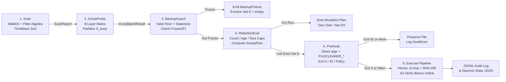
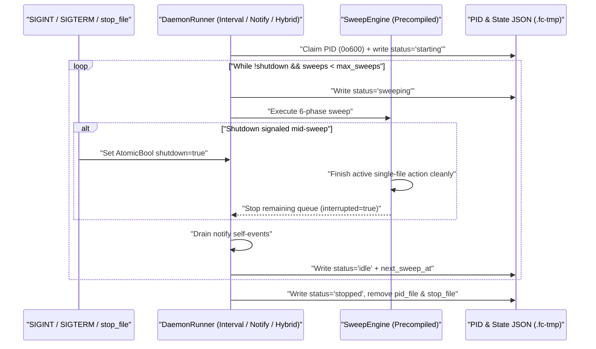

# Fail-Closed Six-Phase Pipeline Architecture

FileCleaner replaces fragile shell cleanup scripts (`find ... -delete`, platform-locked `logrotate`) with a
deterministic state machine (`src/engine.rs`) where safety invariants strictly precede eviction and filesystem
mutation.

## Architectural Design Goals

Traditional cron cleanup utilities fail through silent truncation of active transfers, unguarded deletion of aging
backups when upstream dump jobs break, divergence between dry-run previews and live execution, and shell command
injection on special filenames. FileCleaner eliminates these failure modes through four structural principles:

1. **Strict Phase Ordering**: Discovery, active-writer detection, backup-safety gating, retention evaluation,
   external hook verification, and atomic mutation execute as distinct stages with explicit intermediate artifacts
   (`ScanReport`, `InUseBatchResult`, `SweepPlan`, `ActionReport`).
2. **Fail-Closed Defaults**: Missing `birthtime`, unparseable filename timestamps, symlinks
   (`follow_symlinks = false`), probe permission errors on a candidate, and S3 verification omissions never fall back
   to deletion.
3. **Dry-Run / Live Parity**: `filecleaner plan` and `filecleaner run --dry-run` execute the identical planning logic
   (Phases 1–4) as live runs, projecting the exact `SweepPlan` without creating staging files or opening S3 sockets.
4. **Injectable OS Boundaries**: Wall-clock time (`Clock`), OS locks and descriptor tables (`LockProbe`), hook
   spawning (`HookRunner`), and S3 transport (`S3Uploader`) sit behind Rust traits so deterministic tests exercise
   failure paths without real clocks or network outages.

---

## Six-Phase Pipeline Topology

### Phase 1: Discovery, Filter Algebra & Self-Exclusion (`src/scanner.rs`)

`Scanner::scan_rule_compiled` traverses `rule.path` with `WalkDir`. When `recursive` is `false`, traversal stops at
`max_depth(1)`; symlinks are skipped before stat-ing unless `follow_symlinks = true`, and directory exclusions
(`exclude_globs`, `exclude_regex`) prune subtrees early inside `filter_entry`.

Before any rule matcher runs, `Scanner` enforces two structural exclusions:

- **Internal Artifact Guard**: Configured `audit.log_path`, its rotated `<audit_log>.1` sibling, `daemon.pid_file`,
  `daemon.state_file`, `daemon.stop_file`, and all `*.fc-tmp` / `*.fc-tmp.*` staging buffers are filtered out using
  lexical and canonical path resolution (`resolve_path_lexically`).
- **In-Place Idempotency Guard**: For rules lacking removing actions (`Delete`, `Trash`, `Move`, `CopyTruncate`),
  files already carrying compressed suffixes (`.gz`, `.lz4`, `.br`, `.zip`) or matching trailing `rename_template`
  date stamps are skipped during discovery so daemon sweeps do not compound `.gz.gz` or duplicate date suffixes
  (`RCA-006`).

Timestamp resolution (`TimeBasis`) never guesses across missing metadata. `TimeBasis::Created` fails explicitly with
`Io` when the filesystem lacks birth timestamps, and `TimeBasis::FilenameDate` records unparseable names into
`skipped_timestamp_parse` (`decision: "skip_ts_parse"`) without evicting them.

### Phase 2: Non-Intrusive Multi-Probe Active-Writer Detection (`src/in_use.rs`)

`InUseDetector::check_batch_scoped` evaluates six probes ordered to minimize contention and syscalls:

1. **Zero-Contention Probes First**: Layer 1 (`sidecar_suffixes`), Layer 3 (`SweepLockProbe` single-pass `/proc/*/fd`
   snapshot on Linux), and Layer 5 (`min_idle_age`) execute before OS lock probes.
2. **Floor & Dry-Run Lock Isolation**: Candidates already in $P_{\text{floor}}$ or already marked busy skip OS lock
   syscalls entirely. During `plan` or `--dry-run`, `SweepEngine` calls `check_os_lock_readonly` (`LOCK_SH | LOCK_NB`
   on Unix, `FILE_SHARE_READ` on Windows) instead of exclusive locks.
3. **Batched Stability Window**: Layer 6 (`stability_window`) snapshots `(size, mtime)` across all candidates that
   survived Layers 1–5, performs a single `thread::sleep(stability_window)`, and re-snapshots all survivors in
   $O(\Delta_{\text{stab}})$ wall-clock time.

Any candidate-level I/O or stat error fails closed as `InUseReason::ProbeError`, placing the file into
$S_{\text{busy}}$. Unprivileged `EACCES`/`EPERM` on unrelated root-owned `/proc/<pid>/fd` directories is aggregated as
a non-fatal diagnostic rather than blocking all sweeps.

### Phases 3 & 4: Backup Safety Guardrails Before Retention (`src/policy.rs`)

`RetentionEngine::plan` evaluates `BackupGuard` before applying `max_files`, `max_age`, or `max_total_size`:

- Files smaller than `min_valid_backup_bytes` remain countable against directory quotas but are excluded from
  $\mathcal{F}_{\text{valid}}$ so truncated `0`-byte dumps cannot satisfy freshness checks or occupy protected floor
  slots.
- If zero valid backups exist (when `freeze_on_empty_valid = true`), or if the newest valid backup breaches
  `require_newer_within` or `freeze_if_newest_older_than`, the entire rule freezes (`RuleOutcome::Frozen`,
  $E = \emptyset$).
- Otherwise, `compute_protected_floor_paths` locks the newest `min_keep_files` valid backups in $P_{\text{floor}}$,
  and $S_{\text{busy}}$ candidates are excluded alongside them. Only
  $\mathcal{F} \setminus (P_{\text{floor}} \cup S_{\text{busy}})$ enters the eviction pass.
- If safety locks or non-removing actions (`UploadS3` without `Delete`, `Compress` with
  `compress_remove_source = false`, `RenameByDate`) leave `max_files` or `max_total_size` exceeded, the rule finishes
  cleanly as `RuleOutcome::Constrained` rather than violating safety invariants.

### Phase 5: Shell-Free Synchronous Hooks (`src/hooks.rs`)

`ProcessHookRunner` invokes `Command::new(&hook.command).args(...)` directly—never through `sh -c` or `cmd /C`—so
arbitrary filenames remain harmless `argv` strings. Standard input and output detach (`Stdio::null()`), stderr drains
incrementally through an `Arc<Mutex<Vec<u8>>>` bounded to `64 KiB` with a `50 ms` post-exit grace window (`RCA-007`),
and Unix children run in isolated process groups (`process_group(0)`) killed via `-pgid` `SIGKILL` upon
`hook.timeout`. Exit code `42` (`skip_exit_code`) acts as a benign per-file veto without failing the sweep.

### Phase 6: Atomic `.fc-tmp` Staging & Cryptographic Verification (`src/actions.rs`, `src/s3.rs`)

`ActionExecutor::execute_pipeline_with_s3` threads `WorkingTarget` sequentially through `rule.actions`:

- **Handle Pinning**: When `follow_symlinks = false`, `open_regular_nofollow` opens candidates with `O_NOFOLLOW` +
  `(st_dev, st_ino)` checks (Unix) or `FILE_FLAG_OPEN_REPARSE_POINT` + reparse-attribute rejection (Windows).
- **Atomic Commits**: `Compress`, cross-filesystem `Move`/`Trash`, and `CopyTruncate` write to exclusive `0o600` sibling
  paths (`<dest>.fc-tmp.<pid>.<seq>`) guarded by an RAII `TempFileGuard`, call `sync_all()`, verify SHA-256 on disk
  re-read for cross-FS moves, restore `atime`/`mtime` via `std::fs::FileTimes`, and atomically rename before unlinking
  any source.
- **S3 Fail-Closed Gate**: `HttpS3Uploader` reads credentials strictly from environment variables wrapped in
  `RedactedSecret`, signs requests with pure-Rust AWS SigV4, enforces `max_redirects(0)` and TLS by default, and
  requires verified `x-amz-checksum-sha256` (`ChecksumSha256`) or streaming `GetObject` (`ReadbackSha256`) parity
  before returning control to any subsequent `Delete`, `Trash`, or `Move` step.

---

## Daemon Event Loop and Cooperative Shutdown

`DaemonRunner` (`src/daemon.rs`) defaults to `Hybrid` mode so filesystem watcher responsiveness (`notify` coalesced by
`daemon.debounce`) pairs with periodic fallback ticks (`daemon.interval`) that advance age and staleness clocks even
in idle vaults or network mounts. Before signaling `SIGTERM` or writing `stop_file`, `daemon_stop` verifies via
`is_filecleaner_process` (`/proc/<pid>/comm|exe|cmdline` on Linux, `ps` on macOS/BSD, `QueryFullProcessImageNameW` on
Windows) that the recorded PID still belongs to `filecleaner`, eliminating recycled-PID collateral signals.

---

## Related Documentation

- Exact configuration fields and invariants:
  [Configuration Schema & Invariants](../../03-reference/configuration/config-schema-and-invariants.md)
- CLI commands, exit codes, and audit schemas:
  [CLI Commands & Exit Codes](../../03-reference/cli-and-scripts/cli-commands-and-exit-codes.md)
- Mathematical derivations and TOCTOU bounds:
  [Retention Calculus and TOCTOU Defenses](../deep-dives/retention-calculus-and-toctou-defenses.md)
- Practical S3 archival and backup retention guide:
  [Configure Backup Retention and S3 Archival](../../02-how-to-guides/operations/configure-backup-retention-and-s3-archival.md)
- Live sandbox introduction: [Local Retention Sandbox](../../01-tutorials/01-local-retention-sandbox.md)
