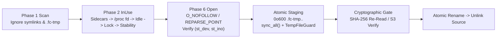

# Retention Calculus and TOCTOU Defenses

This deep dive formalizes FileCleaner's mathematical retention invariants (`src/scanner.rs`, `src/policy.rs`) alongside
the kernel-handle, staging, and cryptographic verification defenses (`src/in_use.rs`, `src/actions.rs`, `src/hooks.rs`,
`src/s3.rs`) that prevent race-condition corruption.

## 1. Candidate Filter Algebra and Deterministic Ordering

During Phase 1 (`Scanner::scan_rule_compiled`), each discovered regular non-internal file $f$ inside `rule.path` is
evaluated against an include predicate $I(f)$, an exclude predicate $X(f)$, and an optional byte-size filter
$B_{\text{range}}(f)$:

$$
I(f) = \begin{cases}
\text{true} & \text{if } \text{include\_globs} = \emptyset \land \text{include\_regex} = \emptyset \\
\text{GlobMatch}_{\text{inc}}(f) \lor \text{RegexMatch}_{\text{inc}}(f) & \text{otherwise}
\end{cases}
$$

$$
X(f) = \text{GlobMatch}_{\text{exc}}(f) \lor \text{RegexMatch}_{\text{exc}}(f)
$$

$$
B_{\text{range}}(f) = \left(\text{min\_file\_size} = \bot \lor \text{size}(f) \ge \text{min\_file\_size}\right) \land \left(\text{max\_file\_size} = \bot \lor \text{size}(f) \le \text{max\_file\_size}\right)
$$

$$
f \in \mathcal{F} \iff I(f) \land \neg X(f) \land B_{\text{range}}(f)
$$

Notice that $X(f)$ evaluates ancestor directory prefixes as well as the normalized `/` relative path and basename,
pruning excluded subtrees inside `WalkDir::filter_entry` before opening child entries. Furthermore, `min_file_size` and
`max_file_size` bound rule membership *before* backup-guard analysis, whereas `backup_guard.min_valid_backup_bytes`
classifies corrupt stubs *within* $\mathcal{F}$.

### Deterministic Total Order Across Coarse Clocks

Each candidate $f \in \mathcal{F}$ resolves a UTC timestamp $t(f)$ from `TimeBasis::Modified`, `TimeBasis::Created`
(never falling back to `mtime` if unsupported), or `TimeBasis::FilenameDate` (skipping unparseable names fail-closed).
Because FAT32 and network filesystems often exhibit 1-second or 2-second timestamp granularity, FileCleaner establishes
a strict total order $\prec_{\text{new}}$ tie-broken by normalized relative path:

$$
f_i \prec_{\text{new}} f_j \iff t(f_i) > t(f_j) \lor \Big(t(f_i) = t(f_j) \land \text{rel\_path}(f_i) < \text{rel\_path}(f_j)\Big)
$$

This guarantees identical `SweepPlan` outputs across repeated `plan` and `run` executions on the same directory
snapshot.

---

## 2. Backup Safety Partition and Dead-Man's-Switch Freeze

Given the valid-backup byte floor $B_{\min} = \text{min\_valid\_backup\_bytes} \ge 0$, `RetentionEngine::plan` partitions
the newest-first sequence $\mathcal{F} = (f_1, f_2, \dots, f_n)$ into valid backups $\mathcal{F}_{\text{valid}}$ and
undersized stubs $\mathcal{F}_{\text{stub}}$:

$$
\mathcal{F}_{\text{valid}} = \left\{f \in \mathcal{F} \mid \text{size}(f) \ge B_{\min}\right\}, \qquad \mathcal{F}_{\text{stub}} = \mathcal{F} \setminus \mathcal{F}_{\text{valid}}
$$

Excluding $\mathcal{F}_{\text{stub}}$ from $\mathcal{F}_{\text{valid}}$ stops a failing cron job that emits `0`-byte
error dumps from displacing genuine older backups inside the protected floor or resetting the freshness clock
$t_{\max}$:

$$
t_{\max} = \begin{cases}
\max_{f \in \mathcal{F}_{\text{valid}}} t(f) & \text{if } \mathcal{F}_{\text{valid}} \neq \emptyset \\
-\infty & \text{if } \mathcal{F}_{\text{valid}} = \emptyset
\end{cases}
$$

Let $\text{guard\_active}$ hold whenever `backup_guard.enabled == true` or any threshold ($\text{min\_keep\_files} > 0$,
$B_{\min} > 0$, $\Delta_{\text{fresh}} = \text{require\_newer\_within}$, or
$T_{\text{cutoff}} = \text{freeze\_if\_newest\_older\_than}$) is configured. The freeze predicate
$\text{Frozen}(\mathcal{F})$ triggers when any staleness or empty-valid condition fails:

$$
\text{Frozen}(\mathcal{F}) \iff \Big(\text{guard\_active} \land \mathcal{F}_{\text{valid}} = \emptyset \land \text{freeze\_on\_empty\_valid}\Big) \lor \Big(\text{guard\_active} \land \Delta_{\text{fresh}} \neq \bot \land (t_{\text{now}} - t_{\max} > \Delta_{\text{fresh}})\Big) \lor \Big(\text{guard\_active} \land T_{\text{cutoff}} \neq \bot \land t_{\max} < T_{\text{cutoff}}\Big)
$$

Whenever $\text{Frozen}(\mathcal{F})$ holds, the eviction set $E$ is forced empty unconditionally:

$$
\text{Frozen}(\mathcal{F}) \implies E = \emptyset
$$

When not frozen, let $\mathcal{F}_{\text{valid}} = (v_1, \dots, v_m)$ preserve newest-first ordering. The protected
backup floor $P_{\text{floor}}$ and busy exclusion set $S_{\text{busy}}$ combine into the immutable protection boundary
$P$:

$$
N_{\min} = \min\left(|\mathcal{F}_{\text{valid}}|, \text{min\_keep\_files}\right), \qquad P_{\text{floor}} = \{v_1, \dots, v_{N_{\min}}\}
$$

$$
P = P_{\text{floor}} \cup S_{\text{busy}}, \qquad \mathcal{C} = \mathcal{F} \setminus P, \qquad E \subseteq \mathcal{C}
$$

By construction, $E \cap P_{\text{floor}} = \emptyset$ and $E \cap S_{\text{busy}} = \emptyset$ hold as strict algebraic
invariants regardless of `max_files`, `max_age`, or `max_total_size`.

---

## 3. Sequential Quota Calculus and In-Place Action Accounting

Evictable candidates $\mathcal{C}$ are ordered into traversal sequence $\pi_{\mathcal{C}}$ according to
`eviction_order`:

- `OldestFirst`: $t(f)$ ascending, tie-broken by $\text{size}(f)$ descending, then $\text{rel\_path}(f)$ ascending.
- `LargestFirst`: $\text{size}(f)$ descending, tie-broken by $t(f)$ ascending, then $\text{rel\_path}(f)$ ascending.

Retention caps evaluate sequentially over a running pair $(c_{k-1}, b_{k-1})$ initialized at $c_0 = |\mathcal{F}|$ and
$b_0 = \sum_{f \in \mathcal{F}} \text{size}(f)$, because protected files in $P$ still occupy physical directory slots
and disk bytes. At step $k$ for candidate $f = \pi_{\mathcal{C}, k}$, each active threshold in
$\mathcal{R}_{\text{active}} \subseteq \{\text{files}, \text{age}, \text{size}\}$ evaluates:

$$
\text{pred}_{\text{files}}(c_{k-1}) \iff c_{k-1} > \text{max\_files}, \qquad \text{pred}_{\text{age}}(f) \iff t_{\text{now}} - t(f) > \text{max\_age}, \qquad \text{pred}_{\text{size}}(b_{k-1}) \iff b_{k-1} > \text{max\_total\_size}
$$

Predicates combine via `CombineMode`:

$$
\text{ShouldEvict}(f, c_{k-1}, b_{k-1}) = \begin{cases}
\bigvee_{r \in \mathcal{R}_{\text{active}}} \text{pred}_r & \text{if } \text{combine\_mode} = \text{Any} \\
\bigwedge_{r \in \mathcal{R}_{\text{active}}} \text{pred}_r & \text{if } \text{combine\_mode} = \text{All}
\end{cases}
$$

### Action-Specific Quota Conservation (`removes_file` and `reclaims_bytes`)

Not every `ActionStep` removes a directory entry or frees local bytes (`RCA-006`). `RetentionEngine::plan` therefore
models two indicator booleans derived from `rule.actions`:

- `removes_file` ($\rho_{\text{file}}$): `true` if `actions` contains `Delete`, `Trash`, or `Move`, or if
  `CopyTruncate` is combined with `min_file_size > 0` (which excludes the truncated $0$-byte inode on subsequent scans).
- `reclaims_bytes` ($\rho_{\text{bytes}}$): `true` if `actions` contains `Delete`, `Trash`, `Move`, or `CopyTruncate`.

When `ShouldEvict` accepts candidate $f$, the running state transitions via:

$$
c_k = c_{k-1} - \mathbf{1}[\rho_{\text{file}}], \qquad b_k = b_{k-1} - \mathbf{1}[\rho_{\text{bytes}}] \cdot \text{size}(f)
$$

Consequently, rules configured with pure in-place pipelines—such as `actions = ["upload_s3"]` (without `delete`),
`actions = ["rename_by_date"]`, or `actions = ["compress"]` with `compress_remove_source = false`—retain
$\rho_{\text{file}} = 0$ and $\rho_{\text{bytes}} = 0$. If caps remain exceeded after processing all of $\mathcal{C}$, or
if protected sets $P$ alone exceed `max_files` / `max_total_size`, `RetentionEngine::plan` marks
`RuleOutcome::Constrained` rather than weakening safety floors:

$$
\text{Constrained}(\mathcal{F}, E) \iff \neg \text{Frozen}(\mathcal{F}) \land \Big(\big(\text{max\_files} \neq \bot \land c_{\text{final}} > \text{max\_files} \land (|P| > \text{max\_files} \lor (\neg \rho_{\text{file}} \land |E| = |\mathcal{C}|))\big) \lor \big(\text{max\_total\_size} \neq \bot \land b_{\text{final}} > \text{max\_total\_size} \land (\text{bytes}(P) > \text{max\_total\_size} \lor (\neg \rho_{\text{bytes}} \land |E| = |\mathcal{C}|))\big)\Big)
$$

---

## 4. TOCTOU and Race-Condition Defenses Across Boundaries

Because filesystem state can mutate between Phase 1 (`Scanner`) and Phase 6 (`ActionExecutor`), FileCleaner layers
non-intrusive detection with kernel-enforced handle pinning:

### Non-Intrusive Probe Sequencing and Batched Stability

In `InUseDetector::check_batch_scoped`, probes evaluate cheapest and least intrusive signals first (`sidecar_suffixes`,
single-pass Linux `/proc/*/fd` snapshot in `SweepLockProbe`, and `min_idle_age` with future-skew protection when
$\text{mtime}(f) > t_{\text{now}}$). Native OS locks run only on candidates not already busy and not in $P_{\text{floor}}$,
using non-exclusive `LOCK_SH | LOCK_NB` / `FILE_SHARE_READ` during `plan` and `--dry-run` so dry-run checks never contend
with readers.

Layer 6 (`stability_window`, $\Delta_{\text{stab}}$) batches all Layer 1–5 survivors into one initial $(s_0, m_0)$ pass,
one `sleep` of duration $\Delta_{\text{stab}}$, and one closing $(s_1, m_1)$ pass, reducing wall-clock overhead from
$O(N \cdot \Delta_{\text{stab}})$ to $O(\Delta_{\text{stab}})$.

### Symlink-Swap Resistance (`open_regular_nofollow`)

Even if an attacker swaps a regular file for a symlink between Phase 1 (`WalkDir`) and Phase 6 execution, three
sequential checks block symlink traversal when `follow_symlinks = false`:

1. **Pre-Action Check (`src/engine.rs`)**: Inspects `fs::symlink_metadata(&candidate.path)` immediately prior to
   `ActionExecutor`.
2. **Non-Following Kernel Open (`src/actions.rs`)**: Calls `open_regular_nofollow` using `O_NOFOLLOW` on Unix (failing
   cleanly with `ELOOP` on symlinks) and `FILE_FLAG_OPEN_REPARSE_POINT` (`0x0020_0000`) on Windows, followed by rejecting
   `FILE_ATTRIBUTE_REPARSE_POINT` (`0x0400`) on the opened handle metadata.
3. **Inode Identity Continuity**: Verifies
   `(handle_meta.dev(), handle_meta.ino()) == (sym_meta.dev(), sym_meta.ino())` on Unix both when opening for
   copy/upload and immediately before calling `set_len(0)` during `CopyTruncate`.

### Residual `CopyTruncate` Window Trade-Off

`ActionStep::CopyTruncate` intentionally operates on active append-only logs whose writers keep descriptors open without
signal-based rotation. FileCleaner minimizes lost bytes by streaming, compressing, `sync_all()`-ing, and atomically
renaming the archive *before* opening the source descriptor for truncation (`set_len(0)` + `sync_all()`). Any bytes
written between the copy EOF read and `set_len(0)` cannot be recovered at the POSIX file-API level without cooperative
writer rotation (`rename` + `SIGHUP`/`SIGUSR1`), which is why `CopyTruncate` requires explicit opt-in and triggers a
warning in `filecleaner validate`.

---

## 5. Cryptographic Verification Gates (`Move` and `UploadS3`)

### Cross-Filesystem `Move` and `Trash` Integrity

When `std::fs::rename` returns `CrossesDevices` (`EXDEV`), `move_with_cross_fs_fallback` computes the streaming source
SHA-256 digest $H_{\text{src}}$ and byte count $L_{\text{src}}$ while writing `<dest>.fc-tmp.<pid>.<seq>` (`0o600`),
flushes and calls `sync_all()`, then **re-opens `<dest>.fc-tmp...` from disk** to compute an independent digest
$H_{\text{verify}}$ and length $L_{\text{verify}}$. The source is unlinked if and only if:

$$
H_{\text{src}} = H_{\text{verify}} \land L_{\text{src}} = L_{\text{verify}}
$$

Any divergence deletes `<dest>.fc-tmp...` via `TempFileGuard::drop`, preserves the source intact, and aborts with
`FileCleanerError::IntegrityMismatch`.

### Fail-Closed S3 Single-Part and Multipart Verification

In `src/s3.rs`, `HttpS3Uploader` computes local $H_{\text{local}}$ and $L_{\text{local}}$ directly from the pinned
`open_regular_nofollow_read` descriptor. For files exceeding `multipart_part_size`, each part $j \in \{1, \dots, N\}$
carries its individual SHA-256 checksum header and contributes its raw 32-byte digest $d_j$ toward the S3 composite
multipart checksum:

$$
H_{\text{composite}} = \text{base64}\left(\text{SHA256}\left(d_1 \parallel d_2 \parallel \dots \parallel d_N\right)\right) \text{-} N
$$

Post-upload verification enforces the fail-closed gating invariant before returning control to any subsequent `Delete`,
`Trash`, or `Move` step in `rule.actions`:

$$
\text{LocalDeleteAllowed}(f) \iff \text{UploadOk}(f) \land H_{\text{local}}(f) = H_{\text{remote}}(f) \land L_{\text{local}}(f) = L_{\text{remote}}(f)
$$

Under default `ChecksumSha256` mode, a signed `HeadObject` (`x-amz-checksum-mode: ENABLED`) must return exact
`Content-Length` equal to $L_{\text{local}}$ and an `x-amz-checksum-sha256` matching either single-part
$\text{base64}(H_{\text{local}})$ or $H_{\text{composite}}$. Under `ReadbackSha256` mode, FileCleaner streams the full
remote object via `GetObject` through a constant-memory `Sha256` hasher to confirm end-to-end byte parity.

---

## Related Documentation

- Pipeline topology and phase overview:
  [Fail-Closed Six-Phase Pipeline](../architecture-overview/fail-closed-six-phase-pipeline.md)
- Configuration fields and `INV-CFG-*` invariants:
  [Configuration Schema & Invariants](../../03-reference/configuration/config-schema-and-invariants.md)
- Error codes, probe reasons, and remediation matrix:
  [Error & Alert Matrix](../../03-reference/troubleshooting-codes/error-and-alert-matrix.md)
- Hook & TOCTOU security runbook:
  [Enforce Pre-Delete Hooks and TOCTOU Guards](../../02-how-to-guides/security/enforce-pre-delete-hooks-and-toctou-guards.md)
- Freeze & S3 failure incident runbook:
  [Remediate Backup Freeze or S3 Failure](../../02-how-to-guides/incident-response/remediate-backup-freeze-or-s3-failure.md)
