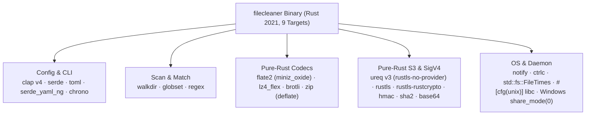

# ADR-001: Pure-Rust Fail-Closed Engine Across Nine Cross-Compilation Targets

| Attribute | Value |
| :--- | :--- |
| **Status** | Accepted |
| **Date** | `2026-11-22` |
| **Deciders** | FileCleaner Core Engineering |
| **Supersedes** | None (`IMP-001`, `IMP-004`, `APP-001`, `APP-003` in `RCA_REGISTER.md`) |

## Context

FileCleaner targets autonomous directory retention, backup vault protection, and S3/MinIO archival across
heterogeneous infrastructure: static Alpine/scratch containers (`musl`), glibc Linux servers (`x86_64`, `ARM64`,
`ARMv7`), Windows Server/ARM64 (`MSVC`), and Intel/Apple Silicon macOS workstations.

Two primary design constraints govern the engine architecture:

1. **Zero C/C++ Cross-Toolchain Friction**: Introducing `-sys` crates (`openssl-sys`, `aws-lc-sys`, `ring`, `zstd-sys`,
   `liblz4-sys`, `bzip2-sys`) forces external `cc`, `cmake`, `nasm`, or sysroot toolchains across GitHub Actions runners
   and fails frequently on `aarch64-unknown-linux-musl`, `armv7-unknown-linux-gnueabihf`, and
   `aarch64-pc-windows-msvc` (`IMP-001`).
2. **Zero Silent Data Loss**: Cleanup automation runs unsupervised on critical database backups and active write
   spools. Silent fallbacks—such as dropping from missing `birthtime` to `mtime`, deleting unverified S3 uploads,
   ignoring lock probe failures, or letting retention caps override backup minimums—create unrecoverable outages.

## Pure-Rust Crate Stack Architecture

## Options Considered and Trade-Offs

| Option | Cross-Compilation Portability | Runtime Safety & Fail-Closed Guarantees | Binary Footprint & Ops Complexity | Verdict |
| :--- | :--- | :--- | :--- | :--- |
| **Option A: Shell + Cron + `logrotate` + `aws-cli`** | Low: GNU vs BSD flag drift (`find`, `stat`, `sha256sum`), unavailable natively on Windows | Low: shell interpolation hazards, no unified 6-layer lock probe, weak stale-backup wipe guards | Requires Python, AWS CLI, `logrotate`, and shell runtimes in every container | Rejected |
| **Option B: Rust Engine with `-sys` C Libraries & `aws-lc-rs`/`ring`** | Low: requires C cross-compilers, `cmake`, and NASM/Perl toolchains for `musl` and ARM/Windows ARM64 | High if implemented manually, but native C dependency supply chain complicates static `musl` builds | Larger build matrix complexity; slower local cross-checks | Rejected |
| **Option C: 100% Pure-Rust Fail-Closed Engine (`miniz_oxide`, `lz4_flex`, `rustls-rustcrypto`)** | High: compiles cleanly to all 9 targets with zero C `-sys` bindings (`cargo-zigbuild` for Linux cross) | High: type-safe 6-phase pipeline, `O_NOFOLLOW` / `share_mode(0)`, `BackupGuard` freezes, SHA-256 gated S3 | Single static binary (`~100%` self-contained); zero runtime packages in Docker `debian:bookworm-slim` | **Selected** |

## Decision

Adopt **Option C**: engineer FileCleaner exclusively on pure-Rust crates paired with a fail-closed 6-phase execution
pipeline:

1. **Automated Pure-Rust Supply-Chain Gate**: `tests/governance_and_docs_test.rs` parses both `Cargo.toml` and
   `Cargo.lock` on every CI run and fails the build if any `-sys` crate, `ring`, `aws-lc-*`, `openssl*`, or
   `native-tls` enters the build graph of `filecleaner`, `ureq`, `rustls`, or `rustls-rustcrypto`.
2. **Stdlib Timestamp Restoration (`IMP-004`)**: Preserve `atime`/`mtime` via Rust stdlib `std::fs::File::set_times`
   (`std::fs::FileTimes`) instead of unmaintained crates (`filetime`).
3. **Pure-Rust Codecs & SigV4 S3 (`APP-003`)**: Support `gzip` (`flate2`/`miniz_oxide`), `lz4` (`lz4_flex`), `brotli`
   (`brotli`), and `zip` (`zip` with `default-features = false, features = ["deflate"]`), alongside `ureq` v3
   (`rustls-no-provider`, `rustls-webpki-roots`) backed by `rustls-rustcrypto` and custom AWS SigV4 signing
   (`src/s3.rs`).
4. **Fail-Closed Safety Hierarchy**: `InUseDetector` ($S_{\text{busy}}$) and `BackupGuard` ($P_{\text{floor}}$ and
   staleness freezes) unconditionally dominate `max_files`, `max_age`, and `max_total_size`, emitting
   `RuleOutcome::Constrained` rather than relaxing safety floors.

## Consequences

### Positive

- **Deterministic 9-Target Releases**: All 9 release triples (`x86_64`/`aarch64` Linux `gnu` and static `musl`, `armv7`
  Linux `gnueabihf`, `x86_64`/`aarch64` Windows MSVC, `aarch64`/`x86_64` macOS) build cleanly without native C
  dependencies, enabling scratch/minimal non-root Docker images (`UID 10001`).
- **Cryptographic Storage Guarantees**: Local `Delete`, `Trash`, and `Move` steps cannot run after `UploadS3` unless
  remote `HeadObject` (`x-amz-checksum-sha256` + `Content-Length`) or `GetObject` readback confirms exact SHA-256
  parity.
- **High Testability**: Trait abstractions (`Clock`, `LockProbe`, `HookRunner`, `S3Uploader`) achieve `>= 90%` line
  coverage (`94.01%` in `v1.1.0`) across unit, integration, and live Docker E2E suites.

### Negative and Operational Risks

- **No Zstandard (`zstd`) Codec**: Omitting `zstd-sys` excludes `.zst` archives until a mature pure-Rust streaming
  `zstd` encoder becomes viable without sacrificing cross-compilation invariants.
- **`rustls-rustcrypto` Pre-Release Maturity (`APP-003`)**: Pure-Rust cryptography trades peak hardware-accelerated TLS
  throughput for zero C build dependencies; WAN/LAN S3 I/O masks the CPU difference, and upgrading
  `rustls-rustcrypto` to `0.1.x`/`1.0.x` remains tracked once upstream releases stabilize.
- **Non-Linux Unix Open-FD Granularity (`APP-001`)**: macOS and BSD lack Linux `/proc/*/fd`; un-flocked active writers
  without sidecars rely on `min_idle_age` and `stability_window` until native `libproc` FD inspection (`IDEA-004`)
  lands in `v1.2`.

## Related Reference and Procedures

- Configuration fields, codecs, S3 parameters, and `INV-CFG-*` invariants:
  [Configuration Schema & Invariants](../../03-reference/configuration/config-schema-and-invariants.md)
- CLI subcommands and exit-code contract:
  [CLI Commands & Exit Codes](../../03-reference/cli-and-scripts/cli-commands-and-exit-codes.md)
- Deployment SOP for Docker and systemd:
  [Deploy FileCleaner with Docker and systemd](../../02-how-to-guides/deployment/deploy-filecleaner-docker-and-systemd.md)
- Hook and TOCTOU hardening procedures:
  [Enforce Pre-Delete Hooks and TOCTOU Guards](../../02-how-to-guides/security/enforce-pre-delete-hooks-and-toctou-guards.md)
- Six-phase execution flow:
  [Fail-Closed Six-Phase Pipeline](../architecture-overview/fail-closed-six-phase-pipeline.md)
