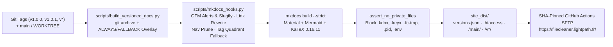

# ADR-002: Diátaxis Four-Quadrant Documentation and Versioned MkDocs Publishing

| Attribute | Value |
| :--- | :--- |
| **Status** | Accepted |
| **Date** | `2026-11-23` |
| **Deciders** | FileCleaner Core Engineering, LightPath Documentation |
| **Supersedes** | None (`Issue #38`) |

## Context

FileCleaner documentation originated as paired English and French manuals (`README.md`, `README.fr.md`,
`docs/en/{HOWTO,USER_GUIDE,COOKBOOK_EXAMPLES,SPECIFICATIONS}.md`,
`docs/fr/{HOWTO,GUIDE_UTILISATEUR,EXEMPLES_RECETTES,SPECIFICATIONS}.md`) alongside `CHANGELOG.md`,
`docs/RELEASE_NOTES_v1.0.1.md`, `docs/ACTION_LOGBOOK.md`, and `docs/RCA_REGISTER.md`. As adoption scaled past `v1.0.0`
and `v1.0.1` toward `v1.1.0` and public hosting on `https://filecleaner.lightpath.fr/` (IONOS Apache), four structural
constraints emerged:

1. **Genre Mixing in Monolithic Manuals**: Guided tutorials, production systemd/Docker operations, parameter reference
   tables, and mathematical invariants lived inside single long files (`USER_GUIDE.md`, `SPECIFICATIONS.md`), forcing
   operators during incidents to filter architectural prose before finding actionable steps.
2. **Immutable Historical Release Snapshots**: Git release tags `v1.0.0` and `v1.0.1` predate `mkdocs.yml`, KaTeX
   scripts, CSS theme files, and Diátaxis directories (`01-tutorials/`..`04-explanation/`); `v1.0.0` even predates
   `docs/en/HOWTO.md`.
3. **Static Apache Hosting & Secret Hygiene**: IONOS shared hosting serves static HTML/CSS/JS bundles only, requiring
   subpath-preserving `.htaccess` redirects (`/`, `/latest/`, `/dev/`), a `versions.json` manifest for Material's
   `mike` version selector, and ironclad exclusion of `.kdbx`, `.keyx`, `.fc-tmp`, `.pid`, `.log`, and `.env`
   artifacts.
4. **Dual-Mode Link & CI Enforcement**: Relative Markdown links must resolve identically on GitHub, inside
   `diataxis_check.py` / `pytest`, and across MkDocs directory URLs, while GitHub Actions workflows must maintain
   FileCleaner's strict supply-chain rules (40-char SHA action pinning, zero `${{ ... }}` interpolation inside `run:`
   blocks, `permissions: contents: read`, and Rust-validated TOML/YAML doc snippets).

## Multi-Version Build and Publishing Pipeline

## Options Considered and Trade-Offs

| Option | Genre Separation & Procedural Clarity | Historical Release Versioning | Static IONOS Hosting & Security | CI & Test Integration | Verdict |
| :--- | :--- | :--- | :--- | :--- | :--- |
| **Option A: Bilingual Flat Markdown Only (`docs/en/`, `docs/fr/`)** | Low: mixes tutorials, runbooks, parameters, and proofs in long manuals | None: GitHub web UI shows only one branch at a time | None: no unified search, version selector, or KaTeX web portal | No Vale/STE procedural enforcement on runbooks | Rejected |
| **Option B: Unversioned MkDocs Material (`main` Only)** | Medium: adds tabs and search, but lacks quadrant guardrails without restructuring | None: `v1.0.0`/`v1.0.1` binary users see unreleased `v1.1.0` flags (`upload_s3`) | Static HTML works, but lacks `/latest/` and `/v*/` Apache routing | Requires custom handling for root `README.md`, `README.fr.md`, and `CHANGELOG.md` | Rejected |
| **Option C: Diátaxis 4-Quadrant Tree + Versioned MkDocs Material Overlay** | High: isolates `01-tutorials/`, `02-how-to-guides/` (ASD-STE100 Issue 9), `03-reference/`, and `04-explanation/` while keeping EN/FR manuals in `nav:` | Full: builds `main` (`/dev/`) and all semver tags (`v1.0.0`, `v1.0.1`, `v*`, `/latest/`) via `git archive` overlay | Full: static `site_dist/` with `.htaccess` `301`/`302` redirects, `versions.json`, `exclude_docs`, and post-build privacy guard | Automated via `pytest` (`test_diataxis_documentation.py`, `test_mkdocs_publishing.py`), Rust `governance_and_docs_test.rs`, `.vale.ini`, `.markdownlint.json`, and `docs-ci.yml` | **Selected** |

## Decision

Adopt **Option C**: organize active operational and architectural documentation into the four canonical Diátaxis
quadrants (`docs/01-tutorials/`, `docs/02-how-to-guides/`, `docs/03-reference/`, `docs/04-explanation/`), retain the
existing bilingual EN/FR manuals and governance registers inside a 6-tab MkDocs Material navigation (`Home`,
`Tutorials`, `How-To Guides`, `Reference`, `Explanation`, `Releases & Governance`), and publish versioned static sites
to `https://filecleaner.lightpath.fr/` using `scripts/build_versioned_docs.py` and `scripts/mkdocs_hooks.py`.

Key implementation mechanisms include:

1. **Non-Destructive Historical Tag Overlay**: `scripts/build_versioned_docs.py` extracts each semver tag via
   `git archive`, overlays `ALWAYS_OVERLAY_FILES` (`mkdocs.yml`, `scripts/mkdocs_hooks.py`, `docs/stylesheets/extra.css`,
   `docs/javascripts/katex.js`) and `FALLBACK_OVERLAY_FILES` (`docs/index.md`, `docs/assets/logo.svg`,
   `docs/assets/header-banner.svg`), and compiles each snapshot under `mkdocs build --strict`.
2. **Depth-Aware Hook & Historical Fallback (`scripts/mkdocs_hooks.py`)**:
   - Injects virtual root documents (`overview-en.md` from `README.md`, `overview-fr.md` from `README.fr.md`,
     `CHANGELOG.md`) and converts GitHub `[!NOTE|TIP|IMPORTANT|WARNING|CAUTION]` alerts plus GFM heading slugs
     (`gfm_slugify`).
   - Rewrites both Markdown links and HTML ``/`<a href>` attributes using exact depth calculations (`md_d` vs
     `html_d`), normalizes historical `v1.0.1` `docs/docs/` paths, redirects external repo paths (`src/`, `tests/`,
     `examples/`, `Cargo.toml`) to pinned GitHub ref URLs, and maps missing historical quadrant directories (`v1.0.0`,
     `v1.0.1`) to `en/HOWTO.md`, `en/COOKBOOK_EXAMPLES.md`, `en/USER_GUIDE.md`, `en/SPECIFICATIONS.md`, or
     `overview-en.md`.
   - Lazily imports `mkdocs` and `pathspec` inside hook entrypoints so unit tests import and verify hook logic even when
     MkDocs is absent.
3. **Triple-Layer Quality & Supply-Chain Gates**:
   - **Action-Quadrant STE Gate**: `.vale.ini` and `tests/test_diataxis_documentation.py` enforce ASD-STE100 Issue 9
     structural rules (`<= 20` words/sentence, active imperative, zero contractions/semicolons/passive voice) on all
     non-index `docs/02-how-to-guides/**/*.md`.
   - **Rust Config & Math Parity Gate**: `tests/governance_and_docs_test.rs` validates TOML/YAML `[[rules]]` blocks in
     `docs/01-tutorials/` and `docs/02-how-to-guides/` via `filecleaner::Config::validate()`, enforces LaTeX delimiter
     integrity across all Markdown files, verifies EN/FR heading parity across all 5 legacy bilingual pairs, and checks
     40-char SHA pinning plus `permissions: contents: read` on `docs-ci.yml` and `docs-publish.yml`.
   - **Build-Time Privacy Guard**: `exclude_docs` in `mkdocs.yml` paired with `assert_no_private_files` in
     `scripts/build_versioned_docs.py` blocks sensitive extensions (`.kdbx`, `.keyx`, `.fc-tmp`, `.pid`, `.env`) from
     entering `site_dist/`.

## Consequences

### Positive

- **Incident-Ready Separation of Concerns**: Operators resolve freezes and S3 errors using terse ASD-STE100 runbooks
  (`02-how-to-guides/`) cross-linked with exact error matrices (`03-reference/`), without scrolling past mathematical
  proofs.
- **Zero-Drift Versioned Documentation**: Users pinned to `v1.0.0`, `v1.0.1`, or `v1.1.0` view documentation matching
  their binary capabilities via `/latest/` and tag selectors, while contributors preview unreleased work under `/main/`
  (`/dev/`).
- **Verified Code Examples**: Every documented `[[rules]]` TOML/YAML snippet in tutorials and how-to guides is compiled
  and validated against `filecleaner::Config::validate()` during Rust tests.

### Negative and Operational Risks

- **Historical Tag Regression Coupling**: Modifying `mkdocs.yml` or `docs/index.md` requires checking
  `prune_nav_for_existing_files` and historical-tag fallbacks across `v1.0.0` and `v1.0.1` so `mkdocs build --strict`
  does not break older snapshots.
- **Cross-File Relative Link Fragility**: Relocating quadrant pages breaks cross-links unless `scripts/mkdocs_hooks.py`
  depth rules and `test_diataxis_documentation.py` pass together in CI.
- **External KaTeX CDN Reliance**: Rendered HTML pages load KaTeX `0.16.11` assets from `cdn.jsdelivr.net`; strictly
  air-gapped deployments require local vendored assets under `docs/javascripts/` and `docs/stylesheets/`.

## Related Reference and Operational Guides

- Script CLI options, `FILECLEANER_DOCS_*` environment variables, and CI workflows:
  [CLI Commands & Exit Codes](../../03-reference/cli-and-scripts/cli-commands-and-exit-codes.md)
- Configuration schema and `INV-CFG-*` invariants:
  [Configuration Schema & Invariants](../../03-reference/configuration/config-schema-and-invariants.md)
- Container and service deployment procedures:
  [Deploy FileCleaner with Docker and systemd](../../02-how-to-guides/deployment/deploy-filecleaner-docker-and-systemd.md)
- Backup retention and S3 archival operations:
  [Configure Backup Retention and S3 Archival](../../02-how-to-guides/operations/configure-backup-retention-and-s3-archival.md)
- Engine design rationale:
  [ADR-001: Pure-Rust Fail-Closed Engine](adr-001-pure-rust-fail-closed-engine.md)
