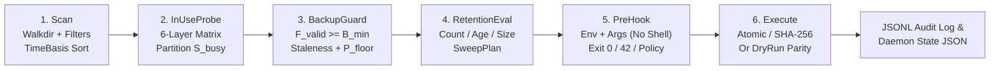
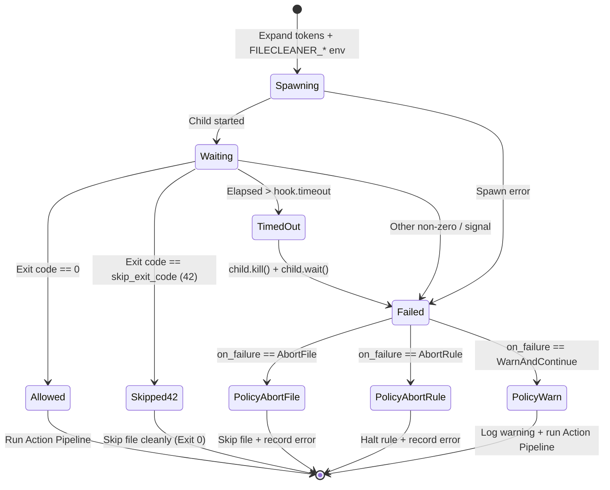
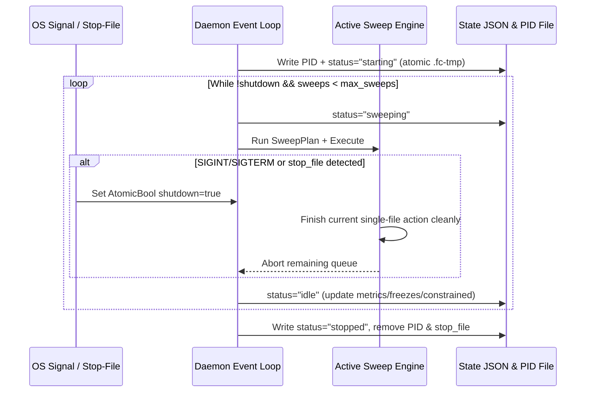

<div align="center">
  
</div>

# FileCleaner v1.0.0 — Formal Technical Specifications & Engineering Architecture

> **Language Editions**: **English (Normative)** · [Français (`docs/fr/SPECIFICATIONS.md`)](../fr/SPECIFICATIONS.md)  
> **Related Governance Documents**: [Dev-Team Alignment Session](../team-sessions/team-session-2026-11-20.md) · [Action Logbook](../ACTION_LOGBOOK.md) · [RCA Register](../RCA_REGISTER.md)

---

## Table of Contents

1. [System Overview & Design Guarantees](#1-system-overview--design-guarantees)
2. [Configuration Schema & Validation Invariants](#2-configuration-schema--validation-invariants)
3. [Scanning & Timestamp Resolution](#3-scanning--timestamp-resolution)
4. [Formal Mathematical Retention & Backup-Safety Model](#4-formal-mathematical-retention--backup-safety-model)
5. [Multi-Probe In-Use File Detection Matrix](#5-multi-probe-in-use-file-detection-matrix)
6. [Pre-Action / Pre-Delete Hook Execution Protocol](#6-pre-action--pre-delete-hook-execution-protocol)
7. [Ordered Lifecycle Action Pipeline](#7-ordered-lifecycle-action-pipeline)
8. [Daemon Architecture & Signals](#8-daemon-architecture--signals)
9. [CLI Subcommands, Exit Codes, Structured JSONL Audit Log & Security/Error Model](#9-cli-subcommands-exit-codes-structured-jsonl-audit-log--securityerror-model)

---

## 1. System Overview & Design Guarantees

### 1.1 Purpose & Scope

**FileCleaner** (`filecleaner` v1.0.0, Rust Edition 2021, Apache-2.0) is a deterministic, cross-platform directory retention, backup safety guardrail, active-file probe, lifecycle transformation, and daemon scheduling engine. It replaces fragile ad-hoc shell scripts (`find ... -delete`, platform-locked `logrotate`) with a mathematically specified, fail-closed pipeline engineered for zero silent data loss across production servers, backup vaults, and developer workstations.

### 1.2 Zero-Silent-Data-Loss Philosophy & Strict 6-Phase Pipeline

Every rule sweep executes six strictly ordered, fail-closed phases:



Design guarantees enforced across every phase:

1. **Fail-Closed Safety Precedence**: Safety guards (`InUseProbe` and `BackupGuard`) strictly dominate retention caps (`max_files`, `max_age`, `max_total_size`). If a constraint cannot be met without violating `min_keep_files` or evicting an in-use file, the eviction is blocked and the rule finishes as `RuleOutcome::Constrained`.
2. **Dry-Run / Live Parity**: `filecleaner plan` and `filecleaner run --dry-run` execute Phases 1–4 identically to live `filecleaner run`, yielding an identical `SweepPlan` without any filesystem mutation.
3. **No Silent Filtering Failures**: Unsupported filesystem timestamps (e.g., `TimeBasis::Created` without `statx` `btime`), unparseable `FilenameDate` names, or probe errors never silently fall back to deletion.
4. **Symlink Non-Traversal Default**: Symbolic links are neither traversed nor selected as candidates unless `follow_symlinks = true` is explicitly configured.
5. **Injectable Determinism Traits**: Core OS interactions are abstracted behind injectable traits (`Clock`, `FsOps`, `LockProbe`, `HookRunner`) so deterministic unit and failure-injection suites reach $\ge 90\%$ line coverage (`cargo llvm-cov --fail-under-lines 90`).

### 1.3 Atomic Write Semantics & Crash-Safe Staging

Every FileCleaner-generated file (compressed archives, cross-filesystem move targets, PID files, live daemon JSON state, starter configs) uses crash-safe temporary staging:

1. Write to a sibling temporary artifact `<target>.fc-tmp.<pid>.<seq>` (or `<target>.fc-tmp`) created exclusively (`create_new(true)`) with private `0o600` Unix permissions.
2. Flush stream encoders and call `sync_all()` (`fsync`) on the staged file handle.
3. Restore metadata (`atime`, `mtime`, permissions) where applicable.
4. Atomically swap `<target>.fc-tmp...` to `<target>` via OS rename (`rename(2)` / Windows overwrite semantics) without clobbering existing targets unless explicitly permitted.
5. Unlink source files **only after** steps 1–4 (and SHA-256 verification for cross-FS moves) succeed.

All `.fc-tmp`, `.fc-tmp.*`, and rotated `<audit_log>.1` internal artifacts are unconditionally excluded from rule candidate discovery so concurrent or interrupted runs never delete live staging buffers or audit history. When `follow_symlinks = false`, FileCleaner opens source files with non-following flags (`O_NOFOLLOW` plus `(st_dev, st_ino)` identity verification on Unix; `FILE_FLAG_OPEN_REPARSE_POINT` plus reparse-attribute rejection on Windows) and verifies inode continuity before `copy_truncate` truncation.

### 1.4 Pure-Rust Portability & 9-Target Cross-Compilation Contract

FileCleaner v1.0.0 forbids C/C++ `-sys` build dependencies (`openssl-sys`, `libz-sys`, `liblz4-sys`, `bzip2-sys`) in favor of pure-Rust crates:

- **CLI & Config**: `clap` (v4 derive), `serde`, `serde_json`, `toml`, `serde_yaml_ng`, `thiserror`, `chrono` (with `serde`)
- **Traversal & Matching**: `walkdir`, `globset`, `regex`
- **Compression & Integrity**: `flate2` (default pure-Rust `miniz_oxide`), `lz4_flex`, `brotli`, `zip` (`default-features = false`, pure-Rust `deflate`), `sha2`, plus Rust stdlib `std::fs::FileTimes` (`File::set_times`)
- **Daemon & OS Integration**: `notify`, `ctrlc`, and target-gated `#[cfg(unix)] libc` plus standard Windows `OpenOptionsExt::share_mode(0)`.

This stack compiles cleanly across all 9 release targets: `x86_64-unknown-linux-gnu`, `x86_64-unknown-linux-musl`, `aarch64-unknown-linux-gnu`, `aarch64-unknown-linux-musl`, `armv7-unknown-linux-gnueabihf`, `x86_64-pc-windows-msvc`, `aarch64-pc-windows-msvc`, `aarch64-apple-darwin`, and `x86_64-apple-darwin`.

---

## 2. Configuration Schema & Validation Invariants

### 2.1 File Format Detection & Top-Level `Config`

`Config::from_file(path)` auto-detects the serialization format from the lowercase file extension (`Config::load_validated(path)` chains parsing and `Config::validate()`):

- `.toml` $\rightarrow$ `toml` parser
- `.yaml` or `.yml` $\rightarrow$ `serde_yaml_ng` parser
- Any other or missing extension $\rightarrow$ `FileCleanerError::ConfigFormat` (no heuristic guessing)

Top-level `Config` fields (`src/config.rs`):

| Field | Rust Type | Default | Description |
| :--- | :--- | :--- | :--- |
| `dry_run` | `bool` | `false` | Global dry-run switch (`Plan`/`--dry-run` or per-rule `dry_run` also enable simulation). |
| `daemon` | `DaemonConfig` | Default `DaemonConfig` | Daemon scheduling `mode`, `interval`, `watch`, `debounce`, `sweep_on_start`, and PID/state/stop paths. |
| `audit` | `AuditConfig` | Default `AuditConfig` | Structured JSONL audit logging (`log_path: Option<PathBuf>`, `jsonl: bool` default `true`). |
| `audit_log` | `Option<PathBuf>` | `None` | Top-level JSONL log path shorthand (resolved with `audit.log_path` via `Config::effective_audit_log()`). |
| `global_trash_dir` | `Option<PathBuf>` | `None` | Fallback quarantine directory when a rule selects `ActionStep::Trash` without rule-local `trash_dir`. |
| `rules` | `Vec<RuleConfig>` | **Required (non-empty)** | Ordered list of independent directory retention and lifecycle rules. |

### 2.2 `RuleConfig`, `DaemonConfig`, and Enumerations

All enums serialize in `snake_case` by default while accepting `PascalCase` `serde` aliases (e.g., `"modified"` / `"Modified"`, `"oldest_first"` / `"OldestFirst"`).

#### `RuleConfig`

| Field | Rust Type | Default | Description |
| :--- | :--- | :--- | :--- |
| `name` | `String` | **Required** | Unique non-empty identifier across `rules`. |
| `path` | `PathBuf` | **Required** | Root directory monitored by this rule. |
| `enabled` | `bool` | `true` | Disabled rules are skipped cleanly during sweeps. |
| `recursive` | `bool` | `false` | Descend into subdirectories up to `max_depth`. |
| `max_depth` | `Option<usize>` | `None` | Maximum traversal depth (`1` = immediate children only; ignored unless `recursive = true`). |
| `follow_symlinks` | `bool` | `false` | Follow symbolic links (must remain `false` unless explicitly intended). |
| `include_globs` | `Vec<String>` | `[]` | Glob patterns matching candidate paths (empty = include all). |
| `exclude_globs` | `Vec<String>` | `[]` | Glob patterns excluding candidate paths or subdirectories (always overrides includes). |
| `include_regex` | `Option<String>` | `None` | Optional Rust `regex` pattern matching candidate relative paths or names. |
| `exclude_regex` | `Option<String>` | `None` | Optional Rust `regex` pattern excluding candidate relative paths or names (always overrides includes). |
| `min_file_size` | `Option<u64>` | `None` | Optional minimum candidate size filter (files smaller than `min_file_size` are ignored by the rule). |
| `max_file_size` | `Option<u64>` | `None` | Optional maximum candidate size filter (files larger than `max_file_size` are ignored by the rule). |
| `time_basis` | `TimeBasis` | `Modified` | `modified` (`Modified`) \| `created` (`Created`) \| `filename_date` (`FilenameDate`). |
| `filename_date_regex` | `Option<String>` | `None` | Required when `time_basis = "filename_date"`. |
| `filename_date_format` | `Option<String>` | `None` | Validated `chrono` `strftime` format required for `FilenameDate`. |
| `max_files` | `Option<usize>` | `None` | Maximum total candidate file count before eviction. |
| `max_age` | `Option<Duration>` | `None` | Maximum file age $t_{\text{now}} - t(f)$ before eviction. |
| `max_total_size` | `Option<u64>` | `None` | Maximum cumulative directory byte budget across $\mathcal{F}$. |
| `combine_mode` | `CombineMode` | `Any` | `any` (`Any`, logical OR) \| `all` (`All`, logical AND) across active limits. |
| `eviction_order` | `EvictionOrder` | `OldestFirst` | `oldest_first` (`OldestFirst`) \| `largest_first` (`LargestFirst`). |
| `dry_run` | `bool` | `false` | Force dry-run planning without mutating filesystem state for this rule. |
| `backup_guard` | `BackupGuardConfig` | Default | Safety floor & dead-man's-switch freeze controls. |
| `in_use` | `InUseConfig` | Default | 6-layer active-writer detection settings. |
| `pre_delete_hook` | `Option<HookConfig>` | `None` | Synchronous external veto command (`serde` alias `pre_hook`) evaluated before mutating/deleting a file. |
| `actions` | `Vec<ActionStep>` | `[Delete]` | Ordered lifecycle pipeline executed on each selected candidate. |
| `move_to` | `Option<PathBuf>` | `None` | Destination directory required when `actions` includes `ActionStep::Move`. |
| `move_date_subdir` | `Option<String>` | `None` | Optional `chrono` `strftime` date subdirectory template appended inside `move_to` (e.g. `"%Y/%m"`). |
| `move_overwrite` | `bool` | `false` | Permit overwriting an existing target during `ActionStep::Move`. |
| `trash_dir` | `Option<PathBuf>` | `None` | Rule-specific quarantine directory used when `actions` includes `ActionStep::Trash`. |
| `compression` | `CompressionFormat` | `Gzip` | Codec selected when `actions` includes `ActionStep::Compress`. |
| `compression_level` | `Option<u32>` | `None` | Optional codec-specific compression level. |
| `compress_remove_source` | `bool` | `true` | Unlink original file after staged compression succeeds. |
| `compress_overwrite` | `bool` | `false` | Permit overwriting an existing compressed destination archive. |
| `copy_truncate_to` | `Option<PathBuf>` | `None` | Destination archive directory for `ActionStep::CopyTruncate` (falls back to `move_to` if unset). |
| `rename_template` | `Option<String>` | `None` | Optional filename/`strftime` template when `actions` includes `ActionStep::RenameByDate`. |

#### `BackupGuardConfig`

| Field | Rust Type | Default | Description |
| :--- | :--- | :--- | :--- |
| `enabled` | `bool` | `false` | Master toggle enabling backup safety guardrails for this rule. |
| `min_keep_files` | `usize` | `0` | Minimum number of newest valid backups protected unconditionally ($P_{\text{floor}}$). |
| `min_valid_backup_bytes` | `u64` | `0` | Minimum byte size $B_{\min}$ required to qualify as valid backup (`serde` alias `min_valid_size`). |
| `require_newer_within` | `Option<Duration>` | `None` | Dead-man's-switch staleness window $\Delta_{\text{fresh}}$ (`serde` alias `max_newest_age`). |
| `freeze_if_newest_older_than` | `Option<DateTime<Utc>>` | `None` | Absolute staleness cutoff $T_{\text{cutoff}}$ (`serde` alias `min_newest_timestamp`, RFC 3339 UTC). |
| `freeze_on_empty_valid` | `bool` | `true` | Freeze rule if $\mathcal{F}_{\text{valid}} = \emptyset$ when `backup_guard.enabled == true` (`serde` alias `freeze_on_empty`). |

#### `InUseConfig`

| Field | Rust Type | Default | Description |
| :--- | :--- | :--- | :--- |
| `enabled` | `bool` | `true` | Master toggle for multi-probe in-use checks. |
| `check_sidecar_locks` | `bool` | `true` | Check companion sidecar lock/temp files. |
| `sidecar_suffixes` | `Vec<String>` | `[".lock", ".lck", ".part", ".tmp", ".processing"]` | Sidecar and active-temp suffixes. |
| `check_os_locks` | `bool` | `true` | Probe OS-native locks (Unix `flock(LOCK_EX | LOCK_NB)`, Windows `share_mode(0)`). |
| `check_proc_fd` | `bool` | `true` | Scan Linux `/proc/*/fd` open file descriptors by `(st_dev, st_ino)`. |
| `min_idle_age` | `Option<Duration>` | `None` | Optional cooldown requiring $t_{\text{now}} - \text{mtime}(f) \ge \Delta_{\text{idle}}$. |
| `stability_window` | `Option<Duration>` | `None` | Optional two-point `(size, mtime)` observation interval. |

#### `HookConfig` & `HookFailurePolicy`

| Field | Rust Type | Default | Description |
| :--- | :--- | :--- | :--- |
| `command` | `String` | **Required** | Executable path or program name (invoked directly without shell). |
| `args` | `Vec<String>` | `[]` | Argument vector supporting `{path}`, `{name}`, `{size}`, `{mtime_iso}`, `{rule}`. |
| `timeout` | `Duration` | `"30s"` | Maximum wall-clock runtime before child termination. |
| `on_failure` | `HookFailurePolicy` | `AbortFile` | `abort_file` (`AbortFile`) \| `abort_rule` (`AbortRule`) \| `warn_and_continue` (`WarnAndContinue`). |
| `skip_exit_code` | `Option<i32>` | `Some(42)` | Exit code interpreted as intentional graceful per-file skip. |
| `run_in_dry_run` | `bool` | `false` | Flag permitting hook execution during `--dry-run` / `plan`. |
| `working_dir` | `Option<PathBuf>` | `None` | Optional child working directory. |
| `env` | `BTreeMap<String, String>` | `{}` | Additional static environment variables passed alongside `FILECLEANER_*`. |

#### `ActionStep` & `CompressionFormat`

- `ActionStep`: `rename_by_date` (`RenameByDate`), `compress` (`Compress`), `move` (`Move`), `copy_truncate` (`CopyTruncate`), `trash` (`Trash`), `delete` (`Delete`). Step parameters (`move_to`, `move_date_subdir`, `move_overwrite`, `trash_dir`, `compression`, `compression_level`, `compress_remove_source`, `compress_overwrite`, `copy_truncate_to`, `rename_template`) reside directly on `RuleConfig`.
- `CompressionFormat`: `gzip` (`Gzip`, default), `lz4` (`Lz4`), `brotli` (`Brotli`), `zip` (`Zip`).

#### `DaemonConfig` & `DaemonMode`

| Field | Rust Type | Default | Description |
| :--- | :--- | :--- | :--- |
| `mode` | `DaemonMode` | `Hybrid` | `interval` (`Interval`) \| `notify` (`Notify`) \| `hybrid` (`Hybrid`). |
| `interval` | `Duration` | `"60s"` | Periodic sweep interval (`serde` alias `poll_interval`; also serves as fallback tick in `Hybrid`). |
| `watch` | `bool` | `false` | Explicit FS watcher toggle (`notify`); enables `Notify`/`Hybrid` watching when `true` or `mode != Interval`. |
| `debounce` | `Duration` | `"2s"` | `notify` event coalescing window before triggering sweep. |
| `sweep_on_start` | `bool` | `true` | Execute an immediate initial sweep on daemon startup before waiting for next interval/event. |
| `pid_file` | `Option<PathBuf>` | `None` | Optional PID lock file path written atomically on daemon start and removed on shutdown. |
| `state_file` | `Option<PathBuf>` | `None` | Optional live JSON status file path updated atomically on state transitions. |
| `stop_file` | `Option<PathBuf>` | `None` | Optional cooperative shutdown marker file checked by event loop. |

### 2.3 Human-Readable Byte Unit Grammar (`parse_bytes`)

`parse_bytes(input)` accepts either raw unsigned integers (e.g., `1048576`) or string literals matching `<number>\s*<unit>?` where `<number>` is a non-negative integer or decimal fraction (e.g., `"1.5GiB"`, `"500 MB"`, `"64KiB"`):

| Unit | Standard | Multiplier (Bytes) |
| :--- | :--- | :--- |
| `B` (or omitted) | Raw | $1$ |
| `KB` | SI Decimal | $10^3 = 1{,}000$ |
| `K`, `KiB` | IEC Binary | $2^{10} = 1{,}024$ |
| `MB` | SI Decimal | $10^6 = 1{,}000{,}000$ |
| `M`, `MiB` | IEC Binary | $2^{20} = 1{,}048{,}576$ |
| `GB` | SI Decimal | $10^9 = 1{,}000{,}000{,}000$ |
| `G`, `GiB` | IEC Binary | $2^{30} = 1{,}073{,}741{,}824$ |
| `TB` | SI Decimal | $10^{12} = 1{,}000{,}000{,}000{,}000$ |
| `T`, `TiB` | IEC Binary | $2^{40} = 1{,}099{,}511{,}627{,}776$ |
| `PB` | SI Decimal | $10^{15}$ |
| `P`, `PiB` | IEC Binary | $2^{50}$ |

Parsing invariants:

- Unit matching is case-insensitive (`kb`, `KB`, `kib`, `KiB`), strictly distinguishing SI decimal (`KB`, `MB`, `GB`, `TB`, `PB`) from IEC binary (`K`/`KiB`, `M`/`MiB`, `G`/`GiB`, `T`/`TiB`, `P`/`PiB`).
- Multiplication and rounding check against `u64::MAX`; negative signs, `NaN`, `inf`, empty strings, and unrecognized suffixes return `FileCleanerError::InvalidByteSize`.

### 2.4 Human-Readable Duration Grammar (`parse_duration_str`)

`parse_duration_str(input)` parses bare integers (interpreted as seconds, e.g., `"60"`) or one or more `<uint><unit>` segments (e.g., `"500ms"`, `"30s"`, `"1d 12h"`, `"2m30s"`, `"2w"`) into `std::time::Duration`:

| Token | Unit | Equivalent Milliseconds |
| :--- | :--- | :--- |
| `ms` | Milliseconds | $1$ |
| `s` | Seconds | $1{,}000$ |
| `m` | Minutes | $60{,}000$ |
| `h` | Hours | $3{,}600{,}000$ |
| `d` | Days ($24\text{ h}$) | $86{,}400{,}000$ |
| `w` | Weeks ($7\text{ d}$) | $604{,}800{,}000$ |

Parsing invariants: checked overflow arithmetic against `u64::MAX` milliseconds; rejects empty strings, negative inputs, malformed numerals, and unknown suffixes (`FileCleanerError::InvalidDuration`).

### 2.5 Configuration Validation Invariants (`Config::validate`)

`Config::validate()` enforces all static invariants prior to executing any scan or mutation:

| Invariant ID | Condition Enforced | Failure Error |
| :--- | :--- | :--- |
| `INV-CFG-01` | `rules` vector MUST NOT be empty; `global_trash_dir` (if `Some`) MUST NOT be empty. | `ConfigValidation` |
| `INV-CFG-02` | Every `rule.name.trim()` MUST be non-empty and globally unique across `rules`. | `ConfigValidation` |
| `INV-CFG-03` | `rule.path` MUST be non-empty, and `rule.actions` MUST NOT be empty. | `ConfigValidation` |
| `INV-CFG-04` | `include_regex`, `exclude_regex`, and `filename_date_regex` MUST compile as valid `regex::Regex`. | `InvalidRegex` |
| `INV-CFG-05` | All strings in `include_globs` and `exclude_globs` MUST compile into `globset::Glob`. | `InvalidGlob` |
| `INV-CFG-06` | `TimeBasis::FilenameDate` requires BOTH `filename_date_regex` and non-empty `filename_date_format`, and `StrftimeItems` MUST contain no `Item::Error`. Also, `move_date_subdir` (if `Some`) MUST contain valid `StrftimeItems`. | `ConfigValidation` |
| `INV-CFG-07` | If `max_files` is `Some(m)`, MUST satisfy `m >= backup_guard.min_keep_files`. If both `min_file_size` and `max_file_size` are `Some`, MUST satisfy `min_file_size <= max_file_size`. | `ConfigValidation` |
| `INV-CFG-08` | `ActionStep::Move` requires `rule.move_to = Some(...)`; `ActionStep::Trash` requires `rule.trash_dir = Some(...)` or `config.global_trash_dir = Some(...)`; `ActionStep::CopyTruncate` requires `rule.copy_truncate_to = Some(...)` or `rule.move_to = Some(...)`. | `ConfigValidation` |
| `INV-CFG-09` | **Self-Containment Guard**: If `rule.recursive == true` and `move_to`, `copy_truncate_to`, or effective `trash_dir` lexically/canonically equals `rule.path` or nests inside `rule.path`, configuration is rejected UNLESS `exclude_globs` or `exclude_regex` strictly excludes the destination path and its descendants. | `ConfigValidation` |
| `INV-CFG-10` | **Pipeline Termination Guard**: Terminal actions (`Delete`, `Trash`) MUST NOT be followed by additional `ActionStep` entries in `rule.actions`. | `ConfigValidation` |
| `INV-CFG-11` | `pre_delete_hook` (when `Some`) MUST have non-empty `command` and `timeout > 0`. | `ConfigValidation` |
| `INV-CFG-12` | `daemon.interval > 0`; `CopyTruncate` steps require explicit opt-in (`actions = ["copy_truncate"]`) and emit explicit documentation/validation advisory regarding write-vs-truncate race boundaries. | `ConfigValidation` |

### 2.6 Canonical TOML & YAML Examples

#### TOML Example (`filecleaner.toml`)

```toml
dry_run = false
global_trash_dir = "/var/tmp/filecleaner-trash"

[daemon]
mode = "hybrid"
interval = "5m"
watch = true
debounce = "2s"
sweep_on_start = true
pid_file = "/run/filecleaner/filecleaner.pid"
state_file = "/run/filecleaner/state.json"
stop_file = "/run/filecleaner/filecleaner.stop"

[audit]
log_path = "/var/log/filecleaner/audit.jsonl"
jsonl = true

[[rules]]
name = "pg-backups"
path = "/var/backups/postgres"
recursive = true
max_depth = 2
follow_symlinks = false
include_globs = ["*.sql", "*.sql.gz", "*.dump"]
exclude_globs = ["pinned/**"]
min_file_size = "1KiB"
time_basis = "filename_date"
filename_date_regex = 'pg_(\d{8}_\d{6})'
filename_date_format = "%Y%m%d_%H%M%S"
max_files = 14
max_age = "30d"
max_total_size = "50GiB"
combine_mode = "any"
eviction_order = "oldest_first"
actions = ["compress", "move"]
compression = "gzip"
compress_remove_source = true
compress_overwrite = false
move_to = "/mnt/cold-archive/postgres"
move_date_subdir = "%Y/%m"
move_overwrite = false

[rules.backup_guard]
enabled = true
min_keep_files = 3
min_valid_backup_bytes = "1MiB"
require_newer_within = "36h"
freeze_on_empty_valid = true

[rules.in_use]
enabled = true
min_idle_age = "10s"
stability_window = "2s"

[rules.pre_delete_hook]
command = "/usr/local/bin/verify-offsite-copy"
args = ["--file", "{path}", "--rule", "{rule}"]
timeout = "15s"
on_failure = "abort_file"
skip_exit_code = 42
run_in_dry_run = false
```

#### YAML Example (`filecleaner.yaml`)

```yaml
dry_run: true

daemon:
  mode: interval
  interval: 10m
  watch: false
  debounce: 2s
  sweep_on_start: true

audit:
  log_path: /var/log/filecleaner/audit.jsonl
  jsonl: true

rules:
  - name: app-logs
    path: /var/log/myapp
    recursive: false
    dry_run: true
    include_globs:
      - "*.log"
    time_basis: modified
    max_age: 7d
    max_total_size: 2GiB
    combine_mode: any
    eviction_order: oldest_first
    in_use:
      enabled: true
      check_os_locks: false
      check_proc_fd: false
      min_idle_age: 5s
      stability_window: 0s
    actions:
      - copy_truncate
    copy_truncate_to: /var/log/myapp/rotated
    compression: lz4
```

---

## 3. Scanning & Timestamp Resolution

### 3.1 Directory Traversal Semantics

FileCleaner traverses `rule.path` using `walkdir::WalkDir`:

- **Depth Bounds**: If `rule.recursive == false`, traversal sets `max_depth(1)` (immediate child entries of `rule.path` only). If `rule.recursive == true`, `max_depth(d)` is applied when `rule.max_depth = Some(d)`, or unbounded when `None`.
- **Symlink Non-Traversal Default**: `follow_symlinks(rule.follow_symlinks)` defaults to `false`. Any entry where `entry.file_type().is_symlink()` is skipped immediately during discovery unless `follow_symlinks == true` (and even with `follow_symlinks == true`, `walkdir` directory loop detection aborts cycles cleanly with `FileCleanerError::Io`).
- **Regular Files Only**: Only entries satisfying `metadata.is_file()` are admitted to candidate filtering. Directories, Unix domain sockets, FIFOs, block/character devices, and special pseudo-files are skipped.
- **Internal Artifact Self-Exclusion**: Any file matching `*.fc-tmp` or `*.fc-tmp.*`, as well as configured `audit.log_path`, `daemon.pid_file`, `daemon.state_file`, and `daemon.stop_file` paths, are unconditionally excluded from discovery.

### 3.2 Include, Exclude & Size-Bounds Filter Algebra

Relative paths from `rule.path` are normalized to forward-slash POSIX representation (`a/b/file.log`) before matching so globs and regexes behave identically across Windows and Unix.

Let $I(f)$ be the include predicate, $X(f)$ be the exclude predicate, and $B_{\text{range}}(f)$ be the optional per-file byte filter (`min_file_size`, `max_file_size`) for a regular file $f$:

$$
I(f) = \begin{cases}
\text{true} & \text{if } \text{include\_globs} = \emptyset \land \text{include\_regex} = \emptyset \\
\text{GlobMatch}_{\text{inc}}(f) \lor \text{RegexMatch}_{\text{inc}}(f) & \text{otherwise}
\end{cases}
$$

$$
X(f) = \text{GlobMatch}_{\text{exc}}(f) \lor \text{RegexMatch}_{\text{exc}}(f)
$$

$$
B_{\text{range}}(f) = \left(\text{min\_file\_size} = \bot \lor \text{size}(f) \ge \text{min\_file\_size}\right) \land \left(\text{max\_file\_size} = \bot \lor \text{size}(f) \le \text{max\_file\_size}\right)
$$

A file enters the scanned candidate pool $\mathcal{F}$ if and only if:

$$
f \in \mathcal{F} \iff I(f) \land \neg X(f) \land B_{\text{range}}(f)
$$

Thus, **exclude rules unconditionally override include rules**, and `min_file_size`/`max_file_size` bound which files enter rule scope (distinct from `backup_guard.min_valid_backup_bytes`, which classifies corrupt backup stubs *within* $\mathcal{F}$). Note: `globset` matches against both relative path and filename patterns seamlessly when normalized with `/`.

### 3.3 Timestamp Resolution (`TimeBasis`)

Each candidate $f$ resolves a UTC timestamp $t(f)$ according to `rule.time_basis`:

1. **`TimeBasis::Modified`**: Reads `metadata.modified()` (`mtime`) and converts it to `DateTime<Utc>`.
2. **`TimeBasis::Created`**: Reads `metadata.created()` (`birthtime`). On filesystems or kernels lacking creation timestamp support (`std::io::ErrorKind::Unsupported`), FileCleaner **MUST NOT** silently substitute `mtime`; it emits `FileCleanerError::TimestampUnsupported` (protecting the file fail-closed).
3. **`TimeBasis::FilenameDate`**:
   - Applies compiled `filename_date_regex` to the file's basename (e.g., `backup_20261120_020000.sql.gz`).
   - Extracts capture group `"date"` if present, else positional group `1`, else full match group `0`.
   - Parses the extracted slice via `filename_date_format`:
     - First attempts RFC/offset-aware parsing (`DateTime::parse_from_str`) if format includes `%z`/`%:z`/`%Z`,
     - Otherwise attempts `NaiveDateTime::parse_from_str` interpreted as UTC,
     - Otherwise attempts `NaiveDate::parse_from_str` normalized to `00:00:00 UTC`.
   - **Fail-Closed Parse Handling**: If the regex fails to match or the date substring fails to parse, the file is **excluded from retention eviction** (never deleted silently) and recorded with a `TimestampParseSkipped` diagnostic audit event.

### 3.4 Deterministic Candidate Ordering

Candidates in $\mathcal{F} = \{f_1, f_2, \dots, f_n\}$ are ordered strictly descending by timestamp:

$$
t(f_i) > t(f_j) \lor \Big(t(f_i) = t(f_j) \land \text{rel\_path}(f_i) < \text{rel\_path}(f_j)\Big) \implies f_i \prec_{\text{new}} f_j
$$

Lexicographical tie-breaking on normalized relative path guarantees 100% deterministic ordering across filesystems with coarse timestamp granularity (e.g., FAT32 or 1-second `mtime` resolution).

---

## 4. Formal Mathematical Retention & Backup-Safety Model

### 4.1 Candidate Ordering & Valid Backup Filter

Let $\mathcal{F} = (f_1, f_2, \dots, f_n)$ denote the scanned candidate sequence ordered newest-first:

$$
t(f_1) \ge t(f_2) \ge \dots \ge t(f_n)
$$

Given the configured minimum valid backup byte threshold $B_{\min} = \text{backup\_guard.min\_valid\_backup\_bytes} \ge 0$, partition $\mathcal{F}$ into valid backups $\mathcal{F}_{\text{valid}}$ and undersized/stub artifacts $\mathcal{F}_{\text{stub}} = \mathcal{F} \setminus \mathcal{F}_{\text{valid}}$:

$$
\mathcal{F}_{\text{valid}} = \left\{f \in \mathcal{F} \mid \text{size}(f) \ge B_{\min}\right\}
$$

Files below $B_{\min}$ (such as $0\text{-byte}$ failed database dumps or truncated headers) are deliberately **excluded** from $\mathcal{F}_{\text{valid}}$ so corrupt stubs can neither satisfy freshness checks nor displace genuine backups in the protected floor.

**In-Directory Transformed Outputs Rule**: When an earlier sweep executes an in-place transform (`RenameByDate` or `Compress`) whose output remains inside `rule.path`, still satisfies $I(f) \land \neg X(f)$, and has $\text{size}(f) \ge B_{\min}$, that transformed output remains in $\mathcal{F}_{\text{valid}}$ on subsequent sweeps and continues counting toward `min_keep_files` and freshness $t_{\max}$. Outputs moved outside `rule.path` via `Move` or `Trash` exit $\mathcal{F}$.

### 4.2 Staleness Dead-Man's-Switch Invariant (Freeze Rule)

Define the maximum valid backup timestamp $t_{\max}$:

$$
t_{\max} = \begin{cases}
\max_{f \in \mathcal{F}_{\text{valid}}} t(f) & \text{if } \mathcal{F}_{\text{valid}} \neq \emptyset \\
-\infty & \text{if } \mathcal{F}_{\text{valid}} = \emptyset
\end{cases}
$$

Let $t_{\text{now}}$ be the sweep evaluation timestamp from `Clock::now()`, $\Delta_{\text{fresh}} = \text{require\_newer\_within}$ (if configured), and $T_{\text{cutoff}} = \text{freeze\_if\_newest\_older\_than}$ (alias `min_newest_timestamp`, if configured). Define $\text{guard\_active}$ as true whenever `backup_guard.enabled == true` or any backup guard constraint is configured ($\text{min\_keep\_files} > 0 \lor B_{\min} > 0 \lor \Delta_{\text{fresh}} \neq \bot \lor T_{\text{cutoff}} \neq \bot$).

The **Staleness Dead-Man's-Switch** triggers a safety freeze predicate $\text{Frozen}(\mathcal{F})$ iff:

$$
\text{Frozen}(\mathcal{F}) \iff \left(\mathcal{F}_{\text{valid}} = \emptyset \land \text{guard\_active} \land \text{freeze\_on\_empty\_valid}\right) \lor \left(\Delta_{\text{fresh}} \neq \bot \land t_{\text{now}} - t_{\max} > \Delta_{\text{fresh}}\right) \lor \left(T_{\text{cutoff}} \neq \bot \land t_{\max} < T_{\text{cutoff}}\right)
$$

**Freeze Invariant**: Whenever $\text{Frozen}(\mathcal{F})$ evaluates to true, the eviction set $E$ is unconditionally forced empty:

$$
\text{Frozen}(\mathcal{F}) \implies E = \emptyset
$$

No file in $\mathcal{F}$ is renamed, compressed, moved, truncated, trashed, or deleted, and a `BackupGuardFreeze` event is emitted to the JSONL audit log and daemon state JSON (`active_freezes`).

### 4.3 Minimum Backup Floor Invariant

Let $\mathcal{F}_{\text{valid}} = (v_1, v_2, \dots, v_m)$ preserve the newest-first ordering $t(v_1) \ge t(v_2) \ge \dots \ge t(v_m)$. Define the protected floor cardinality $N_{\min}$ and protected floor set $P_{\text{floor}}$:

$$
N_{\min} = \min\left(|\mathcal{F}_{\text{valid}}|, \text{min\_keep\_files}\right)
$$

$$
P_{\text{floor}} = \{v_1, v_2, \dots, v_{N_{\min}}\}
$$

**Minimum Backup Floor Invariant**: The eviction set $E$ MUST be strictly disjoint from $P_{\text{floor}}$:

$$
E \cap P_{\text{floor}} = \emptyset
$$

### 4.4 In-Use Exclusion Invariant

Let $S_{\text{busy}} \subseteq \mathcal{F}$ denote the set of files marked in-use (or indeterminate/fail-closed on direct candidate probe error) by the Multi-Probe In-Use Matrix (Section 5).

**In-Use Exclusion Invariant**: The eviction set $E$ MUST be strictly disjoint from $S_{\text{busy}}$:

$$
E \cap S_{\text{busy}} = \emptyset
$$

Define the combined protected set $P$ and evictable candidate pool $\mathcal{C}$:

$$
P = P_{\text{floor}} \cup S_{\text{busy}}, \qquad \mathcal{C} = \mathcal{F} \setminus P
$$

### 4.5 Retention Rules, `CombineMode`, and `EvictionOrder`

Let $\pi = (\pi_1, \pi_2, \dots, \pi_n)$ be the eviction priority permutation of $\mathcal{F}$ induced by `eviction_order`:

- **`EvictionOrder::OldestFirst`**: Primary sort ascending by timestamp $t(\pi_i)$ (oldest first), tie-broken descending by $\text{size}(\pi_i)$ then ascending by relative path.
- **`EvictionOrder::LargestFirst`**: Primary sort descending by $\text{size}(\pi_i)$ (largest first), tie-broken ascending by $t(\pi_i)$ (oldest among equal sizes) then ascending by relative path.

Let $\pi_{\mathcal{C}}$ be the subsequence of $\pi$ restricted to evictable files $\mathcal{C} = \mathcal{F} \setminus P$. Notice that **all** files in $\mathcal{F}$ (including $P_{\text{floor}}$ and $S_{\text{busy}}$) physically occupy directory count and byte quota until removed.

Initialize running remaining state from $\mathcal{F}$ prior to scanning $\pi_{\mathcal{C}}$ at index $k = 0$:

$$
c_0 = |\mathcal{F}|, \qquad b_0 = \sum_{f \in \mathcal{F}} \text{size}(f), \qquad E_0 = \emptyset
$$

For each successive evictable candidate $f = \pi_{\mathcal{C}, k}$ ($k = 1, \dots, |\mathcal{C}|$), evaluate each configured retention constraint $r \in \mathcal{R}_{\text{active}} \subseteq \{\text{files}, \text{age}, \text{size}\}$ against the current running state $(c_{k-1}, b_{k-1})$:

$$
\text{pred}_{\text{files}}(c_{k-1}) \iff c_{k-1} > \text{max\_files}
$$

$$
\text{pred}_{\text{age}}(f) \iff t_{\text{now}} - t(f) > \text{max\_age}
$$

$$
\text{pred}_{\text{size}}(b_{k-1}) \iff b_{k-1} > \text{max\_total\_size}
$$

Combine the active predicates according to `combine_mode`:

$$
\text{ShouldEvict}(f, c_{k-1}, b_{k-1}) = \begin{cases}
\bigvee_{r \in \mathcal{R}_{\text{active}}} \text{pred}_r & \text{if } \text{combine\_mode} = \text{Any} \\
\bigwedge_{r \in \mathcal{R}_{\text{active}}} \text{pred}_r & \text{if } \text{combine\_mode} = \text{All}
\end{cases}
$$

State transition at step $k$:

$$
(E_k, c_k, b_k) = \begin{cases}
\left(E_{k-1} \cup \{f\},\; c_{k-1} - 1,\; b_{k-1} - \text{size}(f)\right) & \text{if } \text{ShouldEvict}(f, c_{k-1}, b_{k-1}) \\
\left(E_{k-1},\; c_{k-1},\; b_{k-1}\right) & \text{otherwise}
\end{cases}
$$

Finally, $E = E_{|\mathcal{C}|}$ ordered in traversal sequence $\pi_{\mathcal{C}}$. (If $\mathcal{R}_{\text{active}} = \emptyset$ and non-empty `actions` are explicitly configured, $E = \pi_{\mathcal{C}}$ when not frozen.)

**Correctness Properties**:

1. Because every member of $P_{\text{floor}} \cup S_{\text{busy}}$ is absent from $\pi_{\mathcal{C}}$, both $E \cap P_{\text{floor}} = \emptyset$ and $E \cap S_{\text{busy}} = \emptyset$ hold unconditionally by construction.
2. Under `CombineMode::Any`, evicting $f$ decrements $c$ and $b$, stopping count/size evictions precisely once remaining directory count $\le \text{max\_files}$ and remaining bytes $\le \text{max\_total\_size}$ (if enough evictable candidates exist), while still evaluating $\text{pred}_{\text{age}}$ for every item in $\pi_{\mathcal{C}}$.
3. Under `CombineMode::All` (e.g., `max_files = 5` AND `max_age = 30d`), a file is evicted only while *every* configured condition holds simultaneously—preserving up to 5 backups even past 30 days, and retaining files younger than 30 days even if count exceeds 5.

### 4.6 Constraint Conflict Resolution (`RuleOutcome::Constrained`)

If after applying $E$ (or planning $E$ in `plan`/`--dry-run`) any aggregate cap remains unsatisfied because `BackupGuard` ($P_{\text{floor}}$) and/or `InUseProbe` ($S_{\text{busy}}$) prevented further evictions:

$$
\text{Constrained}(\mathcal{F}, E) \iff \neg \text{Frozen}(\mathcal{F}) \land \left(\left(\text{max\_files} \neq \bot \land c_{\text{final}} > \text{max\_files}\right) \lor \left(\text{max\_total\_size} \neq \bot \land b_{\text{final}} > \text{max\_total\_size}\right)\right)
$$

Resolution contract:

- **Safety ALWAYS wins**: FileCleaner **never** relaxes $P_{\text{floor}}$ or $S_{\text{busy}}$.
- **Rule Status**: Outcome is recorded as `RuleOutcome::Constrained` (with structured diagnostics: `remaining_files`, `target_max_files`, `remaining_bytes`, `target_max_total_size`, `protected_floor_count`, `busy_skipped_count`).
- **Telemetry & Exit Code**: Logged to the JSONL audit log and daemon live JSON state (`constrained_rules`). Default CLI exit code remains `0` (preventing false cron pager alarms on transient locks); passing `--strict-constraints` elevates `Constrained` to exit code `3`.

---

## 5. Multi-Probe In-Use File Detection Matrix

When `in_use.enabled == true`, every candidate $f \in \mathcal{F}$ passes through up to six orthogonal safety probes before eviction planning.

### 5.1 Probe Specification Matrix

| Layer | Probe Mechanism | OS Scope | Detection Trigger | Fail-Safe & Edge Semantics |
| :--- | :--- | :--- | :--- | :--- |
| **1** | **Sidecar & Temp-Suffix Markers** | All OSes | Filename ends with suffix in `sidecar_suffixes` (`.lock`, `.lck`, `.part`, `.tmp`, `.processing`) **OR** sibling `<candidate_path><ext>` exists when `check_sidecar_locks = true`. | Always active when `in_use.enabled && check_sidecar_locks`. Prevents splitting multi-file transfer locks. |
| **2** | **Unix Advisory `flock`** | `#[cfg(unix)]` | When `check_os_locks = true`, open candidate `O_RDONLY`, invoke `libc::flock(fd, LOCK_EX \| LOCK_NB)` in live runs or non-exclusive `LOCK_SH \| LOCK_NB` in read-only `plan`/`--dry-run` mode. `EWOULDBLOCK`/`EAGAIN` $\rightarrow$ busy; on success immediately `LOCK_UN` and close. | Uses `O_RDONLY` (unlike `fcntl` `F_WRLCK`, `flock` succeeds on read-only fds across Linux/macOS without mutating `mtime`). Skipped when cheaper probes (`sidecars`, `/proc`, `min_idle_age`) or $P_{\text{floor}}$ already apply. |
| **3** | **Linux `/proc/*/fd` Inode Scan** | `#[cfg(target_os = "linux")]` | When `check_proc_fd = true`, stat candidate for `(st_dev, st_ino)`. Scan `/proc/<pid>/fd/*` (excluding `self` PID) once per sweep via `SweepLockProbe` and match `(dev, ino)` via `stat`. | Unprivileged `EACCES`/`EPERM` on other users' `/proc/<pid>/fd` is **logged as diagnostic note** (not a global wildcard block); matching accessible fd flags `ProcFdOpen { pid }`. |
| **4** | **Windows Exclusive / Read-Only Share-Mode** | `#[cfg(windows)]` | When `check_os_locks = true`, open candidate via `OpenOptions` with `share_mode(0)` in live runs or non-exclusive `FILE_SHARE_READ` (`access_mode(0).share_mode(1)`) in read-only `plan`/`--dry-run` mode. | Any open handle with incompatible sharing returns `ERROR_SHARING_VIOLATION` (32) or `ERROR_LOCK_VIOLATION` (33) $\rightarrow$ `WindowsShareViolation`. Close immediately on success. |
| **5** | **Minimum Idle Age Cooldown** | All OSes | Check $t_{\text{now}} - \text{mtime}(f) < \Delta_{\text{idle}}$ (always uses filesystem `mtime` regardless of rule `time_basis`). | Protects freshly touched files & future-skewed timestamps ($\text{mtime} > t_{\text{now}}$) fail-closed. |
| **6** | **Two-Point Stability Window** | All OSes | Snapshot $p_0 = (\text{size}_0, \text{mtime}_0)$, wait $\Delta_{\text{stab}} = \text{stability\_window}$, snapshot $p_1 = (\text{size}_1, \text{mtime}_1)$. Trigger if $p_0 \neq p_1$. | **Batched Optimization**: Capture $p_0$ across all Probes 1–5 survivors, sleep **once** for $\Delta_{\text{stab}}$, then capture $p_1$ for all ($O(\Delta_{\text{stab}})$ total instead of $O(N \cdot \Delta_{\text{stab}})$). |

### 5.2 Aggregation, `InUseReport`, and `CopyTruncate` Interaction

- **Fail-Closed Union**: A candidate $f$ is classified safe ($f \notin S_{\text{busy}}$) if and only if **every** applicable enabled probe confirms it is idle. Any single probe match or candidate-level I/O error (`ENOENT` race, `EACCES` opening candidate) places $f \in S_{\text{busy}}$ with structured `InUseReason` variants in `InUseReport { path, is_busy, reasons }`.
- **`CopyTruncate` Interaction Note**: Because `ActionStep::CopyTruncate` specifically targets actively held append-only log descriptors (e.g., an un-reopened application log open under `/proc/*/fd` or Windows sharing), operators enabling `CopyTruncate` on a rule typically configure `check_os_locks = false` / `check_proc_fd = false` while keeping `min_idle_age` or `check_sidecar_locks = true` according to log-writer behavior.

---

## 6. Pre-Action / Pre-Delete Hook Execution Protocol

### 6.1 Invocation Scope & Argument Template Security

When `rule.pre_delete_hook = Some(hook)` (alias `pre_hook`) is configured, FileCleaner executes `hook.command` synchronously immediately before running `rule.actions` on each selected candidate $f \in E$:

- **Dry-Run Default**: During `plan` or `--dry-run`, hooks are **skipped** by default (`run_in_dry_run = false`) and reported as `HookSimulatedDryRun`. Hooks execute in dry-run only when `hook.run_in_dry_run == true`.
- **Direct Argv Execution (Zero Shell Injection)**: FileCleaner **MUST** spawn the process directly via `std::process::Command::new(&hook.command).args(&expanded_args)` — **never** via `sh -c` or `cmd /C`. Untrusted filenames containing `;`, `|`, `$()`, quotes, or spaces cannot trigger command injection.

Template placeholders expanded inside each element of `hook.args`:

| Token | Substituted Value |
| :--- | :--- |
| `{path}` | Full candidate path |
| `{name}` | Candidate file basename |
| `{size}` | File size in bytes (decimal integer string) |
| `{mtime_iso}` | Filesystem `mtime` formatted as RFC 3339 UTC |
| `{rule}` | `rule.name` |

### 6.2 `FILECLEANER_*` Environment Variables

Child processes inherit a deterministic metadata environment:

| Variable | Value |
| :--- | :--- |
| `FILECLEANER_PATH` | Full candidate file path |
| `FILECLEANER_NAME` | Candidate file basename |
| `FILECLEANER_DIR` | Parent directory path |
| `FILECLEANER_SIZE` | File size in bytes (decimal string) |
| `FILECLEANER_MTIME_ISO` | Filesystem `mtime` in RFC 3339 UTC |
| `FILECLEANER_RULE` | Rule identifier (`rule.name`) |
| `FILECLEANER_ACTION` | Pipeline summary (e.g., `compress(Gzip)->move` or `delete`) |
| `FILECLEANER_DRY_RUN` | `"true"` or `"false"` |

### 6.3 Timeout & Exit-Code State Machine



Hook verdicts:

- **Exit Code `0`**: Proceed to `ActionStep` execution.
- **Exit Code `skip_exit_code` (default `42`)**: Intentionally skip this candidate without error (`HookSkippedFile`); continue processing remaining candidates in $E$. Sweep exit code remains `0`.
- **Timeout**: Terminate child via `child.kill()` followed by `child.wait()` (reaping zombies) and dispatch to `hook.on_failure`.
- **Other Non-Zero / Spawn Failure**: Apply `HookFailurePolicy`:
  - `AbortFile`: Skip current file only, log `HookFailed` error, continue remaining candidates.
  - `AbortRule`: Immediately abort remaining candidates in the current rule (`RuleAbortedByHook`), isolate failure from other independent rules, set operational error flag (exit `1`).
  - `WarnAndContinue`: Log warning (`HookWarnAndContinue`) and proceed to execute the action pipeline on the candidate.

---

## 7. Ordered Lifecycle Action Pipeline

### 7.1 Sequential `WorkingTarget` Propagation

For each candidate $f \in E$ cleared by all gates and hooks, FileCleaner executes `rule.actions` strictly in order while tracking `WorkingTarget` (current path, current size, original metadata). Non-terminal transformations (`RenameByDate`, `Compress` with `remove_source = true`, `Move`) update `WorkingTarget` to the newly produced artifact path so subsequent steps compose naturally (e.g., `RenameByDate -> Compress -> Move`). Terminal actions (`Trash`, `Delete`) conclude the pipeline for that file.

### 7.2 Normative Action Specifications

#### 7.2.1 `RenameByDate` (`rename_template`)

1. Format candidate timestamp $t(f)$ using `rule.rename_template` (`chrono` `strftime` pattern, default `%Y%m%d_%H%M%S`), yielding `<stem>_<formatted><ext>` (or pattern expansion) inside the same directory.
2. **Collision Handling**: Never silently clobber an existing destination; fail cleanly (`FileCleanerError::Io`) or disambiguate with deterministic numeric suffix when enabled without silent overwrite.
3. Preserve original `mtime` (`std::fs::FileTimes` via `File::set_times`) and update `WorkingTarget`.

#### 7.2.2 `Compress` (`compression`, `compression_level`, `compress_remove_source`, `compress_overwrite`)

Pure-Rust codecs only:

| `CompressionFormat` | Crate / Backend | Output Suffix | Metadata Notes |
| :--- | :--- | :--- | :--- |
| `Gzip` | `flate2` (`miniz_oxide`) | `.gz` | Stores original filename & `mtime` in gzip header; restores file `mtime` on output. |
| `Lz4` | `lz4_flex::frame::FrameEncoder` | `.lz4` | Pure-Rust LZ4 frame format; restores file `mtime` on output. |
| `Brotli` | `brotli::CompressorWriter` | `.br` | Pure-Rust Brotli stream; restores file `mtime` on output. |
| `Zip` | `zip::ZipWriter` (`deflate`) | `.zip` | Single archive entry with basename + preserved DOS `mtime`; restores outer `.zip` `mtime`. |

Atomic execution sequence:

1. Verify target `<path><suffix>` does not already exist (unless `rule.compress_overwrite == true`).
2. Stream source bytes into staged `<dest>.fc-tmp`.
3. Finalize encoder stream and invoke `sync_all()`.
4. Copy original `atime`/`mtime` via `std::fs::FileTimes` (`File::set_times`) onto `<dest>.fc-tmp`.
5. Atomically rename `<dest>.fc-tmp` $\rightarrow$ `<dest>`.
6. Only after step 5 succeeds, if `rule.compress_remove_source == true`, unlink original source file and update `WorkingTarget` to `<dest>`. On any failure before step 5, remove `<dest>.fc-tmp` and leave source intact.

#### 7.2.3 `Move` (`move_to`, `move_date_subdir`, `move_overwrite`)

1. Resolve target base `dest_dir = move_to` (plus optional `strftime`-formatted `move_date_subdir` subfolder) and create via `create_dir_all`.
2. Construct `<dest_dir>/<basename>`. Reject if destination exists and `rule.move_overwrite == false`.
3. **Same-Filesystem Fast Path**: Attempt `std::fs::rename(&src, &dest)`. If successful, update `WorkingTarget` and proceed.
4. **Cross-Filesystem (`EXDEV` / Cross-Volume) Verified Copy Path**:
   - Stream copy `src` $\rightarrow$ `<dest>.fc-tmp` while computing source streaming `Sha256` digest $H_{\text{src}}$ and byte count $L_{\text{src}}$.
   - Flush and `sync_all()` `<dest>.fc-tmp`.
   - Re-open `<dest>.fc-tmp` from disk and compute an independent verification `Sha256` digest $H_{\text{verify}}$ and size $L_{\text{verify}}$.
   - Verify $H_{\text{src}} = H_{\text{verify}} \land L_{\text{src}} = L_{\text{verify}}$. On any mismatch, delete `<dest>.fc-tmp`, leave `src` untouched, and abort with `FileCleanerError::IntegrityMismatch`.
   - Restore original `atime`/`mtime` (`std::fs::FileTimes` via `File::set_times`) and Unix mode permissions on `<dest>.fc-tmp`.
   - Atomically rename `<dest>.fc-tmp` $\rightarrow$ `<dest>`.
   - Finally unlink `src` and record `sha256` digest in JSONL audit log.

#### 7.2.4 `CopyTruncate` (`copy_truncate_to` / `move_to`, `compression`)

Designed strictly as an **explicit opt-in** mechanism for active append-only log files where writers hold open descriptors (`O_APPEND`) and ignore signals:

1. Construct timestamped archive destination inside `rule.copy_truncate_to` (falling back to `rule.move_to` when `copy_truncate_to` is unset), optionally compressed via `rule.compression` when combined with `Compress` or configured extension.
2. Stream copy current bytes of `src` to staged `<archive>.fc-tmp` (computing and verifying SHA-256 or finishing encoder stream), flush, `sync_all()`, restore `mtime`, and atomically rename to `<archive>`.
3. Re-open `src` with write access and call `file.set_len(0)` followed by `sync_all()`, preserving the original file path and inode.

**Explicit Trade-Off & Opt-In Warning**: Because a non-cooperating writer can append trailing bytes between the end of the copy pass and `set_len(0)`, those interstitial bytes cannot be recovered after truncation. FileCleaner minimizes this window by completing compression and staging *before* truncation, and emits a configuration warning during `validate`.

#### 7.2.5 `Trash` (`trash_dir` / `global_trash_dir`)

Relocates `WorkingTarget` into `rule.trash_dir` (falling back to `config.global_trash_dir`). If `<trash_dir>/<basename>` already exists, disambiguates cleanly via timestamp/sequence suffix so trashed files never overwrite each other. Cross-filesystem moves obey the verified SHA-256 protocol in Section 7.2.3.

#### 7.2.6 `Delete`

Permanently unlinks `std::fs::remove_file(&working_path)`. Terminates the pipeline for that item.

### 7.3 Strict `DryRun` Zero-Mutation Guarantee

When `effective_dry_run == true` (via `--dry-run`, `plan`, global `dry_run`, or rule `dry_run`):

- Zero filesystem write/rename/mkdir/truncate/unlink calls are permitted anywhere inside target paths or destinations.
- No `.fc-tmp` staging artifacts are created.
- Every rule produces the exact `SweepPlan` decisions (`KeepFloor`, `KeepRetention`, `SkipInUse`, `SkipHook`, `FreezeBackupGuard`, `WouldAct`, `Constrained`) identical to live mode, writing `dry_run: true` entries if audit logging is enabled.

---

## 8. Daemon Architecture & Signals

### 8.1 Scheduling Modes (`interval`, `notify`, `hybrid`)

- **`DaemonMode::Interval`**: Executes sweeps on a fixed period `daemon.interval` (alias `poll_interval`, plus immediate initial sweep if `sweep_on_start == true`).
- **`DaemonMode::Notify`**: Uses `notify::RecommendedWatcher` (enabled when `mode == Notify` or `watch == true`) watching all unique `rule.path` directories (recursively if any attached rule is recursive). Filesystem events are coalesced over `daemon.debounce` before launching a sweep.
- **`DaemonMode::Hybrid` (Default)**: Combines `notify` event responsiveness with `daemon.interval` fallback ticks so wall-clock expirations (`max_age`, `require_newer_within`) advance reliably even in quiet directories or network filesystems without `inotify`/`ReadDirectoryChangesW` events.

### 8.2 PID File & Live JSON State File

- **PID File (`daemon.pid_file`)**: Checked on startup; if an existing PID is alive, startup fails cleanly with exit code `4` (`DaemonAlreadyRunning`). Stale PID files from dead processes are atomically replaced via `0o600` `.fc-tmp` staging and removed upon graceful shutdown.
- **Live JSON State File (`daemon.state_file`)**: Written atomically (`0o600` `.fc-tmp` + `rename`) on startup, sweep start, sweep completion, and shutdown:

```json
{
  "version": "1.0.0",
  "pid": 42180,
  "status": "idle",
  "watch_mode": "hybrid",
  "started_at": "2026-11-20T09:00:00.000Z",
  "last_sweep_at": "2026-11-20T09:05:00.142Z",
  "next_sweep_at": "2026-11-20T09:10:00.000Z",
  "sweeps_completed": 2,
  "total_files_evaluated": 128,
  "total_files_processed": 14,
  "total_bytes_reclaimed": 536870912,
  "active_freezes": ["pg-backups"],
  "constrained_rules": [],
  "last_error": null
}
```

Valid `status` values: `"starting"`, `"idle"`, `"sweeping"`, `"stopping"`, `"stopped"`.

### 8.3 Graceful Shutdown & Bounded `--max-sweeps`



Shutdown protocol invariants:

1. **Dual Shutdown Channel**: Handles both OS signals (`SIGINT` / `SIGTERM` via `ctrlc`) and a cross-platform cooperative **stop-file** (`daemon.stop_file`, written with `0o600` Unix mode and polled on `200 ms` wake intervals).
2. **PID Identity Verification on `daemon stop`**: Before writing `stop_file` or issuing Unix `SIGTERM`, `daemon stop` checks that any live PID in `pid_file` belongs to a `filecleaner` process (via `/proc` on Linux, `ps` on non-Linux Unix, or `QueryFullProcessImageNameW` on Windows), refusing with exit code `4` if the OS recycled the PID to an unrelated executable.
3. **Never Mid-File Abort**: If shutdown is signaled during a sweep, FileCleaner finishes the active single-file action (so no `.fc-tmp` or half-copied move is abandoned), cancels remaining queued items, writes `"stopped"` state JSON, removes `pid_file` and `stop_file`, flushes audit logs, and exits `0`.
4. **Bounded Sweeps (`--max-sweeps <N>`)**: Exits deterministically after $N$ completed sweeps, enabling deterministic CI and integration tests without sleeping daemons.

---

## 9. CLI Subcommands, Exit Codes, Structured JSONL Audit Log & Security/Error Model

### 9.1 CLI Subcommands (`clap` v4 Derive)

Global options accepted before subcommands: `-c, --config <PATH>`, `--dry-run`, `--json`, `-v, --verbose`, `-q, --quiet`, `--audit-log <PATH>`.

| Subcommand | Purpose & Key Flags | Mutation Allowed |
| :--- | :--- | :--- |
| `filecleaner run` (alias `clean`) | Execute single synchronous sweep via `--config` or ad-hoc `--dir`. Flags: `--rule <NAME>...`, `--dry-run`, `--fail-on-freeze`, `--strict-constraints`, `--dir <DIR>`, `--include <GLOB>...`, `--exclude <GLOB>...`, `--recursive`, `--max-files <N>`, `--max-age <DUR>`, `--max-size <BYTES>`, `--min-keep <N>`, `--min-valid-backup-bytes <BYTES>`, `--require-newer-within <DUR>`, `--freeze-before-date <TS>`, `--min-idle-age <DUR>`, `--rename-by-date`, `--rename-template <FMT>`, `--compress <CODEC>`, `--move-to <DIR>`, `--trash-dir <DIR>`, `--pre-hook <CMD>`, `--json`. | Live (unless `--dry-run`) |
| `filecleaner plan` | Strictly read-only execution plan (forces `dry_run = true`). Supports all `run` config and ad-hoc flags. | **Never** |
| `filecleaner check-in-use <PATH...>` | Run Multi-Probe In-Use Matrix on one or more paths. Flags: `--idle-age <DUR>`, `--stability <DUR>`, `--sidecar-ext <EXT>...`, `--no-flock`, `--no-proc-fd`, `--no-windows-share`, `--json`. | **Never** |
| `filecleaner validate [PATH]` | Parse config (positional `<PATH>` or `-c/--config <PATH>`), byte/duration units, regex/globs, and all `INV-CFG-*` invariants. Flags: `--json`. | **Never** |
| `filecleaner init` | Generate annotated starter config (`-o/--output <PATH>`, `--profile backups\|logs\|spool`, `--format toml\|yaml`, `--force`) with safe defaults (`dry_run = true`, `min_keep_files = 3`). | Only creates config file |
| `filecleaner daemon run` | Start foreground daemon (`--mode interval\|notify\|hybrid`, `--max-sweeps <N>`, `--fail-on-freeze`, `--strict-constraints`, `--dry-run`). | Per sweep mode |
| `filecleaner daemon status` | Inspect `pid_file` liveness and `state_file` metrics (`--pid-file <PATH>`, `--state-file <PATH>`, `--json`). | **Never** |
| `filecleaner daemon stop` | Create `stop_file` (and send `SIGTERM` on Unix), wait up to `--timeout <DUR>` (default `10s`) for PID exit (`--pid-file <PATH>`, `--stop-file <PATH>`). | Writes/cleans `stop_file` |
| `filecleaner daemon service-template` | Emit ready-to-install OS service definition (`--init-system systemd\|launchd\|windows-task` [alias `--target`], `-c/--config <PATH>`, `--user <USER>`, `-o/--output <PATH>`). | Stdout / `--output` only |

### 9.2 Deterministic Exit Codes

| Exit Code | Meaning & Trigger Conditions |
| :--- | :--- |
| **`0`** | Clean completion (`run`/`plan`/`validate`/`init`/`daemon`), or `check-in-use` reports file is **SAFE (not in use)**. Includes graceful `skip_exit_code = 42` hook skips and non-strict `Frozen`/`Constrained` sweeps. |
| **`1`** | Operational / I/O error, `IntegrityMismatch`, hook `AbortFile`/`AbortRule` failure, or `TimestampUnsupported` error during live sweep. |
| **`2`** | CLI usage error or configuration / `INV-CFG-*` validation failure (`validate` failed, malformed TOML/YAML). |
| **`3`** | Safety gate triggered in strict mode: `Frozen(F)` when `--fail-on-freeze` is passed, or `RuleOutcome::Constrained` when `--strict-constraints` is passed. |
| **`4`** | Daemon lifecycle error (`daemon run` when PID already running, `daemon status` stopped/stale, `daemon stop` timeout). |
| **`10`** | `check-in-use <PATH>` determined target file is **IN-USE / BUSY** (enables crisp shell gating: `if filecleaner check-in-use file; then ... fi`). |

### 9.3 Structured JSONL Audit Log Schema

Every audit line is a self-contained UTF-8 JSON object terminated by `\n` and flushed synchronously per event. `AuditLogger` opens `audit.jsonl` with private `0o600` permissions on Unix and rotates single-generation to `<audit_log>.1` (`0o600`) when reaching `50 MiB` (`DEFAULT_AUDIT_ROTATE_BYTES`); both the primary log and `<audit_log>.1` are guarded against rule scanning:

| Field | Type | Description |
| :--- | :--- | :--- |
| `ts` | `String` (RFC 3339 UTC) | Event timestamp |
| `event` | `String` | `sweep_start` \| `sweep_end` \| `file_decision` \| `backup_freeze` \| `rule_constrained` \| `hook_exec` \| `action_exec` \| `error` |
| `run_id` | `String` | Unique sweep execution identifier |
| `rule` | `Option<String>` | Rule name |
| `path` | `Option<String>` | Target candidate path |
| `size_bytes` | `Option<u64>` | File size in bytes |
| `resolved_ts` | `Option<String>` | Resolved `TimeBasis` timestamp in RFC 3339 UTC |
| `decision` | `Option<String>` | `keep_floor` \| `keep_retention` \| `skip_in_use` \| `skip_hook` \| `skip_ts_parse` \| `freeze` \| `would_act` \| `acted` \| `aborted` \| `error` |
| `in_use_reasons` | `Option<Vec<String>>` | Active probe triggers when skipped in-use |
| `actions` | `Vec<String>` | Pipeline step labels (`RenameByDate`, `Compress(Gzip)`, `Move`, etc.) |
| `dest_path` | `Option<String>` | Output path for `RenameByDate`/`Compress`/`Move`/`Trash` |
| `sha256` | `Option<String>` | Lowercase hex SHA-256 digest verified during cross-FS `Move`/`CopyTruncate` |
| `dry_run` | `bool` | Whether dry-run mode was active |
| `duration_ms` | `u64` | Operation duration in milliseconds |
| `error` | `Option<String>` | Structured diagnostic message on error/freeze/constrained excess |

Example JSONL lines:

```json
{"ts":"2026-11-20T09:05:00.010Z","event":"file_decision","run_id":"run-42180-1","rule":"pg-backups","path":"/var/backups/postgres/pg_20261101_020000.sql","size_bytes":10485760,"resolved_ts":"2026-11-01T02:00:00Z","decision":"acted","in_use_reasons":null,"actions":["Compress(Gzip)","Move"],"dest_path":"/mnt/cold-archive/postgres/pg_20261101_020000.sql.gz","sha256":"e3b0c44298fc1c149afbf4c8996fb92427ae41e4649b934ca495991b7852b855","dry_run":false,"duration_ms":42,"error":null}
{"ts":"2026-11-20T09:05:00.015Z","event":"rule_constrained","run_id":"run-42180-1","rule":"pg-backups","path":null,"size_bytes":null,"resolved_ts":null,"decision":"keep_floor","in_use_reasons":null,"actions":[],"dest_path":null,"sha256":null,"dry_run":false,"duration_ms":47,"error":"max_total_size exceeded (60GiB > 50GiB): blocked by min_keep_files=3"}
```

### 9.4 Security & Error Model (`FileCleanerError`)

#### Error Taxonomy (`thiserror`, `src/error.rs`)

`FileCleanerError` variants: `ConfigParse { path, reason }`, `ConfigFormat { path, extension }`, `ConfigValidation(String)`, `InvalidGlob { pattern, source }`, `InvalidRegex { pattern, source }`, `InvalidDuration(String)`, `InvalidByteSize(String)`, `Io { path, source }`, `Serialization(String)`, `HookFailed { rule, command, exit_code, stderr }`, `HookTimedOut { rule, command, timeout_secs }`, `InUseProbe(String)`, `Compression { path, reason }`, `IntegrityMismatch { path, expected, actual }`, `BackupGuardViolation { rule, reason }`, `Daemon(String)` (plus Wave 2 timestamp diagnostic variants `TimestampParse` / `TimestampUnsupported` if elevated to explicit variants).

#### Security Threat & Mitigation Matrix

| Threat Vector | Architectural Mitigation |
| :--- | :--- |
| **Shell / Command Injection** | Hooks invoke `Command::new(cmd).args(vec)` directly; **never** invoke `sh -c` or `cmd /C`. Filenames with metacharacters remain literal argv bytes. |
| **Symlink Traversal / Escape** | `follow_symlinks = false` default plus non-following opens (`O_NOFOLLOW` / `FILE_FLAG_OPEN_REPARSE_POINT`) and pre-execute `(dev, ino)` checks prevent symlink-swap TOCTOU and out-of-tree deletion. |
| **Infinite Self-Move Loops** | `INV-CFG-09` blocks `Move`/`Trash` inside recursive rule roots unless excluded, and idempotent `Compress`/`RenameByDate` skip already transformed names. |
| **TOCTOU Write Corruption** | 6-layer active-writer matrix (`min_idle_age` + 2-point `stability_window` + non-intrusive OS lock probes) + `0o600` `.fc-tmp` staging + post-copy SHA-256 verification. |
| **Partial / 0-Byte Backup Spoofing** | $\mathcal{F}_{\text{valid}}$ size floor $B_{\min}$ rejects corrupt stubs before computing $P_{\text{floor}}$ or $t_{\max}$. |
| **Unbounded Hook Hangs & Output OOM** | Strict wall-clock `hook.timeout` enforced via Unix process-group `SIGKILL` + `child.kill()`/`wait()`, `Stdio::null()` stdout, `64 KiB` stderr cap, and bounded `mpsc` pipe drain. |
