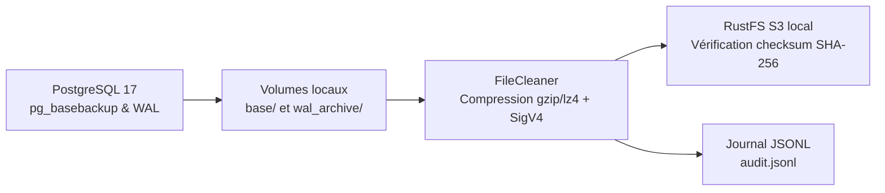

# Tutoriel 3 : Laboratoire Docker PostgreSQL WAL et S3

Ce troisième laboratoire met en œuvre une pile complète comprenant PostgreSQL 17, un serveur compatible S3 local (RustFS) et FileCleaner pour archiver des sauvegardes de base et des segments WAL avec vérification d'intégrité SHA-256.

## Architecture du laboratoire



## Prérequis

- Docker Engine avec le plugin Docker Compose (`docker compose version`).
- Un clone local du dépôt `jmrenouard/FileCleaner` contenant `scripts/e2e-dba-s3-lab.sh` et `examples/dba-postgres-wal-s3.toml`.

## Étape 1 : Inspecter le profil DBA PostgreSQL + S3

Générez ou inspectez la configuration dédiée au profil DBA :

```bash
filecleaner init --profile dba-postgres --format toml -o /tmp/dba-postgres.toml
filecleaner validate -c /tmp/dba-postgres.toml
```

Le profil [examples/dba-postgres-wal-s3.toml](../../../examples/dba-postgres-wal-s3.toml) définit deux règles distinctes :

- `pg-base-backups` : conserve au moins `7` sauvegardes de base valides (`>= 1 MiB`), compresse les surplus en `gzip`, les transfère vers S3 sous `postgres/base-backups/%Y/%m/` puis supprime la copie locale après confirmation `checksum_sha256`.
- `pg-wal-archive` : conserve `16` segments récents (`16 MiB` minimum, expression régulière stricte `^[0-9A-F]{24}$`), exclut les marqueurs `.ready`, `.done` et `.history`, compresse en `lz4` puis archive vers S3.

## Étape 2 : Lancer le scénario automatisé Docker + RustFS

Exécutez le script de laboratoire automatisé [scripts/e2e-dba-s3-lab.sh](../../../scripts/e2e-dba-s3-lab.sh) depuis la racine du dépôt :

```bash
bash scripts/e2e-dba-s3-lab.sh
```

Ce script effectue successivement :

1. Le démarrage de PostgreSQL 17 et de RustFS S3 dans un réseau Docker isolé.
2. La création de sauvegardes de base et de segments WAL factices puis réels.
3. L'exécution de `filecleaner plan` puis `filecleaner run` avec les identifiants S3 injectés uniquement via variables d'environnement (`AWS_ACCESS_KEY_ID`, `AWS_SECRET_ACCESS_KEY`).
4. La vérification que les objets compressés existent sur S3, que leur empreinte SHA-256 correspond et que les planchers `BackupGuard` locaux n'ont jamais été franchis.
5. L'arrêt et la suppression automatique des conteneurs et volumes temporaires en fin de test.

## Étape 3 : Poursuivre vers la mise en production

Pour configurer cet archivage sur vos serveurs de base de données, consultez le guide [Configurer la rétention et l'archivage S3](../02-guides-pratiques/exploitation/configurer-retention-et-archivage-s3.md) ainsi que l'[analyse du pipeline fail-closed en 6 phases](../04-explications/vue-architecture/pipeline-fail-closed-six-phases.md).
