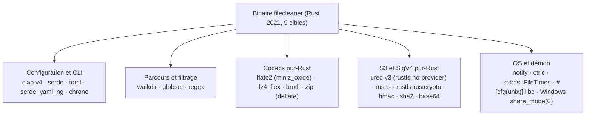

# ADR-001 : Moteur pur-Rust fail-closed sans dépendances C ni shell

- **Statut** : Accepté
- **Date** : 2026-11-20
- **Périmètre** : `Cargo.toml`, moteur d'exécution, pile cryptographique TLS/S3, codecs et hooks

## Contexte et contraintes

Un outil d'exploitation destiné aux serveurs de bases de données, aux conteneurs distroless et aux postes d'administration multiplateformes (Linux GNU/musl, macOS, Windows) échoue fréquemment lorsque sa distribution dépend de bibliothèques partagées système comme `libssl.so` (OpenSSL), d'utilitaires externes (`gzip`, `awscli`, `curl`) ou d'un interpréteur shell (`/bin/sh -c`).

## Architecture de dépendances retenue

## Décision

1. **Zéro liaison OpenSSL ou C externe** : TLS repose intégralement sur `rustls` avec le fournisseur cryptographique pur-Rust `rustls-rustcrypto`, tandis que les signatures AWS SigV4 et empreintes SHA-256 s'appuient sur `hmac`, `sha2` et `base64`. Cela garantit la compilation croisée statique `x86_64-unknown-linux-musl` et `aarch64-unknown-linux-musl` sans en-têtes C.
2. **Codecs intégrés en Rust pur** : `gzip` (`flate2` + backend `miniz_oxide`), `lz4` (`lz4_flex`), `brotli` et `zip` (`deflate`) s'exécutent dans le même processus sans forker de sous-processus ni exposer de vulnérabilités d'arguments CLI.
3. **Interdiction absolue d'invocation shell** : les hooks pré-suppression utilisent exclusivement `std::process::Command::new(command)` avec passage direct des arguments substitués `{path}`, `{name}`, `{size}`, `{mtime_iso}`, `{rule}` afin d'éliminer toute classe d'injection shell via noms de fichiers malveillants.
4. **Sémantique fail-closed généralisée** : en l'absence de lecture fiable d'horodatage, de sonde de verrou ou de vérification `checksum_sha256` S3, le candidat est préservé intact.

## Conséquences

- **Positif** : binaire autonome portable, empreinte mémoire déterministe, image Docker `scratch`/non-root (`65532:65532`) sans shell installé, zéro risque d'injection de commande dans les hooks.
- **Compromis** : le temps de compilation initial inclut les crates cryptographiques et de compression pur-Rust, et le binaire ne délègue pas les formats propriétaires externes comme `zstd` natif tant qu'une dépendance pure n'est pas activée.

## Références

- [Cargo.toml](../../../../Cargo.toml)
- [Pipeline fail-closed en 6 phases](../vue-architecture/pipeline-fail-closed-six-phases.md)
