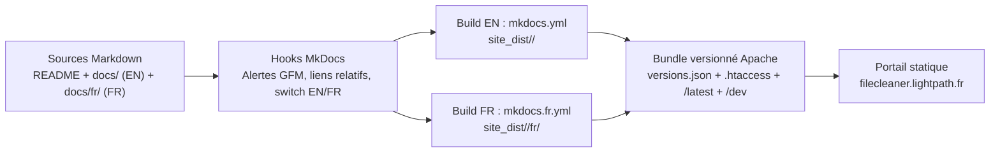

# ADR-002 : Architecture documentaire Diátaxis bilingue et MkDocs versionnée

- **Statut** : Accepté (mis à jour pour séparation EN/FR dédiée)
- **Date** : 2026-11-23
- **Périmètre** : `mkdocs.yml`, `mkdocs.fr.yml`, `scripts/mkdocs_hooks.py`, `scripts/build_versioned_docs.py`, `.github/workflows/docs-publish.yml`

## Contexte

Un site MkDocs Material unique mélangeant une arborescence anglaise et française dans la même barre de navigation dégrade la recherche plein texte, les libellés d'interface et la clarté pour les opérateurs d'astreinte. De plus, la documentation doit rester consultable par version (`v1.0.0`, `v1.0.1`, `main`) sur hébergement statique Apache IONOS tout en excluant strictement tout fichier sensible (`.kdbx`, `.keyx`, `.env*`, `.fc-tmp`, `.pid`).

## Architecture de publication retenue

## Décision

1. **Taxonomie Diátaxis en quatre quadrants par langue** :
   - Anglais sous `docs/01-tutorials/`, `docs/02-how-to-guides/`, `docs/03-reference/`, `docs/04-explanation/`.
   - Français sous `docs/fr/01-tutoriels/`, `docs/fr/02-guides-pratiques/`, `docs/fr/03-reference/`, `docs/fr/04-explications/`, avec application d'ASD-STF100 sur `02-guides-pratiques/`.
2. **Deux configurations MkDocs isolées avec sélecteur dynamique** : `mkdocs.yml` (`language: en`) exclut tous les contenus français et `mkdocs.fr.yml` (`language: fr`) exclut tous les contenus anglais tout en remappant `fr/` à la racine du sous-site `/<ver>/fr/`. `scripts/mkdocs_hooks.py` ajuste dynamiquement `extra.alternate` selon le préfixe de version actif (`/main/` <-> `/main/fr/`, `/v1.0.1/` <-> `/v1.0.1/fr/`).
3. **Instantanés Git immuables** : `scripts/build_versioned_docs.py` extrait chaque tag publié par `git archive`, superpose la thématique et les hooks modernes, élague les pages absentes des tags historiques et garantit zéro artefact privé via `assert_no_private_files`.

## Conséquences

- **Positif** : navigation et moteur de recherche 100 % monolingues par sous-site, bascule EN/FR préservant la version consultée, zéro mélange linguistique en CI grâce aux builds `--strict` séparés.
- **Compromis** : tout changement de structure du portail exige une mise à jour symétrique des fichiers de navigation anglais et français et de leurs jeux de tests automatisés.

## Références

- [Schéma de configuration et invariants](../../03-reference/configuration/schema-configuration-et-invariants.md)
- [Documentation Diátaxis française](../index.md)
