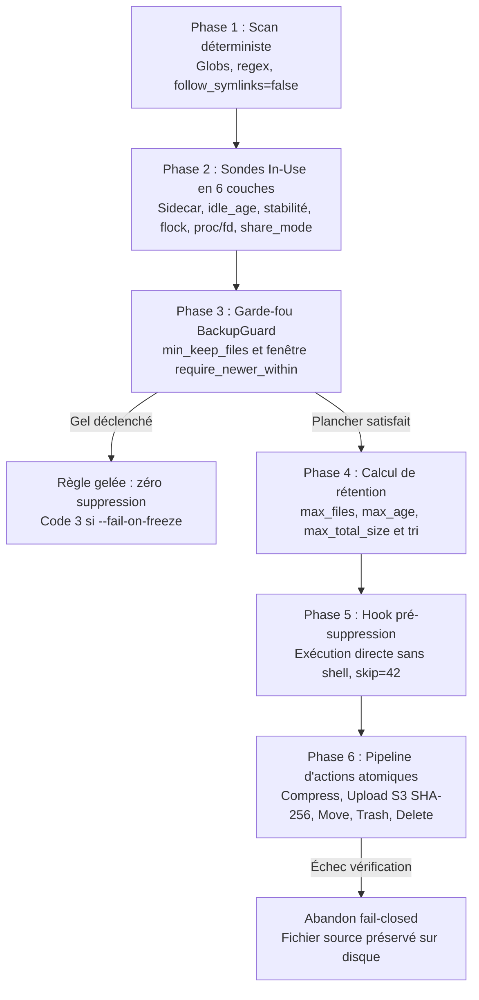

# Pipeline fail-closed en 6 phases

FileCleaner exécute chaque balayage comme un pipeline synchrone et ordonné en six phases où toute incertitude de métadonnée, de verrouillage ou de vérification distante interrompt la mutation destructive avant qu'elle ne touche le disque.

## Topologie du pipeline

## Principes de conception

### Séparation stricte entre filtrage, protection et mutation

Un nettoyeur classique mélange souvent la recherche de fichiers et la suppression immédiate dans un même parcours d'arborescence. Cette approche rend impossible le maintien d'un plancher global (`min_keep_files`) ou d'un budget cumulatif (`max_total_size`) car la décision sur le premier fichier dépend de l'ensemble complet des candidats valides.

FileCleaner matérialise d'abord la liste complète en mémoire lors de la phase 1 (`Scanner`), fige l'ensemble protégé lors des phases 2 et 3 (`InUseDetector` puis `BackupGuard`), et ne calcule les évictions qu'après avoir garanti les invariants globaux.

### Garanties fail-closed sur les actions composites

Lorsqu'une règle enchaîne `actions = ["compress", "upload_s3", "delete"]`, chaque étape agit sur l'artefact produit à l'étape précédente et vérifie son succès avant de passer à la suite :

1. **Compression pure-Rust (`compress`)** : écrit dans un fichier temporaire `.fc-tmp` puis renomme atomiquement ; en cas d'erreur de codec ou d'espace disque, le fichier source intact reste inchangé.
2. **Transfert S3 vérifié (`upload_s3`)** : calcule l'empreinte SHA-256 locale, signe la requête en SigV4 via `rustls` pur-Rust, puis vérifie côté serveur via `HeadObject` (`checksum_sha256`) ou lecture intégrale (`readback_sha256`).
3. **Suppression conditionnelle (`delete`)** : n'est jamais appelée si une étape précédente échoue ou si un verrou est détecté entre la planification et l'exécution.

## Lectures complémentaires

- [Calcul de rétention et défenses TOCTOU](../analyses-internes/calcul-retention-et-defenses-toctou.md)
- [ADR-001 : Moteur pur-Rust fail-closed](../decisions-architecture/adr-001-moteur-pur-rust-fail-closed.md)
- [Commandes CLI et codes de sortie](../../03-reference/cli-et-scripts/commandes-cli-et-codes-sortie.md)
