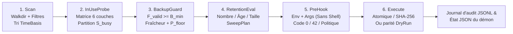
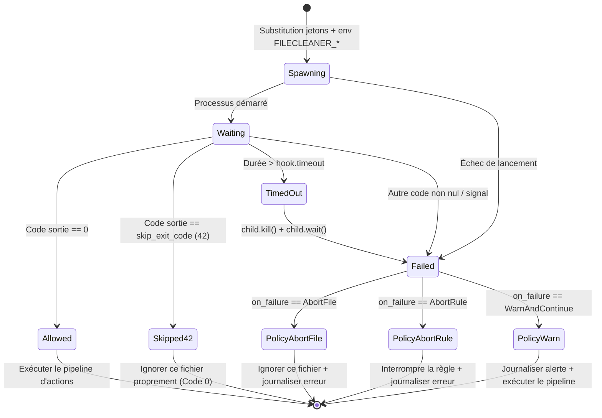
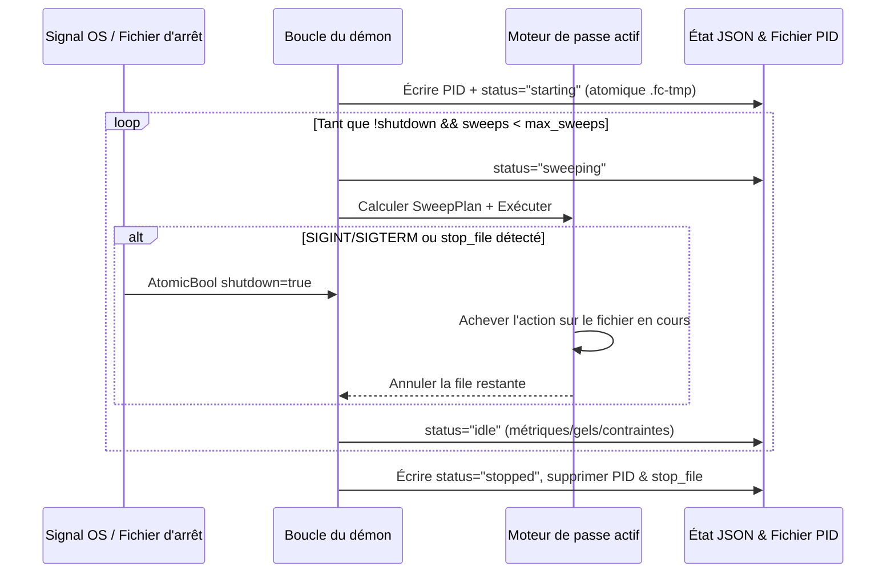

<div align="center">
  
</div>

# FileCleaner v1.1.0 — Spécifications Techniques Formelles & Architecture d'Ingénierie

> **Éditions linguistiques** : [English (`docs/en/SPECIFICATIONS.md`)](../en/SPECIFICATIONS.md) · **Français (Normatif)**  
> **Documents de gouvernance associés** : [Session d'alignement équipe](../team-sessions/team-session-2026-11-20.md) · [Journal d'actions](../ACTION_LOGBOOK.md) · [Registre RCA](../RCA_REGISTER.md)

---

## Table des matières

1. [Vue d'ensemble du système et garanties de conception](#1-vue-densemble-du-système-et-garanties-de-conception)
2. [Schéma de configuration et invariants de validation](#2-schéma-de-configuration-et-invariants-de-validation)
3. [Parcours de fichiers et résolution des horodatages](#3-parcours-de-fichiers-et-résolution-des-horodatages)
4. [Modèle mathématique formel de rétention et de garde de sauvegarde](#4-modèle-mathématique-formel-de-rétention-et-de-garde-de-sauvegarde)
5. [Matrice multi-sondes de détection de fichiers en cours d'utilisation](#5-matrice-multi-sondes-de-détection-de-fichiers-en-cours-dutilisation)
6. [Protocole d'exécution des hooks pré-action / pré-suppression](#6-protocole-dexécution-des-hooks-pré-action--pré-suppression)
7. [Pipeline ordonné d'actions sur le cycle de vie](#7-pipeline-ordonné-dactions-sur-le-cycle-de-vie)
8. [Architecture du démon et gestion des signaux](#8-architecture-du-démon-et-gestion-des-signaux)
9. [Sous-commandes CLI, codes de sortie, journal d'audit JSONL structuré et modèle de sécurité](#9-sous-commandes-cli-codes-de-sortie-journal-daudit-jsonl-structuré-et-modèle-de-sécurité)

---

## 1. Vue d'ensemble du système et garanties de conception

### 1.1 Objectif et périmètre

**FileCleaner** (`filecleaner` v1.1.0, Rust Edition 2021, Apache-2.0) est un moteur déterministe et multiplateforme dédié à la rétention de répertoires, à la protection des sauvegardes par garde-fous, à la détection de fichiers actifs, à l'orchestration de transformations de cycle de vie et à la planification en démon. Il remplace les scripts shell fragiles (`find ... -delete`, `logrotate` dépendant de l'OS) par un pipeline formellement spécifié à échec sécurisé (*fail-closed*), conçu pour éliminer toute perte silencieuse de données sur serveurs de production, coffres de sauvegarde et postes développeurs.

### 1.2 Philosophie « zéro perte silencieuse » et pipeline strict en 6 phases

Chaque passe d'évaluation (*sweep*) d'une règle exécute six phases strictement ordonnées à sûreté intrinsèque :



Garanties architecturales appliquées à chaque phase :

1. **Priorité absolue des garde-fous (*Fail-Closed*)** : Les protections de sûreté (`InUseProbe` et `BackupGuard`) l'emportent toujours sur les plafonds de rétention (`max_files`, `max_age`, `max_total_size`). Si un plafond ne peut être atteint sans violer `min_keep_files` ou évincer un fichier actif, l'éviction est bloquée et la règle s'achève avec le statut `RuleOutcome::Constrained`.
2. **Parité stricte Simulation / Exécution réelle (`Dry-Run`)** : `filecleaner plan` et `filecleaner run --dry-run` exécutent les phases 1 à 4 de manière strictement identique à `filecleaner run`, produisant exactement le même `SweepPlan` sans aucune mutation du système de fichiers.
3. **Aucun repli silencieux sur erreur de filtrage** : Un horodatage non supporté par le système de fichiers (ex. `TimeBasis::Created` sans `statx` `btime`), un nom illisible pour `FilenameDate` ou une erreur de sonde ne conduit jamais à une suppression silencieuse.
4. **Non-traversée des liens symboliques par défaut** : Les liens symboliques ne sont ni traversés ni sélectionnés comme candidats sauf activation explicite de `follow_symlinks = true`.
5. **Traits injectables pour le déterminisme** : Les interactions OS critiques sont abstraites derrière des traits injectables (`Clock`, `FsOps`, `LockProbe`, `HookRunner`) afin d'atteindre $\ge 90\%$ de couverture de lignes déterministe (`cargo llvm-cov --fail-under-lines 90`) par tests unitaires et injection de pannes.

### 1.3 Sémantique d'écriture atomique et fichiers temporaires sûrs

Tout fichier produit par FileCleaner (archives compressées, cibles de déplacement inter-systèmes de fichiers, fichier PID, état JSON du démon, modèles de configuration) suit une séquence de staging résistante aux crashs :

1. Écrire dans un fichier temporaire frère `<target>.fc-tmp.<pid>.<seq>` (ou `<target>.fc-tmp`) créé exclusivement (`create_new(true)`) avec permissions Unix privées `0o600`.
2. Vider les tampons d'encodage et appeler `sync_all()` (`fsync`) sur le descripteur temporaire.
3. Restaurer les métadonnées (`atime`, `mtime`, permissions) lorsque applicable.
4. Basculer atomiquement `<target>.fc-tmp...` vers `<target>` via renommage OS (`rename(2)` / remplacement Windows), sans écraser une cible existante sauf autorisation explicite.
5. Ne supprimer le fichier source **qu'après** réussite complète des étapes 1 à 4 (et vérification SHA-256 pour un déplacement inter-FS).

Tout artefact interne correspondant à `*.fc-tmp`, `*.fc-tmp.*` ou au journal archivé `<audit_log>.1` est inconditionnellement exclu de la phase de découverte des règles afin qu'une exécution concurrente ou interrompue ne détruise jamais un tampon en cours de rédaction ni l'historique d'audit. Lorsque `follow_symlinks = false`, FileCleaner ouvre les fichiers sources sans suivre les liens symboliques (`O_NOFOLLOW` et vérification `(st_dev, st_ino)` sous Unix ; `FILE_FLAG_OPEN_REPARSE_POINT` et rejet d'attribut *reparse point* sous Windows) et vérifie la continuité d'inode avant la troncature `copy_truncate`.

### 1.4 Portabilité pure-Rust et contrat de compilation croisée (9 cibles)

FileCleaner proscrit toute dépendance C/C++ `-sys` (`openssl-sys`, `aws-lc-sys`, `ring`, `libz-sys`, `liblz4-sys`, `bzip2-sys`) au profit exclusif de crates 100 % Rust :

- **CLI & Configuration** : `clap` (v4 derive), `serde`, `serde_json`, `toml`, `serde_yaml_ng`, `thiserror`, `chrono` (avec `serde`)
- **Parcours & Correspondance** : `walkdir`, `globset`, `regex`
- **Compression & Intégrité** : `flate2` (moteur pure-Rust `miniz_oxide` par défaut), `lz4_flex`, `brotli`, `zip` (`default-features = false`, `deflate` pure-Rust), `sha2`, ainsi que la bibliothèque standard Rust `std::fs::FileTimes` (`File::set_times`)
- **Transport S3 & SigV4** : `ureq` v3 (`default-features = false`, `rustls-no-provider`, `rustls-webpki-roots`), `rustls` v0.23 (`default-features = false`, `std`, `logging`, `tls12`), `rustls-rustcrypto` (`CryptoProvider` TLS 100 % Rust), `hmac`, `base64`
- **Démon & Intégration OS** : `notify`, `ctrlc`, ainsi que `#[cfg(unix)] libc` et l'API standard Windows `OpenOptionsExt::share_mode(0)`.

Cette pile compile proprement sur l'ensemble des 9 cibles de distribution : `x86_64-unknown-linux-gnu`, `x86_64-unknown-linux-musl`, `aarch64-unknown-linux-gnu`, `aarch64-unknown-linux-musl`, `armv7-unknown-linux-gnueabihf`, `x86_64-pc-windows-msvc`, `aarch64-pc-windows-msvc`, `aarch64-apple-darwin` et `x86_64-apple-darwin`.

---

## 2. Schéma de configuration et invariants de validation

### 2.1 Détection de format et structure racine `Config`

`Config::from_file(path)` détecte automatiquement le format de sérialisation via l'extension en minuscules (`Config::load_validated(path)` enchaîne l'analyse et `Config::validate()`) :

- `.toml` $\rightarrow$ parseur `toml`
- `.yaml` ou `.yml` $\rightarrow$ parseur `serde_yaml_ng`
- Toute autre extension ou absence d'extension $\rightarrow$ `FileCleanerError::ConfigFormat` (aucune détection heuristique)

Champs de niveau supérieur de `Config` (`src/config.rs`) :

| Champ | Type Rust | Défaut | Description |
| :--- | :--- | :--- | :--- |
| `dry_run` | `bool` | `false` | Interrupteur global de simulation (`plan` / `--dry-run` ou `rule.dry_run` forcent aussi la simulation). |
| `daemon` | `DaemonConfig` | Défaut `DaemonConfig` | Mode de planification `mode`, `interval`, `watch`, `debounce`, `sweep_on_start`, fichiers PID/état/arrêt. |
| `audit` | `AuditConfig` | Défaut `AuditConfig` | Journalisation structurée JSONL (`log_path: Option<PathBuf>`, `jsonl: bool` par défaut `true`). |
| `audit_log` | `Option<PathBuf>` | `None` | Raccourci racine pour le chemin du journal JSONL (résolu avec `audit.log_path` via `Config::effective_audit_log()`). |
| `global_trash_dir` | `Option<PathBuf>` | `None` | Répertoire de quarantaine par défaut lorsqu'une règle utilise `ActionStep::Trash` sans `trash_dir` local. |
| `s3` | `Option<S3Config>` | `None` | Paramètres S3 / compatibles S3 par défaut résolus via `Config::effective_s3(rule)` lorsqu'une règle utilise `ActionStep::UploadS3` sans bloc `s3` local. |
| `rules` | `Vec<RuleConfig>` | **Obligatoire (non vide)** | Liste ordonnée de règles indépendantes de rétention et de cycle de vie. |

### 2.2 `RuleConfig`, `DaemonConfig` et énumérations

Toutes les énumérations sont sérialisées en `snake_case` par défaut tout en acceptant des alias `serde` en `PascalCase` (ex. `"modified"` / `"Modified"`, `"oldest_first"` / `"OldestFirst"`).

#### `RuleConfig`

| Champ | Type Rust | Défaut | Description |
| :--- | :--- | :--- | :--- |
| `name` | `String` | **Obligatoire** | Identifiant unique non vide dans `rules`. |
| `path` | `PathBuf` | **Obligatoire** | Répertoire racine surveillé par la règle. |
| `enabled` | `bool` | `true` | Les règles désactivées sont ignorées proprement lors des passes. |
| `recursive` | `bool` | `false` | Parcourir les sous-répertoires jusqu'à `max_depth`. |
| `max_depth` | `Option<usize>` | `None` | Profondeur maximale (`1` = enfants directs uniquement ; ignoré sauf si `recursive = true`). |
| `follow_symlinks` | `bool` | `false` | Suivre les liens symboliques (doit rester `false` par défaut). |
| `include_globs` | `Vec<String>` | `[]` | Motifs glob d'inclusion (vide = tout inclure). |
| `exclude_globs` | `Vec<String>` | `[]` | Motifs glob d'exclusion de fichiers ou sous-répertoires (prioritaires sur l'inclusion). |
| `include_regex` | `Option<String>` | `None` | Expression régulière Rust optionnelle d'inclusion sur chemins relatifs ou noms. |
| `exclude_regex` | `Option<String>` | `None` | Expression régulière Rust optionnelle d'exclusion (prioritaire sur l'inclusion). |
| `min_file_size` | `Option<u64>` | `None` | Filtre optionnel de taille minimale par candidat (fichiers plus petits ignorés par la règle). |
| `max_file_size` | `Option<u64>` | `None` | Filtre optionnel de taille maximale par candidat (fichiers plus volumineux ignorés). |
| `time_basis` | `TimeBasis` | `Modified` | `modified` (`Modified`) \| `created` (`Created`) \| `filename_date` (`FilenameDate`). |
| `filename_date_regex` | `Option<String>` | `None` | Requis lorsque `time_basis = "filename_date"`. |
| `filename_date_format` | `Option<String>` | `None` | Format `chrono` `strftime` validé requis pour `FilenameDate`. |
| `max_files` | `Option<usize>` | `None` | Nombre maximal de fichiers candidats conservés avant éviction. |
| `max_age` | `Option<Duration>` | `None` | Âge maximal $t_{\text{now}} - t(f)$ avant éviction. |
| `max_total_size` | `Option<u64>` | `None` | Budget maximal cumulé en octets sur $\mathcal{F}$. |
| `combine_mode` | `CombineMode` | `Any` | `any` (`Any`, OU logique) \| `all` (`All`, ET logique) entre limites actives. |
| `eviction_order` | `EvictionOrder` | `OldestFirst` | `oldest_first` (`OldestFirst`) \| `largest_first` (`LargestFirst`). |
| `dry_run` | `bool` | `false` | Force la planification en simulation sans mutation disque pour cette règle. |
| `backup_guard` | `BackupGuardConfig` | Défaut | Plancher de sauvegarde et interrupteur homme-mort de fraîcheur. |
| `in_use` | `InUseConfig` | Défaut | Paramètres de la matrice de détection 6 couches. |
| `pre_delete_hook` | `Option<HookConfig>` | `None` | Commande externe synchrone de veto (alias `serde` : `pre_hook`) évaluée avant mutation/suppression. |
| `actions` | `Vec<ActionStep>` | `[Delete]` | Pipeline ordonné de cycle de vie exécuté par candidat sélectionné. |
| `move_to` | `Option<PathBuf>` | `None` | Répertoire cible requis lorsque `actions` inclut `ActionStep::Move`. |
| `move_date_subdir` | `Option<String>` | `None` | Sous-répertoire de date `chrono` `strftime` optionnel sous `move_to` (ex. `"%Y/%m"`). |
| `move_overwrite` | `bool` | `false` | Autorise l'écrasement d'une cible existante lors de `ActionStep::Move`. |
| `trash_dir` | `Option<PathBuf>` | `None` | Répertoire de quarantaine propre à la règle lorsque `actions` inclut `ActionStep::Trash`. |
| `compression` | `CompressionFormat` | `Gzip` | Codec sélectionné lorsque `actions` inclut `ActionStep::Compress`. |
| `compression_level` | `Option<u32>` | `None` | Niveau de compression optionnel spécifique au codec. |
| `compress_remove_source` | `bool` | `true` | Supprime le fichier source après réussite atomique de la compression. |
| `compress_overwrite` | `bool` | `false` | Autorise l'écrasement d'une archive compressée existante. |
| `copy_truncate_to` | `Option<PathBuf>` | `None` | Répertoire d'archive cible pour `ActionStep::CopyTruncate` (repli sur `move_to` si absent). |
| `rename_template` | `Option<String>` | `None` | Modèle `strftime`/nom de fichier optionnel pour `ActionStep::RenameByDate`. |
| `s3` | `Option<S3Config>` | `None` | Surcharge optionnelle de destination d'archivage S3 propre à la règle (repli sur `[s3]` global si absent). |

#### `BackupGuardConfig`

| Champ | Type Rust | Défaut | Description |
| :--- | :--- | :--- | :--- |
| `enabled` | `bool` | `false` | Interrupteur principal activant les garde-fous de sauvegarde pour la règle. |
| `min_keep_files` | `usize` | `0` | Nombre minimal de sauvegardes valides récentes protégées ($P_{\text{floor}}$). |
| `min_valid_backup_bytes` | `u64` | `0` | Taille minimale $B_{\min}$ en octets d'une sauvegarde valide (alias `serde` : `min_valid_size`). |
| `require_newer_within` | `Option<Duration>` | `None` | Fenêtre de fraîcheur homme-mort $\Delta_{\text{fresh}}$ (alias `serde` : `max_newest_age`). |
| `freeze_if_newest_older_than` | `Option<DateTime<Utc>>` | `None` | Horodatage minimal absolu $T_{\text{cutoff}}$ (alias `serde` : `min_newest_timestamp`, RFC 3339 UTC). |
| `freeze_on_empty_valid` | `bool` | `true` | Geler la règle si $\mathcal{F}_{\text{valid}} = \emptyset$ lorsque `backup_guard.enabled == true` (alias `serde` : `freeze_on_empty`). |

#### `InUseConfig`

| Champ | Type Rust | Défaut | Description |
| :--- | :--- | :--- | :--- |
| `enabled` | `bool` | `true` | Interrupteur global des sondes d'utilisation active. |
| `check_sidecar_locks` | `bool` | `true` | Vérifier les fichiers verrous/temporaires annexes. |
| `sidecar_suffixes` | `Vec<String>` | `[".lock", ".lck", ".part", ".tmp", ".processing"]` | Extensions de verrous annexes et fichiers en transit. |
| `check_os_locks` | `bool` | `true` | Sonder les verrous natifs OS (`flock(LOCK_EX | LOCK_NB)` sous Unix, `share_mode(0)` sous Windows). |
| `check_proc_fd` | `bool` | `true` | Analyser `/proc/*/fd` par `(st_dev, st_ino)` sous Linux. |
| `min_idle_age` | `Option<Duration>` | `None` | Délai de refroidissement optionnel exigeant $t_{\text{now}} - \text{mtime}(f) \ge \Delta_{\text{idle}}$. |
| `stability_window` | `Option<Duration>` | `None` | Fenêtre optionnelle d'observation en deux points `(size, mtime)`. |

#### `HookConfig` & `HookFailurePolicy`

| Champ | Type Rust | Défaut | Description |
| :--- | :--- | :--- | :--- |
| `command` | `String` | **Obligatoire** | Exécutable ou binaire (lancé directement sans interpréteur shell). |
| `args` | `Vec<String>` | `[]` | Vecteur d'arguments supportant `{path}`, `{name}`, `{size}`, `{mtime_iso}`, `{rule}`. |
| `timeout` | `Duration` | `"30s"` | Durée d'exécution maximale avant terminaison forcée. |
| `on_failure` | `HookFailurePolicy` | `AbortFile` | `abort_file` (`AbortFile`) \| `abort_rule` (`AbortRule`) \| `warn_and_continue` (`WarnAndContinue`). |
| `skip_exit_code` | `Option<i32>` | `Some(42)` | Code de sortie indiquant un saut volontaire par fichier sans erreur. |
| `run_in_dry_run` | `bool` | `false` | Autorise l'exécution du hook durant `--dry-run` / `plan`. |
| `working_dir` | `Option<PathBuf>` | `None` | Répertoire de travail optionnel du processus enfant. |
| `env` | `BTreeMap<String, String>` | `{}` | Variables d'environnement statiques additionnelles transmises en plus de `FILECLEANER_*`. |

#### `ActionStep` & `CompressionFormat`

- `ActionStep` : `rename_by_date` (`RenameByDate`), `compress` (`Compress`), `move` (`Move`), `copy_truncate` (`CopyTruncate`), `upload_s3` (`UploadS3`, non terminale), `trash` (`Trash`, terminale), `delete` (`Delete`, terminale). Les paramètres associés (`move_to`, `move_date_subdir`, `move_overwrite`, `trash_dir`, `compression`, `compression_level`, `compress_remove_source`, `compress_overwrite`, `copy_truncate_to`, `rename_template`, `s3`) résident directement sur `RuleConfig`.
- `CompressionFormat` : `gzip` (`Gzip`, défaut), `lz4` (`Lz4`), `brotli` (`Brotli`), `zip` (`Zip`).

#### `S3Config` & `S3VerifyMode`

Les identifiants sont lus exclusivement depuis des variables d'environnement ; aucun champ de clé d'accès ou secrète en clair n'existe dans `S3Config`.

| Champ | Type Rust | Défaut | Description |
| :--- | :--- | :--- | :--- |
| `bucket` | `String` | **Obligatoire** | Nom du bucket S3 cible (non vide ; sans `/`, `\`, `..`, espace ni caractère de contrôle). |
| `region` | `String` | **Obligatoire** | Région de signature AWS ou compatible S3 (ex. `"eu-west-3"`, `"us-east-1"`). |
| `endpoint` | `Option<String>` | `None` | URL personnalisée optionnelle (ex. `"https://minio.internal:9000"`). Exige `https://` sauf `allow_insecure_http = true` ; interdit identifiants/requête/fragment. |
| `prefix` | `Option<String>` | `None` | Préfixe de clé optionnel ajouté devant les objets téléversés (sans `..` ni caractères de contrôle). |
| `key_date_subdir` | `Option<String>` | `None` | Segment de date `chrono` `strftime` validé ajouté après `prefix` (ex. `"%Y/%m/%d"`). |
| `force_path_style` | `bool` | `false` | Active l'adressage par chemin (`<endpoint>/<bucket>/<key>`) pour MinIO, Ceph RGW ou passerelles locales. |
| `allow_insecure_http` | `bool` | `false` | Option explicite autorisant `http://` en clair pour un endpoint personnalisé (`false` par défaut impose TLS). |
| `overwrite` | `bool` | `false` | Autorise l'écrasement d'une clé distante existante (`false` effectue un `HeadObject` préalable et échoue en sûreté sur `200 OK`). |
| `storage_class` | `Option<String>` | `None` | En-tête `x-amz-storage-class` optionnel (ex. `"STANDARD_IA"`, `"GLACIER"`). |
| `verify_mode` | `S3VerifyMode` | `ChecksumSha256` | `checksum_sha256` (`ChecksumSha256`, défaut : `HeadObject` `x-amz-checksum-sha256` + `Content-Length`) \| `readback_sha256` (`ReadbackSha256` : relecture en flux `GetObject` SHA-256). |
| `access_key_env` | `String` | `"AWS_ACCESS_KEY_ID"` | Nom de la variable d'environnement fournissant l'identifiant de clé S3. |
| `secret_key_env` | `String` | `"AWS_SECRET_ACCESS_KEY"` | Nom de la variable d'environnement fournissant la clé secrète S3. |
| `session_token_env` | `Option<String>` | `Some("AWS_SESSION_TOKEN")` | Variable d'environnement optionnelle fournissant un jeton temporaire (`x-amz-security-token`). |
| `timeout` | `Duration` | `"60s"` | Délai maximal par requête HTTP/TLS (`> 0`). |
| `max_retries` | `u32` | `3` | Budget borné de tentatives sur erreurs transitoires `5xx` ou réseau (ne relance jamais `4xx` ni `IntegrityMismatch`). |
| `multipart_part_size` | `u64` | `"16MiB"` | Seuil et taille de partie multipart bornés dans `[5 MiB, 5 GiB]`. |

#### `DaemonConfig` & `DaemonMode`

| Champ | Type Rust | Défaut | Description |
| :--- | :--- | :--- | :--- |
| `mode` | `DaemonMode` | `Hybrid` | `interval` (`Interval`) \| `notify` (`Notify`) \| `hybrid` (`Hybrid`). |
| `interval` | `Duration` | `"60s"` | Période de passe régulière (alias `serde` : `poll_interval` ; sert aussi de repli en `Hybrid`). |
| `watch` | `bool` | `false` | Active l'observateur FS événementiel `notify` (mode `Notify`/`Hybrid` actif si `true` ou `mode != Interval`). |
| `debounce` | `Duration` | `"2s"` | Fenêtre d'agrégation des événements `notify` avant déclenchement. |
| `sweep_on_start` | `bool` | `true` | Exécuter une première passe immédiate au démarrage du démon. |
| `pid_file` | `Option<PathBuf>` | `None` | Chemin optionnel du fichier verrou PID créé atomiquement au lancement et supprimé à l'arrêt. |
| `state_file` | `Option<PathBuf>` | `None` | Chemin optionnel du fichier JSON d'état temps réel mis à jour atomiquement. |
| `stop_file` | `Option<PathBuf>` | `None` | Chemin optionnel du marqueur coopératif d'arrêt vérifié par la boucle d'événements. |

### 2.3 Grammaire des unités d'octets lisibles (`parse_bytes`)

`parse_bytes(input)` accepte soit un entier non signé brut (ex. `1048576`), soit une chaîne de la forme `<nombre>\s*<unité>?` où `<nombre>` est un entier ou décimal non négatif (ex. `"1.5GiB"`, `"500 MB"`, `"64KiB"`) :

| Unité | Norme | Multiplicateur (Octets) |
| :--- | :--- | :--- |
| `B` (ou omise) | Brut | $1$ |
| `KB` | SI Décimal | $10^3 = 1{,}000$ |
| `K`, `KiB` | IEC Binaire | $2^{10} = 1{,}024$ |
| `MB` | SI Décimal | $10^6 = 1{,}000{,}000$ |
| `M`, `MiB` | IEC Binaire | $2^{20} = 1{,}048{,}576$ |
| `GB` | SI Décimal | $10^9 = 1{,}000{,}000{,}000$ |
| `G`, `GiB` | IEC Binaire | $2^{30} = 1{,}073{,}741{,}824$ |
| `TB` | SI Décimal | $10^{12} = 1{,}000{,}000{,}000{,}000$ |
| `T`, `TiB` | IEC Binaire | $2^{40} = 1{,}099{,}511{,}627{,}776$ |
| `PB` | SI Décimal | $10^{15}$ |
| `P`, `PiB` | IEC Binaire | $2^{50}$ |

Invariants d'analyse :

- La reconnaissance des unités est insensible à la casse (`kb`, `KB`, `kib`, `KiB`), tout en distinguant rigoureusement les puissances décimales SI (`KB`, `MB`, `GB`, `TB`, `PB`) des puissances binaires IEC (`K`/`KiB`, `M`/`MiB`, `G`/`GiB`, `T`/`TiB`, `P`/`PiB`).
- Toute multiplication contrôle les dépassements de `u64::MAX` ; les signes négatifs, `NaN`, `inf`, chaînes vides et suffixes inconnus renvoient `FileCleanerError::InvalidByteSize`.

### 2.4 Grammaire des durées (`parse_duration_str`)

`parse_duration_str(input)` analyse des entiers bruts (interprétés en secondes, ex. `"60"`) ou un ou plusieurs segments contigus `<uint><unité>` (ex. `"500ms"`, `"30s"`, `"1d 12h"`, `"2m30s"`, `"2w"`) vers `std::time::Duration` :

| Jeton | Unité | Équivalent en millisecondes |
| :--- | :--- | :--- |
| `ms` | Millisecondes | $1$ |
| `s` | Secondes | $1{,}000$ |
| `m` | Minutes | $60{,}000$ |
| `h` | Heures | $3{,}600{,}000$ |
| `d` | Jours ($24\text{ h}$) | $86{,}400{,}000$ |
| `w` | Semaines ($7\text{ d}$) | $604{,}800{,}000$ |

Invariants d'analyse : arithmétique vérifiée contre le dépassement de `u64::MAX` millisecondes ; rejet des chaînes vides, valeurs négatives, entiers malformés et suffixes non reconnus (`FileCleanerError::InvalidDuration`).

### 2.5 Invariants de validation de configuration (`Config::validate`)

`Config::validate()` vérifie l'ensemble des invariants statiques avant tout parcours ou mutation :

| ID Invariant | Condition imposée | Erreur émise |
| :--- | :--- | :--- |
| `INV-CFG-01` | Le vecteur `rules` NE DOIT PAS être vide ; `global_trash_dir` (si `Some`) NE DOIT PAS être vide. | `ConfigValidation` |
| `INV-CFG-02` | Chaque `rule.name.trim()` DOIT être non vide et unique dans `rules`. | `ConfigValidation` |
| `INV-CFG-03` | `rule.path` DOIT être non vide et `rule.actions` NE DOIT PAS être vide. | `ConfigValidation` |
| `INV-CFG-04` | `include_regex`, `exclude_regex` et `filename_date_regex` DOIVENT compiler en `regex::Regex`. | `InvalidRegex` |
| `INV-CFG-05` | Toutes les chaînes de `include_globs` et `exclude_globs` DOIVENT compiler dans `globset::Glob`. | `InvalidGlob` |
| `INV-CFG-06` | `TimeBasis::FilenameDate` exige SIMULTANÉMENT `filename_date_regex` et un `filename_date_format` non vide sans `Item::Error` dans `StrftimeItems`. De même, `move_date_subdir` (si `Some`) DOIT posséder des `StrftimeItems` valides. | `ConfigValidation` |
| `INV-CFG-07` | Si `max_files` vaut `Some(m)`, la condition `m >= backup_guard.min_keep_files` DOIT être satisfaite. Si `min_file_size` et `max_file_size` sont tous deux `Some`, `min_file_size <= max_file_size` DOIT être vérifié. | `ConfigValidation` |
| `INV-CFG-08` | `ActionStep::Move` requiert `rule.move_to = Some(...)` ; `ActionStep::Trash` requiert `rule.trash_dir = Some(...)` ou `config.global_trash_dir = Some(...)` ; `ActionStep::CopyTruncate` requiert `rule.copy_truncate_to = Some(...)` ou `rule.move_to = Some(...)` ; `ActionStep::UploadS3` requiert `rule.s3 = Some(...)` ou `config.s3 = Some(...)`. | `ConfigValidation` |
| `INV-CFG-09` | **Garde d'auto-inclusion** : Si `rule.recursive == true` et que `move_to`, `copy_truncate_to` ou le `trash_dir` effectif égale lexicalement/canoniquement `rule.path` ou réside à l'intérieur de `rule.path`, la configuration est rejetée SAUF si `exclude_globs` ou `exclude_regex` exclut strictement le répertoire cible et ses descendants. | `ConfigValidation` |
| `INV-CFG-10` | **Garde de terminaison du pipeline** : Les actions terminales (`Delete`, `Trash`) NE DOIVENT être suivies d'aucune autre `ActionStep` dans `rule.actions`. L'étape non terminale `UploadS3` peut précéder `Delete`, `Trash` ou `Move`. | `ConfigValidation` |
| `INV-CFG-11` | `pre_delete_hook` (lorsqu'il vaut `Some`) DOIT avoir un `command` non vide et `timeout > 0`. | `ConfigValidation` |
| `INV-CFG-12` | `daemon.interval > 0` ; toute étape `CopyTruncate` requiert une activation explicite (`actions = ["copy_truncate"]`) et émet un avertissement explicite de validation concernant la fenêtre de concurrence écriture/troncature. | `ConfigValidation` |
| `INV-CFG-13` | **Garde transport et clés S3 (`validate_s3_config`)** : `s3.bucket` et `s3.region` DOIVENT être valides et non vides ; un `endpoint` personnalisé DOIT utiliser `https://` sauf `allow_insecure_http = true` (et proscrire `@`/`?`/`#`/espaces) ; `prefix` interdit `..` et caractères de contrôle ; `key_date_subdir` DOIT contenir des `StrftimeItems` valides ; `timeout > 0` ; `multipart_part_size` DOIT être dans `[5 MiB, 5 GiB]`. | `ConfigValidation` |
| `INV-CFG-14` | **Hygiène des secrets S3** : `access_key_env`, `secret_key_env` et `session_token_env` (si présent) DOIVENT être des noms POSIX valides (`[A-Za-z_][A-Za-z0-9_]*`), garantissant zéro identifiant en clair dans les fichiers TOML/YAML. | `ConfigValidation` |

### 2.6 Exemples canoniques TOML & YAML

#### Exemple TOML (`filecleaner.toml`)

```toml
dry_run = false
global_trash_dir = "/var/tmp/filecleaner-trash"

[daemon]
mode = "hybrid"
interval = "5m"
watch = true
debounce = "2s"
sweep_on_start = true
pid_file = "/run/filecleaner/filecleaner.pid"
state_file = "/run/filecleaner/state.json"
stop_file = "/run/filecleaner/filecleaner.stop"

[audit]
log_path = "/var/log/filecleaner/audit.jsonl"
jsonl = true

[[rules]]
name = "pg-backups"
path = "/var/backups/postgres"
recursive = true
max_depth = 2
follow_symlinks = false
include_globs = ["*.sql", "*.sql.gz", "*.dump"]
exclude_globs = ["pinned/**"]
min_file_size = "1KiB"
time_basis = "filename_date"
filename_date_regex = 'pg_(\d{8}_\d{6})'
filename_date_format = "%Y%m%d_%H%M%S"
max_files = 14
max_age = "30d"
max_total_size = "50GiB"
combine_mode = "any"
eviction_order = "oldest_first"
actions = ["compress", "move"]
compression = "gzip"
compress_remove_source = true
compress_overwrite = false
move_to = "/mnt/cold-archive/postgres"
move_date_subdir = "%Y/%m"
move_overwrite = false

[rules.backup_guard]
enabled = true
min_keep_files = 3
min_valid_backup_bytes = "1MiB"
require_newer_within = "36h"
freeze_on_empty_valid = true

[rules.in_use]
enabled = true
min_idle_age = "10s"
stability_window = "2s"

[rules.pre_delete_hook]
command = "/usr/local/bin/verify-offsite-copy"
args = ["--file", "{path}", "--rule", "{rule}"]
timeout = "15s"
on_failure = "abort_file"
skip_exit_code = 42
run_in_dry_run = false
```

#### Exemple YAML (`filecleaner.yaml`)

```yaml
dry_run: true

daemon:
  mode: interval
  interval: 10m
  watch: false
  debounce: 2s
  sweep_on_start: true

audit:
  log_path: /var/log/filecleaner/audit.jsonl
  jsonl: true

rules:
  - name: app-logs
    path: /var/log/myapp
    recursive: false
    dry_run: true
    include_globs:
      - "*.log"
    time_basis: modified
    max_age: 7d
    max_total_size: 2GiB
    combine_mode: any
    eviction_order: oldest_first
    in_use:
      enabled: true
      check_os_locks: false
      check_proc_fd: false
      min_idle_age: 5s
      stability_window: 0s
    actions:
      - copy_truncate
    copy_truncate_to: /var/log/myapp/rotated
    compression: lz4
```

---

## 3. Parcours de fichiers et résolution des horodatages

### 3.1 Sémantique de parcours de répertoires

FileCleaner parcourt `rule.path` via `walkdir::WalkDir` :

- **Bornes de profondeur** : Si `rule.recursive == false`, le parcours impose `max_depth(1)` (enfants immédiats de `rule.path` uniquement). Si `rule.recursive == true`, `max_depth(d)` est appliqué lorsque `rule.max_depth = Some(d)`, ou illimité si `None`.
- **Non-traversée des liens symboliques par défaut** : `follow_symlinks(rule.follow_symlinks)` vaut `false` par défaut. Toute entrée avec `entry.file_type().is_symlink()` est ignorée dès la découverte sauf si `follow_symlinks == true` (et même dans ce cas, la détection de boucles de `walkdir` interrompt tout cycle avec `FileCleanerError::Io`).
- **Fichiers réguliers uniquement** : Seules les entrées vérifiant `metadata.is_file()` accèdent au filtrage des candidats. Les répertoires, sockets Unix, tubes nommés (FIFO) et périphériques bloc/caractère sont ignorés.
- **Auto-exclusion des artefacts internes** : Tout fichier correspondant à `*.fc-tmp` ou `*.fc-tmp.*`, ainsi que les chemins configurés `audit.log_path`, `daemon.pid_file`, `daemon.state_file` et `daemon.stop_file`, sont exclus inconditionnellement de la découverte.

### 3.2 Algèbre de filtrage Inclusion / Exclusion et bornes de taille

Les chemins relatifs à `rule.path` sont normalisés avec séparateur `/` (POSIX) avant filtrage afin de garantir un comportement identique entre Windows et Unix.

Soit $I(f)$ le prédicat d'inclusion, $X(f)$ le prédicat d'exclusion et $B_{\text{range}}(f)$ le filtre optionnel de taille par fichier (`min_file_size`, `max_file_size`) pour un fichier régulier $f$ :

$$
I(f) = \begin{cases}
\text{true} & \text{if } \text{include\_globs} = \emptyset \land \text{include\_regex} = \emptyset \\
\text{GlobMatch}_{\text{inc}}(f) \lor \text{RegexMatch}_{\text{inc}}(f) & \text{otherwise}
\end{cases}
$$

$$
X(f) = \text{GlobMatch}_{\text{exc}}(f) \lor \text{RegexMatch}_{\text{exc}}(f)
$$

$$
B_{\text{range}}(f) = \left(\text{min\_file\_size} = \bot \lor \text{size}(f) \ge \text{min\_file\_size}\right) \land \left(\text{max\_file\_size} = \bot \lor \text{size}(f) \le \text{max\_file\_size}\right)
$$

Un fichier intègre l'ensemble des candidats $\mathcal{F}$ si et seulement si :

$$
f \in \mathcal{F} \iff I(f) \land \neg X(f) \land B_{\text{range}}(f)
$$

Ainsi, **les règles d'exclusion priment inconditionnellement sur les règles d'inclusion**, et `min_file_size`/`max_file_size` bornent les fichiers entrant dans le périmètre de la règle (à distinguer de `backup_guard.min_valid_backup_bytes` qui classifie les ébauches corrompues *au sein* de $\mathcal{F}$). Note : `globset` gère de manière uniforme les motifs de chemin relatif et de nom de fichier après normalisation en `/`.

### 3.3 Résolution d'horodatage (`TimeBasis`)

Chaque candidat $f$ reçoit un horodatage UTC $t(f)$ selon `rule.time_basis` :

1. **`TimeBasis::Modified`** : Lit `metadata.modified()` (`mtime`) converti en `DateTime<Utc>`.
2. **`TimeBasis::Created`** : Lit `metadata.created()` (`birthtime`). Sur les systèmes de fichiers ou noyaux ne prenant pas en charge la date de création (`std::io::ErrorKind::Unsupported`), FileCleaner **NE DOIT PAS** basculer silencieusement sur `mtime` ; il émet `FileCleanerError::TimestampUnsupported` (protégeant le fichier de façon *fail-closed*).
3. **`TimeBasis::FilenameDate`** :
   - Applique la regex compilée `filename_date_regex` au nom de base du fichier (ex. `backup_20261120_020000.sql.gz`).
   - Extrait le groupe nommé `"date"` s'il existe, sinon le groupe positionnel `1`, sinon le groupe complet `0`.
   - Analyse la sous-chaîne extraite avec `filename_date_format` :
     - Tente d'abord `DateTime::parse_from_str` si le format inclut un fuseau (`%z`/`%:z`/`%Z`),
     - Sinon tente `NaiveDateTime::parse_from_str` interprété en UTC,
     - Sinon tente `NaiveDate::parse_from_str` normalisé à `00:00:00 UTC`.
   - **Gestion fail-closed des échecs de parsing** : Si la regex ne correspond pas ou si la date échoue à l'analyse, le fichier est **exclu de toute éviction** (jamais supprimé silencieusement) et consigné par un événement diagnostique `TimestampParseSkipped`.

### 3.4 Ordre déterministe des candidats

Les candidats de $\mathcal{F} = \{f_1, f_2, \dots, f_n\}$ sont ordonnés strictement par horodatage décroissant :

$$
t(f_i) > t(f_j) \lor \Big(t(f_i) = t(f_j) \land \text{rel\_path}(f_i) < \text{rel\_path}(f_j)\Big) \implies f_i \prec_{\text{new}} f_j
$$

Le départage lexicographique par chemin relatif normalisé garantit un ordonnancement 100 % reproductible même sur systèmes de fichiers à granularité grossière (ex. FAT32 ou résolution à la seconde).

---

## 4. Modèle mathématique formel de rétention et de garde de sauvegarde

### 4.1 Ordre des candidats et filtre de sauvegardes valides

Soit $\mathcal{F} = (f_1, f_2, \dots, f_n)$ la séquence des candidats triés du plus récent au plus ancien :

$$
t(f_1) \ge t(f_2) \ge \dots \ge t(f_n)
$$

Étant donné le seuil minimal de taille de sauvegarde valide $B_{\min} = \text{backup\_guard.min\_valid\_backup\_bytes} \ge 0$, on partitionne $\mathcal{F}$ entre sauvegardes valides $\mathcal{F}_{\text{valid}}$ et artefacts incomplets ou vides $\mathcal{F}_{\text{stub}} = \mathcal{F} \setminus \mathcal{F}_{\text{valid}}$ :

$$
\mathcal{F}_{\text{valid}} = \left\{f \in \mathcal{F} \mid \text{size}(f) \ge B_{\min}\right\}
$$

Les fichiers inférieurs à $B_{\min}$ (tels que des dumps SQL échoués de $0\text{ octet}$ ou des en-têtes tronqués) sont volontairement **exclus** de $\mathcal{F}_{\text{valid}}$ afin qu'un artefact corrompu ne puisse jamais valider les contrôles de fraîcheur ni évincer de vraies sauvegardes hors du plancher protégé.

**Règle sur les sorties transformées dans le même répertoire** : Lorsqu'une passe antérieure exécute une transformation sur place (`RenameByDate` ou `Compress`) dont le fichier résultant reste dans `rule.path`, satisfait encore $I(f) \land \neg X(f)$ et vérifie $\text{size}(f) \ge B_{\min}$, ce fichier reste comptabilisé dans $\mathcal{F}_{\text{valid}}$ pour `min_keep_files` et la fraîcheur $t_{\max}$. Les sorties déplacées hors de `rule.path` via `Move` ou `Trash` quittent $\mathcal{F}$.

### 4.2 Invariant d'interrupteur homme-mort de fraîcheur (règle de gel)

Définissons l'horodatage maximal valide $t_{\max}$ :

$$
t_{\max} = \begin{cases}
\max_{f \in \mathcal{F}_{\text{valid}}} t(f) & \text{if } \mathcal{F}_{\text{valid}} \neq \emptyset \\
-\infty & \text{if } \mathcal{F}_{\text{valid}} = \emptyset
\end{cases}
$$

Soit $t_{\text{now}}$ l'horodatage d'évaluation fourni par `Clock::now()`, $\Delta_{\text{fresh}} = \text{require\_newer\_within}$ (si configuré) et $T_{\text{cutoff}} = \text{freeze\_if\_newest\_older\_than}$ (alias `min_newest_timestamp`, si configuré). Posons $\text{guard\_active}$ vrai dès que `backup_guard.enabled == true` ou qu'au moins une contrainte de garde est configurée ($\text{min\_keep\_files} > 0 \lor B_{\min} > 0 \lor \Delta_{\text{fresh}} \neq \bot \lor T_{\text{cutoff}} \neq \bot$).

L'**interrupteur homme-mort de péremption** déclenche le prédicat de gel $\text{Frozen}(\mathcal{F})$ ssi :

$$
\text{Frozen}(\mathcal{F}) \iff \left(\mathcal{F}_{\text{valid}} = \emptyset \land \text{guard\_active} \land \text{freeze\_on\_empty\_valid}\right) \lor \left(\Delta_{\text{fresh}} \neq \bot \land t_{\text{now}} - t_{\max} > \Delta_{\text{fresh}}\right) \lor \left(T_{\text{cutoff}} \neq \bot \land t_{\max} < T_{\text{cutoff}}\right)
$$

**Invariant de gel** : Dès que $\text{Frozen}(\mathcal{F})$ est vrai, l'ensemble d'éviction $E$ est inconditionnellement vidé :

$$
\text{Frozen}(\mathcal{F}) \implies E = \emptyset
$$

Aucun fichier de $\mathcal{F}$ n'est renommé, compressé, déplacé, tronqué, mis à la corbeille ou supprimé, et un événement `BackupGuardFreeze` est émis vers le journal d'audit JSONL et l'état JSON du démon (`active_freezes`).

### 4.3 Invariant du plancher minimal de sauvegarde

Soit $\mathcal{F}_{\text{valid}} = (v_1, v_2, \dots, v_m)$ conservant l'ordre décroissant $t(v_1) \ge t(v_2) \ge \dots \ge t(v_m)$. Définissons la cardinalité du plancher protégé $N_{\min}$ et l'ensemble protégé $P_{\text{floor}}$ :

$$
N_{\min} = \min\left(|\mathcal{F}_{\text{valid}}|, \text{min\_keep\_files}\right)
$$

$$
P_{\text{floor}} = \{v_1, v_2, \dots, v_{N_{\min}}\}
$$

**Invariant du plancher minimal** : L'ensemble d'éviction $E$ DOIT rester strictement disjoint de $P_{\text{floor}}$ :

$$
E \cap P_{\text{floor}} = \emptyset
$$

### 4.4 Invariant d'exclusion des fichiers en cours d'utilisation

Soit $S_{\text{busy}} \subseteq \mathcal{F}$ l'ensemble des fichiers déclarés actifs (ou indéterminés/en erreur directe de sonde) par la matrice multi-sondes (Section 5).

**Invariant d'exclusion des fichiers actifs** : L'ensemble d'éviction $E$ DOIT rester strictement disjoint de $S_{\text{busy}}$ :

$$
E \cap S_{\text{busy}} = \emptyset
$$

Définissons l'ensemble protégé combiné $P$ et le vivier de candidats éligibles $\mathcal{C}$ :

$$
P = P_{\text{floor}} \cup S_{\text{busy}}, \qquad \mathcal{C} = \mathcal{F} \setminus P
$$

### 4.5 Règles de rétention, `CombineMode` et `EvictionOrder`

Soit $\pi = (\pi_1, \pi_2, \dots, \pi_n)$ la permutation de priorité d'éviction de $\mathcal{F}$ induite par `eviction_order` :

- **`EvictionOrder::OldestFirst`** : Tri primaire croissant sur $t(\pi_i)$ (plus ancien d'abord), départagé par taille $\text{size}(\pi_i)$ décroissante puis par chemin relatif croissant.
- **`EvictionOrder::LargestFirst`** : Tri primaire décroissant sur $\text{size}(\pi_i)$ (plus volumineux d'abord), départagé par $t(\pi_i)$ croissant (plus ancien à taille égale) puis par chemin relatif croissant.

Soit $\pi_{\mathcal{C}}$ la sous-séquence de $\pi$ restreinte aux fichiers éligibles $\mathcal{C} = \mathcal{F} \setminus P$. Tous les fichiers de $\mathcal{F}$ (y compris $P_{\text{floor}}$ et $S_{\text{busy}}$) occupent physiquement du décompte et des octets tant qu'ils ne sont pas retirés.

Initialisons l'état résiduel sur $\mathcal{F}$ avant parcours de $\pi_{\mathcal{C}}$ à l'indice $k = 0$ :

$$
c_0 = |\mathcal{F}|, \qquad b_0 = \sum_{f \in \mathcal{F}} \text{size}(f), \qquad E_0 = \emptyset
$$

Pour chaque candidat éligible successif $f = \pi_{\mathcal{C}, k}$ ($k = 1, \dots, |\mathcal{C}|$), évaluons chaque contrainte configurée $r \in \mathcal{R}_{\text{active}} \subseteq \{\text{files}, \text{age}, \text{size}\}$ sur l'état courant $(c_{k-1}, b_{k-1})$ :

$$
\text{pred}_{\text{files}}(c_{k-1}) \iff c_{k-1} > \text{max\_files}
$$

$$
\text{pred}_{\text{age}}(f) \iff t_{\text{now}} - t(f) > \text{max\_age}
$$

$$
\text{pred}_{\text{size}}(b_{k-1}) \iff b_{k-1} > \text{max\_total\_size}
$$

Combinons les prédicats actifs selon `combine_mode` :

$$
\text{ShouldEvict}(f, c_{k-1}, b_{k-1}) = \begin{cases}
\bigvee_{r \in \mathcal{R}_{\text{active}}} \text{pred}_r & \text{if } \text{combine\_mode} = \text{Any} \\
\bigwedge_{r \in \mathcal{R}_{\text{active}}} \text{pred}_r & \text{if } \text{combine\_mode} = \text{All}
\end{cases}
$$

Transition d'état à l'étape $k$ :

$$
(E_k, c_k, b_k) = \begin{cases}
\left(E_{k-1} \cup \{f\},\; c_{k-1} - 1,\; b_{k-1} - \text{size}(f)\right) & \text{if } \text{ShouldEvict}(f, c_{k-1}, b_{k-1}) \\
\left(E_{k-1},\; c_{k-1},\; b_{k-1}\right) & \text{otherwise}
\end{cases}
$$

Enfin, $E = E_{|\mathcal{C}|}$ conserve l'ordre d'exécution $\pi_{\mathcal{C}}$. (Si $\mathcal{R}_{\text{active}} = \emptyset$ et que des `actions` non vides sont explicitement configurées, $E = \pi_{\mathcal{C}}$ hors gel.)

**Propriétés de correction** :

1. Tout élément de $P_{\text{floor}} \cup S_{\text{busy}}$ étant absent de $\pi_{\mathcal{C}}$, les invariants $E \cap P_{\text{floor}} = \emptyset$ et $E \cap S_{\text{busy}} = \emptyset$ sont garantis par construction.
2. Sous `CombineMode::Any`, chaque éviction décrémente $c$ et $b$, interrompant l'éviction par nombre/taille dès que le répertoire repasse sous $\text{max\_files}$ et $\text{max\_total\_size}$ tout en continuant d'évaluer $\text{pred}_{\text{age}}$ sur l'ensemble de $\pi_{\mathcal{C}}$.
3. Sous `CombineMode::All` (ex. `max_files = 5` ET `max_age = 30d`), un fichier n'est évincé que lorsque *toutes* les conditions actives sont simultanément dépassées — préservant ainsi jusqu'à 5 sauvegardes même au-delà de 30 jours, et épargnant tout fichier de moins de 30 jours même si le total dépasse 5.

### 4.6 Résolution des conflits de contraintes (`RuleOutcome::Constrained`)

Si après sélection de $E$ un plafond agrégé reste dépassé parce que `BackupGuard` ($P_{\text{floor}}$) et/ou `InUseProbe` ($S_{\text{busy}}$) ont empêché toute éviction supplémentaire :

$$
\text{Constrained}(\mathcal{F}, E) \iff \neg \text{Frozen}(\mathcal{F}) \land \left(\left(\text{max\_files} \neq \bot \land c_{\text{final}} > \text{max\_files}\right) \lor \left(\text{max\_total\_size} \neq \bot \land b_{\text{final}} > \text{max\_total\_size}\right)\right)
$$

Contrat de résolution :

- **La sûreté l'emporte TOUJOURS** : FileCleaner n'assouplit jamais $P_{\text{floor}}$ ni $S_{\text{busy}}$.
- **Statut de règle** : Le résultat est classé `RuleOutcome::Constrained` (avec télémétrie structurée : `remaining_files`, `target_max_files`, `remaining_bytes`, `target_max_total_size`, `protected_floor_count`, `busy_skipped_count`).
- **Télémétrie et code de sortie** : Enregistré dans le journal d'audit JSONL et dans l'état JSON du démon (`constrained_rules`). Le code de sortie CLI par défaut reste `0` (évitant de fausses alertes cron sur verrou transitoire) ; l'option `--strict-constraints` élève `Constrained` au code de sortie `3`.

---

## 5. Matrice multi-sondes de détection de fichiers en cours d'utilisation

Lorsque `in_use.enabled == true`, chaque candidat $f \in \mathcal{F}$ traverse jusqu'à six sondes orthogonales avant planification.

### 5.1 Matrice des sondes de détection

| Couche | Mécanisme de sonde | Portée OS | Déclencheur de détection | Sémantique fail-closed & cas limites |
| :--- | :--- | :--- | :--- | :--- |
| **1** | **Marqueurs annexes et suffixes temporaires** | Tous OS | Le nom se termine par un suffixe de `sidecar_suffixes` (`.lock`, `.lck`, `.part`, `.tmp`, `.processing`) **OU** le fichier frère `<candidate_path><ext>` existe lorsque `check_sidecar_locks = true`. | Toujours actif si `in_use.enabled && check_sidecar_locks`. Évite de scinder les transferts protégés par fichier verrou. |
| **2** | **Verrou consultatif Unix `flock`** | `#[cfg(unix)]` | Si `check_os_locks = true`, ouverture `O_RDONLY`, appel `libc::flock(fd, LOCK_EX \| LOCK_NB)` en exécution réelle ou non exclusif `LOCK_SH \| LOCK_NB` en lecture seule (`plan`/`--dry-run`). `EWOULDBLOCK`/`EAGAIN` $\rightarrow$ occupé ; sinon `LOCK_UN` immédiat et fermeture. | L'ouverture `O_RDONLY` permet à `flock` de fonctionner sous Linux/macOS (contrairement à `fcntl` `F_WRLCK`) sans altérer `mtime`. Ignoré si les sondes moins intrusives (`sidecars`, `/proc`, `min_idle_age`) ou $P_{\text{floor}}$ s'appliquent déjà. |
| **3** | **Scan d'inodes Linux `/proc/*/fd`** | `#[cfg(target_os = "linux")]` | Si `check_proc_fd = true`, lecture `(st_dev, st_ino)` du candidat. Parcours unique de `/proc/<pid>/fd/*` par passe via `SweepLockProbe` (hors PID courant) et comparaison par `stat`. | Les erreurs `EACCES`/`EPERM` sur les PID d'autres utilisateurs sont **consignées en diagnostic** (sans faux blocage global) ; toute correspondance accessible signale `ProcFdOpen { pid }`. |
| **4** | **Mode de partage exclusif / lecture seule Windows** | `#[cfg(windows)]` | Si `check_os_locks = true`, ouverture via `OpenOptions` avec `share_mode(0)` en exécution réelle ou non exclusif `FILE_SHARE_READ` (`access_mode(0).share_mode(1)`) en mode lecture seule (`plan`/`--dry-run`). | Tout descripteur tiers avec partage incompatible renvoie `ERROR_SHARING_VIOLATION` (32) ou `ERROR_LOCK_VIOLATION` (33) $\rightarrow$ `WindowsShareViolation`. Fermeture immédiate sinon. |
| **5** | **Refroidissement minimal (`min_idle_age`)** | Tous OS | Vérifie $t_{\text{now}} - \text{mtime}(f) < \Delta_{\text{idle}}$ (utilise toujours le `mtime` système quel que soit `time_basis`). | Protège les fichiers récemment modifiés ainsi que les dérives d'horloge futures ($\text{mtime} > t_{\text{now}}$). |
| **6** | **Fenêtre de stabilité en deux points** | Tous OS | Capture $p_0 = (\text{size}_0, \text{mtime}_0)$, attend $\Delta_{\text{stab}} = \text{stability\_window}$, capture $p_1 = (\text{size}_1, \text{mtime}_1)$. Déclenche si $p_0 \neq p_1$. | **Optimisation groupée** : Capture $p_0$ sur tous les survivants des sondes 1–5, dort **une seule fois** $\Delta_{\text{stab}}$, puis capture $p_1$ en lot ($O(\Delta_{\text{stab}})$ total). |

### 5.2 Agrégation, `InUseReport` et interaction `CopyTruncate`

- **Union fail-closed** : Un candidat $f$ n'est jugé sûr ($f \notin S_{\text{busy}}$) que si **toutes** les sondes actives applicables confirment son inactivité. Tout déclenchement unitaire ou erreur I/O sur le candidat lui-même (`ENOENT`, `EACCES`) place $f \in S_{\text{busy}}$ avec motifs structurés dans `InUseReport { path, is_busy, reasons }`.
- **Interaction avec `CopyTruncate`** : Comme `ActionStep::CopyTruncate` vise précisément des journaux maintenus ouverts en écriture continue (`O_APPEND`) par des services actifs, les opérateurs activant `CopyTruncate` désactivent généralement `check_os_locks = false` ou `check_proc_fd = false` sur cette règle tout en conservant `min_idle_age` ou `check_sidecar_locks = true` selon le profil d'écriture.

---

## 6. Protocole d'exécution des hooks pré-action / pré-suppression

### 6.1 Périmètre d'invocation et sécurité des arguments

Lorsque `rule.pre_delete_hook = Some(hook)` (alias `pre_hook`) est configuré, FileCleaner exécute `hook.command` de façon synchrone juste avant `rule.actions` sur chaque candidat retenu $f \in E$ :

- **Comportement en simulation** : Lors de `plan` ou `--dry-run`, les hooks sont **ignorés** par défaut (`run_in_dry_run = false`) et journalisés comme `HookSimulatedDryRun`. Ils ne s'exécutent en simulation que si `hook.run_in_dry_run == true`.
- **Exécution directe via `argv` (zéro injection shell)** : FileCleaner **DOIT** lancer le processus directement par `std::process::Command::new(&hook.command).args(&expanded_args)` — **jamais** via `sh -c` ou `cmd /C`. Des noms de fichiers contenant `;`, `|`, `$()`, guillemets ou espaces ne peuvent déclencher aucune injection de commande.

Paramètres substitués dans chaque chaîne de `hook.args` :

| Jeton | Valeur substituée |
| :--- | :--- |
| `{path}` | Chemin complet du candidat |
| `{name}` | Nom de base du fichier |
| `{size}` | Taille en octets (entier décimal) |
| `{mtime_iso}` | `mtime` système formaté en RFC 3339 UTC |
| `{rule}` | `rule.name` |

### 6.2 Variables d'environnement `FILECLEANER_*`

Le processus enfant reçoit un contexte déterministe de métadonnées :

| Variable | Valeur |
| :--- | :--- |
| `FILECLEANER_PATH` | Chemin complet du fichier cible |
| `FILECLEANER_NAME` | Nom de base du fichier |
| `FILECLEANER_DIR` | Chemin du répertoire parent |
| `FILECLEANER_SIZE` | Taille en octets (chaîne décimale) |
| `FILECLEANER_MTIME_ISO` | `mtime` système en RFC 3339 UTC |
| `FILECLEANER_RULE` | Identifiant de la règle (`rule.name`) |
| `FILECLEANER_ACTION` | Résumé du pipeline (ex. `compress(Gzip)->move` ou `delete`) |
| `FILECLEANER_DRY_RUN` | `"true"` ou `"false"` |

### 6.3 Automate d'états : délai maximal et codes de sortie



Verdicts du hook :

- **Code de sortie `0`** : Poursuivre vers l'exécution du pipeline `ActionStep`.
- **Code de sortie `skip_exit_code` (`42` par défaut)** : Ignorer volontairement ce fichier sans erreur (`HookSkippedFile`) et passer au candidat suivant de $E$. Le code de sortie global reste `0`.
- **Dépassement de `timeout`** : Tuer l'enfant via `child.kill()` puis `child.wait()` (récolte du zombie) et appliquer `hook.on_failure`.
- **Autre code non nul ou échec de lancement** : Appliquer `HookFailurePolicy` :
  - `AbortFile` : Ignorer uniquement ce fichier, journaliser `HookFailed`, continuer la règle.
  - `AbortRule` : Stopper immédiatement les candidats restants de cette règle (`RuleAbortedByHook`), isoler les autres règles et marquer une erreur opérationnelle (code `1`).
  - `WarnAndContinue` : Émettre un avertissement (`HookWarnAndContinue`) et poursuivre l'exécution du pipeline sur ce fichier.

---

## 7. Pipeline ordonné d'actions sur le cycle de vie

### 7.1 Propagation séquentielle de `WorkingTarget`

Pour chaque candidat $f \in E$ validé par les garde-fous et le hook, FileCleaner exécute `rule.actions` strictement dans l'ordre défini tout en maintenant `WorkingTarget` (chemin actif, taille active, métadonnées initiales). Les transformations non terminales (`RenameByDate`, `Compress` avec `remove_source = true`, `Move`) mettent à jour `WorkingTarget` vers le nouvel artefact produit afin que les étapes suivantes se composent naturellement (ex. `RenameByDate -> Compress -> Move`). Les actions terminales (`Trash`, `Delete`) clôturent le pipeline pour cet élément.

### 7.2 Spécifications normatives des actions

#### 7.2.1 `RenameByDate` (`rename_template`)

1. Formater l'horodatage résolu $t(f)$ selon le motif `strftime` `rule.rename_template` (défaut `%Y%m%d_%H%M%S`), produisant `<stem>_<horodatage><ext>` dans le même répertoire.
2. **Gestion des collisions** : Ne jamais écraser silencieusement une cible existante ; échouer proprement (`FileCleanerError::Io`) ou désambiguïser par suffixe numérique déterministe si activé sans écrasement silencieux.
3. Préserver le `mtime` d'origine (`std::fs::FileTimes` via `File::set_times`) et mettre à jour `WorkingTarget`.

#### 7.2.2 `Compress` (`compression`, `compression_level`, `compress_remove_source`, `compress_overwrite`)

Codecs exclusivement pure-Rust :

| `CompressionFormat` | Crate / Moteur | Suffixe | Préservation métadonnées |
| :--- | :--- | :--- | :--- |
| `Gzip` | `flate2` (`miniz_oxide`) | `.gz` | Inscrit nom et `mtime` dans l'en-tête gzip ; restaure le `mtime` du fichier de sortie. |
| `Lz4` | `lz4_flex::frame::FrameEncoder` | `.lz4` | Format frame LZ4 pure-Rust ; restaure le `mtime` du fichier de sortie. |
| `Brotli` | `brotli::CompressorWriter` | `.br` | Flux Brotli pure-Rust ; restaure le `mtime` du fichier de sortie. |
| `Zip` | `zip::ZipWriter` (`deflate`) | `.zip` | Archive mono-entrée avec nom de base et `mtime` DOS ; restaure le `mtime` de l'archive `.zip`. |

Séquence atomique d'exécution :

1. Vérifier que `<path><suffix>` n'existe pas déjà (sauf `rule.compress_overwrite == true`).
2. Compresser en flux vers le fichier temporaire `<dest>.fc-tmp`.
3. Finaliser l'encodeur et appeler `sync_all()`.
4. Restaurer `atime`/`mtime` d'origine via `std::fs::FileTimes` (`File::set_times`) sur `<dest>.fc-tmp`.
5. Renommer atomiquement `<dest>.fc-tmp` $\rightarrow$ `<dest>`.
6. Seulement après réussite de l'étape 5, si `rule.compress_remove_source == true`, supprimer le fichier source et pointer `WorkingTarget` sur `<dest>`. En cas d'échec avant l'étape 5, supprimer `<dest>.fc-tmp` et préserver la source intacte.

#### 7.2.3 `Move` (`move_to`, `move_date_subdir`, `move_overwrite`)

1. Résoudre la base cible `dest_dir = move_to` (plus l'éventuel sous-dossier de date `move_date_subdir` formaté en `strftime`) et créer via `create_dir_all`.
2. Construire `<dest_dir>/<basename>`. Refuser si la cible existe et `rule.move_overwrite == false`.
3. **Voie rapide même système de fichiers** : Tenter `std::fs::rename(&src, &dest)`. En cas de succès, mettre à jour `WorkingTarget`.
4. **Voie vérifiée inter-systèmes de fichiers (`EXDEV` / inter-volumes)** :
   - Copier en flux `src` $\rightarrow$ `<dest>.fc-tmp` tout en calculant l'empreinte `Sha256` source $H_{\text{src}}$ et le nombre d'octets $L_{\text{src}}$.
   - Vider les tampons et appeler `sync_all()` sur `<dest>.fc-tmp`.
   - Rouvrir `<dest>.fc-tmp` depuis le disque pour recalculer indépendamment l'empreinte de vérification `Sha256` $H_{\text{verify}}$ et la taille $L_{\text{verify}}$.
   - Exiger $H_{\text{src}} = H_{\text{verify}} \land L_{\text{src}} = L_{\text{verify}}$. En cas de divergence, effacer `<dest>.fc-tmp`, préserver `src` intact et renvoyer `FileCleanerError::IntegrityMismatch`.
   - Restaurer `atime`/`mtime` (`std::fs::FileTimes` via `File::set_times`) et permissions Unix sur `<dest>.fc-tmp`.
   - Renommer atomiquement `<dest>.fc-tmp` $\rightarrow$ `<dest>`.
   - Supprimer enfin `src` et consigner l'empreinte `sha256` dans le journal d'audit JSONL.

#### 7.2.4 `CopyTruncate` (`copy_truncate_to` / `move_to`, `compression`)

Conçu strictement sur **activation explicite** (*opt-in*) pour les journaux actifs écrits en ajout continu (`O_APPEND`) dont les processus ignorent les signaux :

1. Construire le chemin d'archive horodaté dans `rule.copy_truncate_to` (repli sur `rule.move_to` si absent), avec compression optionnelle via `rule.compression` lorsqu'associée.
2. Copier le contenu actuel de `src` vers `<archive>.fc-tmp` (avec compression en ligne ou vérification SHA-256 à brut), appeler `sync_all()`, restaurer `mtime` et renommer atomiquement vers `<archive>`.
3. Rouvrir `src` en écriture et appeler `file.set_len(0)` suivi de `sync_all()`, en conservant le chemin et l'inode d'origine.

**Compromis explicite et avertissement** : Un écrivain tiers non coopératif peut écrire des octets entre la fin de lecture de la copie et `set_len(0)`, ces octets intermédiaires étant perdus à la troncature. FileCleaner réduit cette fenêtre en achevant compression et staging *avant* la troncature, et émet un avertissement explicite lors de `validate`.

#### 7.2.5 `UploadS3` (`s3` / `[s3]` global, SigV4 pure-Rust et vérification SHA-256 à échec sécurisé)

Transfère en flux le `WorkingTarget` actif (en privilégiant la sortie produite par une étape préalable `Compress`, `CopyTruncate` ou `RenameByDate`) vers S3 ou une passerelle compatible S3 (AWS S3, MinIO, Ceph RGW, Cloudflare R2) via `ureq` v3 + `rustls` + `rustls-rustcrypto` (`max_redirects(0)`, TLS imposé sauf `allow_insecure_http = true`) et AWS Signature Version 4 (`AWS4-HMAC-SHA256`) :

1. **Projection Dry-Run sans E/S** : Lorsque `effective_dry_run == true`, projette l'URI déterministe `s3://<bucket>/<key>` sans lire les identifiants, ni hacher le fichier, ni ouvrir de connexion réseau.
2. **Lecture protégée TOCTOU et SHA-256 local** : Ouvre le fichier via `open_regular_nofollow_read` (`O_NOFOLLOW` / `FILE_FLAG_OPEN_REPARSE_POINT`) et calcule l'empreinte locale SHA-256 $H_{\text{local}}$ ainsi que la taille exacte $L_{\text{local}}$ directement sur le descripteur épinglé.
3. **Contrôle préalable anti-écrasement** : Lorsque `s3.overwrite == false`, envoie une requête `HeadObject` signée et interrompt avec `FileCleanerError::S3Upload` si l'objet existe déjà (`200 OK`).
4. **Téléversement en flux mono-partie ou multipart** :
   - Les fichiers vérifiant $L_{\text{local}} \le \text{multipart\_part\_size}$ sont envoyés par `PutObject` avec `x-amz-checksum-sha256` (base64) et `x-amz-content-sha256`.
   - Les fichiers plus volumineux sont découpés en flux (`CreateMultipartUpload` $\rightarrow$ `UploadPart` avec `x-amz-checksum-sha256` par partie $\rightarrow$ `CompleteMultipartUpload` avec contrôle d'erreur XML `<Error>` sous HTTP 200). En cas d'échec, FileCleaner appelle `AbortMultipartUpload` pour éviter tout fragment orphelin.
5. **Invariant de vérification distante avant suppression locale** : Avant que `UploadS3` ne retourne un succès (et donc avant toute étape `Delete`, `Trash` ou `Move`), FileCleaner vérifie l'intégrité distante selon `s3.verify_mode` :
   - `ChecksumSha256` (défaut) : Exécute `HeadObject` avec `x-amz-checksum-mode: ENABLED`, imposant `Content-Length` $= L_{\text{local}}$ et un en-tête `x-amz-checksum-sha256` égal à l'empreinte base64 mono-partie ou composite multipart S3 `<base64(SHA256(concat(part_sha256_raw)))>-<N>`.
   - `ReadbackSha256` (opt-in pour passerelles anciennes) : Relit `GetObject` en flux à mémoire constante dans un calculateur `Sha256` et exige l'égalité exacte d'empreinte et de taille.

$$
\text{LocalDeleteAllowed}(f) \iff \text{UploadOk}(f) \land H_{\text{local}}(f) = H_{\text{remote}}(f) \land L_{\text{local}}(f) = L_{\text{remote}}(f)
$$

Toute panne réseau, absence d'en-tête de somme de contrôle, collision d'écrasement ou divergence d'empreinte interrompt immédiatement le pipeline avec `FileCleanerError::S3Upload` ou `FileCleanerError::IntegrityMismatch` (code `1`), en préservant le fichier local intact à 100 %. Comme `UploadS3` seul ne supprime aucun fichier local, une règle configurée avec `actions = ["upload_s3"]` conserve le comptage local inchangé (`RuleOutcome::Constrained` si un plafond reste dépassé).

#### 7.2.6 `Trash` (`trash_dir` / `global_trash_dir`)

Déplace `WorkingTarget` vers `rule.trash_dir` (avec repli sur `config.global_trash_dir`). En cas de collision dans la corbeille, ajoute un suffixe horodaté/séquentiel pour prévenir tout écrasement. Les traversées inter-FS respectent le protocole vérifié SHA-256 de la section 7.2.3.

#### 7.2.7 `Delete`

Supprime définitivement le fichier via `std::fs::remove_file(&working_path)`. Termine le pipeline de cet élément.

### 7.3 Garantie stricte de non-mutation en mode `DryRun`

Lorsque `effective_dry_run == true` (`--dry-run`, `plan`, `dry_run` global ou par règle) :

- Aucun appel système d'écriture, renommage, création de répertoire, troncature ou suppression n'est autorisé dans les chemins surveillés ou de destination.
- Aucun artefact `.fc-tmp` n'est créé.
- Chaque règle calcule le `SweepPlan` exact (`KeepFloor`, `KeepRetention`, `SkipInUse`, `SkipHook`, `FreezeBackupGuard`, `WouldAct`, `Constrained`) strictement identique au mode réel, en consignant `dry_run: true` si l'audit est actif.

---

## 8. Architecture du démon et gestion des signaux

### 8.1 Modes de planification (`interval`, `notify`, `hybrid`)

- **`DaemonMode::Interval`** : Exécute les passes à période fixe `daemon.interval` (alias `poll_interval`, plus une passe initiale si `sweep_on_start == true`).
- **`DaemonMode::Notify`** : Utilise `notify::RecommendedWatcher` (activé si `mode == Notify` ou `watch == true`) sur l'ensemble des répertoires `rule.path` uniques (récursivement si au moins une règle associée est récursive), avec agrégation d'événements sur `daemon.debounce` avant déclenchement.
- **`DaemonMode::Hybrid` (Défaut)** : Associe la réactivité de `notify` aux déclenchements périodiques `daemon.interval` afin que les expirations temporelles (`max_age`, `require_newer_within`) s'appliquent même dans des répertoires inactifs ou montages réseau dépourvus d'événements `inotify`/`ReadDirectoryChangesW`.

### 8.2 Fichier PID et état JSON temps réel

- **Fichier PID (`daemon.pid_file`)** : Contrôlé au démarrage ; si un PID actif existe déjà, le lancement échoue proprement avec le code de sortie `4` (`DaemonAlreadyRunning`). Un fichier PID orphelin est remplacé atomiquement via `.fc-tmp` (`0o600`), puis supprimé à l'arrêt gracieux.
- **Fichier d'état JSON temps réel (`daemon.state_file`)** : Écrit atomiquement (`.fc-tmp` `0o600` + `rename`) au démarrage, en début/fin de passe et à l'arrêt :

```json
{
  "version": "1.0.0",
  "pid": 42180,
  "status": "idle",
  "watch_mode": "hybrid",
  "started_at": "2026-11-20T09:00:00.000Z",
  "last_sweep_at": "2026-11-20T09:05:00.142Z",
  "next_sweep_at": "2026-11-20T09:10:00.000Z",
  "sweeps_completed": 2,
  "total_files_evaluated": 128,
  "total_files_processed": 14,
  "total_bytes_reclaimed": 536870912,
  "active_freezes": ["pg-backups"],
  "constrained_rules": [],
  "last_error": null
}
```

Valeurs valides de `status` : `"starting"`, `"idle"`, `"sweeping"`, `"stopping"`, `"stopped"`.

### 8.3 Arrêt gracieux et exécution bornée (`--max-sweeps`)



Invariants du protocole d'arrêt :

1. **Double canal d'arrêt** : Gère à la fois les signaux OS (`SIGINT` / `SIGTERM` via `ctrlc`) et un **fichier d'arrêt** multiplateforme (`daemon.stop_file`, écrit en mode Unix `0o600` et vérifié à pas de réveil de `200 ms`).
2. **Vérification d'identité du PID lors de `daemon stop`** : Avant d'écrire `stop_file` ou d'envoyer `SIGTERM` sous Unix, `daemon stop` vérifie que tout PID actif lu dans `pid_file` appartient bien à un exécutable `filecleaner` (via `/proc` sous Linux, `ps` sous Unix non-Linux, ou `QueryFullProcessImageNameW` sous Windows), et échoue avec le code `4` si le PID a été recyclé vers un processus tiers.
3. **Jamais d'interruption en milieu de fichier** : Lors d'une demande d'arrêt pendant une passe, FileCleaner termine proprement l'action atomique sur le fichier en cours (évitant tout `.fc-tmp` ou copie inachevée), annule le reste de la file, écrit `"stopped"`, supprime `pid_file` et `stop_file`, vide les tampons d'audit et quitte avec le code `0`.
4. **Passes bornées (`--max-sweeps <N>`)** : S'arrête de façon déterministe après $N$ passes complètes, facilitant les tests CI déterministes sans attente indéfinie.

---

## 9. Sous-commandes CLI, codes de sortie, journal d'audit JSONL structuré et modèle de sécurité

### 9.1 Sous-commandes CLI (`clap` v4 Derive)

Options globales acceptées avant les sous-commandes : `-c, --config <PATH>`, `--dry-run`, `--json`, `-v, --verbose`, `-q, --quiet`, `--audit-log <PATH>`.

| Sous-commande | Rôle et options principales | Mutation autorisée |
| :--- | :--- | :--- |
| `filecleaner run` (alias `clean`) | Exécute une passe synchrone via `--config` ou en mode ad-hoc `--dir`. Options : `--rule <NAME>...`, `--dry-run`, `--fail-on-freeze`, `--strict-constraints`, `--dir <DIR>`, `--include <GLOB>...`, `--exclude <GLOB>...`, `--recursive`, `--max-files <N>`, `--max-age <DUR>`, `--max-size <BYTES>`, `--min-keep <N>`, `--min-valid-backup-bytes <BYTES>`, `--require-newer-within <DUR>`, `--freeze-before-date <TS>`, `--min-idle-age <DUR>`, `--rename-by-date`, `--rename-template <FMT>`, `--compress <CODEC>`, `--move-to <DIR>`, `--trash-dir <DIR>`, `--pre-hook <CMD>`, `--json`. | Réelle (sauf `--dry-run`) |
| `filecleaner plan` | Plan d'exécution strictement en lecture seule (force `dry_run = true`). Prend en charge les mêmes options config et ad-hoc que `run`. | **Jamais** |
| `filecleaner check-in-use <PATH...>` | Exécute la matrice multi-sondes sur un ou plusieurs fichiers. Options : `--idle-age <DUR>`, `--stability <DUR>`, `--sidecar-ext <EXT>...`, `--no-flock`, `--no-proc-fd`, `--no-windows-share`, `--json`. | **Jamais** |
| `filecleaner validate [PATH]` | Analyse la configuration (positionnel `<PATH>` ou `-c/--config <PATH>`), les unités, les regex/globs et tous les invariants `INV-CFG-*`. Options : `--json`. | **Jamais** |
| `filecleaner init` | Génère un modèle annoté (`-o/--output <PATH>`, `--profile backups\|logs\|spool\|dba-postgres`, `--format toml\|yaml`, `--force`) avec réglages sûrs (`dry_run = true`, `min_keep_files = 3` ou planchers DBA WAL/sauvegardes de base). | Crée uniquement le fichier config |
| `filecleaner daemon run` | Lance le démon au premier plan (`--mode interval\|notify\|hybrid`, `--max-sweeps <N>`, `--fail-on-freeze`, `--strict-constraints`, `--dry-run`). | Selon mode de passe |
| `filecleaner daemon status` | Consulte la vivacité du `pid_file` et les métriques de `state_file` (`--pid-file <PATH>`, `--state-file <PATH>`, `--json`). | **Jamais** |
| `filecleaner daemon stop` | Crée `stop_file` (et envoie `SIGTERM` sous Unix), attend la fin du PID jusqu'à `--timeout <DUR>` (`10s` par défaut, `--pid-file <PATH>`, `--stop-file <PATH>`). | Écrit/nettoie `stop_file` |
| `filecleaner daemon service-template` | Génère un modèle de service OS prêt à l'emploi (`--init-system systemd\|launchd\|windows-task` [alias `--target`], `-c/--config <PATH>`, `--user <USER>`, `-o/--output <PATH>`). | Sortie standard / `--output` uniquement |

### 9.2 Codes de sortie déterministes

| Code de sortie | Signification et conditions de déclenchement |
| :--- | :--- |
| **`0`** | Succès (`run`/`plan`/`validate`/`init`/`daemon`), ou `check-in-use` confirme que le fichier est **SÛR (inactif)**. Inclut les sauts volontaires `skip_exit_code = 42` et les règles `Frozen`/`Constrained` en mode par défaut. |
| **`1`** | Erreur opérationnelle / I/O, `IntegrityMismatch`, échec de hook `AbortFile`/`AbortRule` ou erreur `TimestampUnsupported` en passe réelle. |
| **`2`** | Erreur de syntaxe CLI ou violation de configuration / d'invariant `INV-CFG-*` (`validate` en échec, TOML/YAML invalide). |
| **`3`** | Garde de sûreté déclenchée en mode strict : `Frozen(F)` avec `--fail-on-freeze`, ou `RuleOutcome::Constrained` avec `--strict-constraints`. |
| **`4`** | Erreur de cycle de vie du démon (`daemon run` alors qu'un PID tourne déjà, `daemon status` arrêté/obsolète, délai dépassé sur `daemon stop`). |
| **`10`** | `check-in-use <PATH>` détecte que la cible est **EN COURS D'UTILISATION / OCCUPÉE** (permet un test shell direct : `if filecleaner check-in-use fichier; then ... fi`). |

### 9.3 Schéma du journal d'audit JSONL structuré

Chaque ligne d'audit est un objet JSON UTF-8 autonome terminé par `\n` et vidé sur disque de façon synchrone par événement. `AuditLogger` ouvre `audit.jsonl` avec permissions privées `0o600` sous Unix et effectue une rotation mono-génération vers `<audit_log>.1` (`0o600`) dès `50 MiB` (`DEFAULT_AUDIT_ROTATE_BYTES`) ; le journal principal et `<audit_log>.1` sont tous deux protégés contre le balayage des règles :

| Champ | Type | Description |
| :--- | :--- | :--- |
| `ts` | `String` (RFC 3339 UTC) | Horodatage de l'événement |
| `event` | `String` | `sweep_start` \| `sweep_end` \| `file_decision` \| `backup_freeze` \| `rule_constrained` \| `hook_exec` \| `action_exec` \| `error` |
| `run_id` | `String` | Identifiant unique d'exécution de passe |
| `rule` | `Option<String>` | Nom de la règle |
| `path` | `Option<String>` | Chemin du candidat ciblé |
| `size_bytes` | `Option<u64>` | Taille du fichier en octets |
| `resolved_ts` | `Option<String>` | Horodatage résolu (`TimeBasis`) en RFC 3339 UTC |
| `decision` | `Option<String>` | `keep_floor` \| `keep_retention` \| `skip_in_use` \| `skip_hook` \| `skip_ts_parse` \| `freeze` \| `would_act` \| `acted` \| `aborted` \| `error` |
| `in_use_reasons` | `Option<Vec<String>>` | Sondes actives déclenchées en cas de fichier occupé |
| `actions` | `Vec<String>` | Étapes du pipeline (`RenameByDate`, `Compress(Gzip)`, `Move`, etc.) |
| `dest_path` | `Option<String>` | Chemin local résultant pour `RenameByDate`/`Compress`/`Move`/`Trash`/`CopyTruncate` (`null` après l'étape terminale `Delete`) |
| `sha256` | `Option<String>` | Empreinte SHA-256 hexadécimale vérifiée lors de `Move`/`CopyTruncate` inter-FS ou `UploadS3` |
| `dry_run` | `bool` | Indique si le mode simulation était actif |
| `duration_ms` | `u64` | Durée de l'opération en millisecondes |
| `error` | `Option<String>` | Diagnostic structuré en cas d'erreur, de gel ou de règle contrainte |
| `details` | `Option<serde_json::Value>` | Métadonnées d'action structurées optionnelles (pour `UploadS3` : `s3_uri`, `etag`, `verify_mode`, `parts_uploaded`, `verified_size` ; omis si `null`) |

Exemples d'enregistrements JSONL :

```json
{"ts":"2026-11-20T09:05:00.010Z","event":"file_decision","run_id":"run-42180-1","rule":"pg-backups","path":"/var/backups/postgres/pg_20261101_020000.sql","size_bytes":10485760,"resolved_ts":"2026-11-01T02:00:00Z","decision":"acted","in_use_reasons":null,"actions":["Compress(Gzip)","Move"],"dest_path":"/mnt/cold-archive/postgres/pg_20261101_020000.sql.gz","sha256":"e3b0c44298fc1c149afbf4c8996fb92427ae41e4649b934ca495991b7852b855","dry_run":false,"duration_ms":42,"error":null}
{"ts":"2026-11-20T09:05:00.015Z","event":"rule_constrained","run_id":"run-42180-1","rule":"pg-backups","path":null,"size_bytes":null,"resolved_ts":null,"decision":"keep_floor","in_use_reasons":null,"actions":[],"dest_path":null,"sha256":null,"dry_run":false,"duration_ms":47,"error":"max_total_size exceeded (60GiB > 50GiB): blocked by min_keep_files=3"}
```

### 9.4 Modèle de sécurité et taxonomie d'erreurs (`FileCleanerError`)

#### Taxonomie d'erreurs (`thiserror`, `src/error.rs`)

Variantes de `FileCleanerError` : `ConfigParse { path, reason }`, `ConfigFormat { path, extension }`, `ConfigValidation(String)`, `InvalidGlob { pattern, source }`, `InvalidRegex { pattern, source }`, `InvalidDuration(String)`, `InvalidByteSize(String)`, `Io { path, source }`, `Serialization(String)`, `HookFailed { rule, command, exit_code, stderr }`, `HookTimedOut { rule, command, timeout_secs }`, `InUseProbe(String)`, `Compression { path, reason }`, `S3Upload { path, uri, reason }`, `IntegrityMismatch { path, expected, actual }`, `BackupGuardViolation { rule, reason }`, `Daemon(String)` (plus d'éventuelles variantes diagnostiques d'horodatage en Vague 2 `TimestampParse` / `TimestampUnsupported`).

#### Matrice des menaces et mesures d'atténuation

| Vecteur de menace | Atténuation architecturale |
| :--- | :--- |
| **Injection de commande / shell** | Les hooks utilisent `Command::new(cmd).args(vec)` directement ; **aucun** appel à `sh -c` ou `cmd /C`. Les métacaractères dans les noms de fichiers restent des octets `argv` littéraux. |
| **Traversée de liens symboliques** | `follow_symlinks = false` par défaut, ouvertures sans suivi (`O_NOFOLLOW` / `FILE_FLAG_OPEN_REPARSE_POINT`) et contrôle `(dev, ino)` avant exécution empêchent les attaques TOCTOU par lien symbolique et la suppression hors arborescence. |
| **Boucles infinies d'auto-déplacement** | `INV-CFG-09` interdit `Move`/`Trash` à l'intérieur d'une racine récursive sauf exclusion explicite, et l'idempotence `Compress`/`RenameByDate` ignore les noms déjà transformés. |
| **Corruption TOCTOU en écriture** | Matrice 6 couches (`min_idle_age` + `stability_window` en 2 points + sondes OS non intrusives) + staging atomique `0o600` `.fc-tmp` + vérification SHA-256 après copie. |
| **Leurre de sauvegarde vide (0 octet)** | Le seuil $B_{\min}$ de $\mathcal{F}_{\text{valid}}$ exclut les ébauches corrompues avant le calcul de $P_{\text{floor}}$ et $t_{\max}$. |
| **Blocage infini et saturation de hook** | Expiration stricte `hook.timeout` appliquée par `SIGKILL` sur le groupe de processus Unix + `child.kill()`/`wait()`, sortie standard `Stdio::null()`, stderr plafonné à `64 KiB` et vidange bornée par `mpsc`. |
| **Fuite de secrets S3 & suppression non vérifiée** | Variables d'environnement uniquement (`INV-CFG-14`) encapsulées dans `RedactedSecret` (jamais journalisées), HTTPS par défaut (`allow_insecure_http = false`), `max_redirects(0)` contre le SSRF/transfert d'en-têtes, et vérification SHA-256 à échec sécurisé avant tout `Delete`/`Trash`/`Move` local. |
